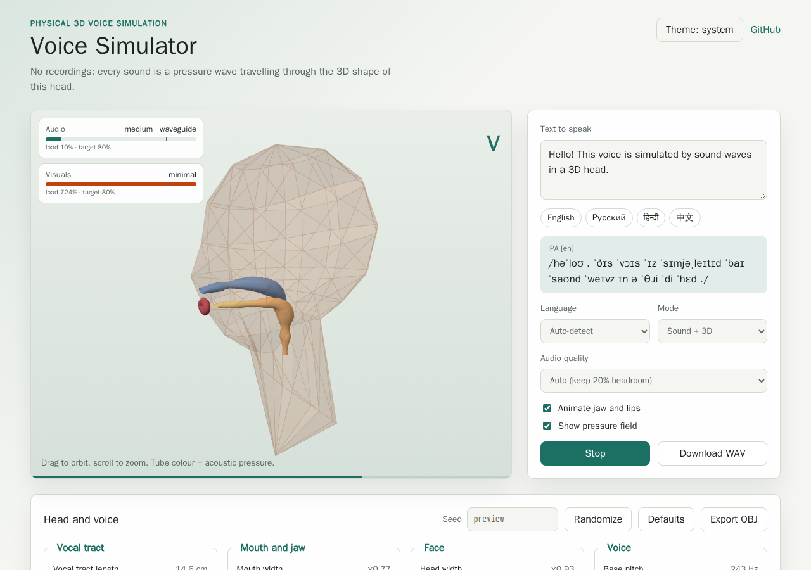

# voice-simulator

A physical 3D voice simulator. There are no recordings and no samples: text is
transcribed to IPA, turned into a smooth articulation plan, and every sound is
a pressure wave travelling through the 3D shape of a parametric low-poly head
(vocal tract, nasal cavity, lips and the air in front of the mouth).



## Features

- **Text to IPA** for English, Russian, Hindi and Chinese, with automatic
  language detection per word (`textToIpa`).
- **Smooth articulation**: IPA becomes a time plan of tract shapes with
  coarticulated transitions, glottal source and pitch contour.
- **Physical acoustics** with two interchangeable solvers:
  - `waveguide`: a branched Kelly-Lochbaum tube (tract + nose) that follows
    the 3D centreline of the head; real time on any device.
  - `fdtd3d`: a sparse-voxel 3D finite-difference time-domain solver of the
    acoustic wave equation inside the voxelised head and the air around it.
- **Low-poly head model** with only acoustically relevant detail (tract tube,
  nasal tube, lips, jaw, skin hull, teeth, tongue, hard and soft palate),
  four mesh LODs and OBJ export.
- **Teeth and piriform fossae in the acoustics**: the incisors narrow the
  tract and turn the frication jet into a sibilant source; the piriform
  fossae add their side-branch antiresonance (waveguide).
- **Head and voice editor**: 32 parameters, everything that changes the
  sound (tract length, pharynx, mouth, jaw, nose, pitch, breathiness,
  jitter, shimmer, vibrato, declination, accent strength, lengthening,
  pauses, wall loss, nasal coupling, frication level, ...). Every page
  refresh starts from a new random seed; `?seed=` makes it reproducible.
- **Male, female and child presets** for random heads (`preset`), with f0
  and formants in the ranges measured by Hillenbrand et al. (1995).
- **Copy a voice**: `matchVoice` analyses a recording (f0, formants,
  vocal-tract length, H1-H2, HNR, speaking rate) and searches for the head
  that sounds most like it; in the app, upload a file or record yourself.
- **Microphone and room**: place the microphone anywhere around the head
  (distance, azimuth, elevation, 1/r fall-off and delay), add a room
  reverb (eight presets or any shoebox with an RT60), or let the 3D solver
  simulate a box of air around the head.
- **Audio formats**: WAV (8-32-bit integer and 32/64-bit float), FLAC,
  AIFF, AU and raw PCM, for both writing and reading, with band-limited
  resampling (`encodeAudio`, `decodeAudio`, `resample`).
- **Automatic LODs** for audio and visuals: a startup benchmark plus a
  runtime governor keep about 20% headroom (target load 80%).
- **Modes**: sound only, 3D only, or both, with optional jaw/lip animation and
  a live pressure-field view.
- **Delivery**: GitHub Pages web app, JavaScript library, CLI, HTTP API with
  WAV streaming, and a Docker image with the server.

The full research, the list of requirements and the plan behind each of them
are in [docs/case-studies/issue-1](docs/case-studies/issue-1/README.md); the
second round (precision, anatomy, listening, presets, voice matching,
formats, linguistics) is in
[docs/case-studies/issue-5](docs/case-studies/issue-5/README.md).

## Quick Start

### Web app

The web app in [`examples/universal-app`](examples/universal-app) is deployed
to GitHub Pages. Run it locally:

```bash
npm install --prefix examples/universal-app
npm run example:web:dev
```

Synthesis runs in a Web Worker and is streamed to Web Audio in chunks; the 3D
view uses three.js and colours the tract (or every air voxel with the 3D
solver) by the simulated acoustic pressure.

Every published release stays online: the previous version of the app is at
[`/v1/`](https://konard.github.io/voice-simulator/v1/).

### Library

```bash
npm install voice-simulator
```

```js
import {
  decodeAudio,
  encodeAudio,
  encodeWav,
  matchVoice,
  randomHeadConfig,
  synthesize,
  synthesizeStream,
  textToIpa,
} from 'voice-simulator';

textToIpa('Привет, мир'); // { lang: 'ru', ipa: 'prʲɪˈvʲet | mʲir', ... }

const head = randomHeadConfig(42); // a different person for every seed
const result = synthesize('Hello world', { head, tier: 'medium' });
const wav = encodeWav(result.samples, result.sampleRate);

// A random woman, heard from 1 m in front in a small room, saved as FLAC.
const far = synthesize('Hello world', {
  head: 'random',
  preset: 'female',
  microphone: { distance: 100, compensate: true },
  room: 'small-room',
});
const flac = encodeAudio(far.samples, far.sampleRate, {
  format: 'flac',
  bitDepth: 24,
});

// Copy a voice: the head that sounds most like a recording.
const { samples, sampleRate } = decodeAudio(recordingBytes);
const { head: copied } = matchVoice(samples, sampleRate, {
  transcript: 'What the recording says',
});

// Streaming: chunks of Float32Array as soon as they are simulated.
for await (const chunk of synthesizeStream('नमस्ते', { tier: 'low' })) {
  play(chunk);
}
```

Lower-level building blocks are exported too: `planUtterance`,
`sampleState`, `tractShape`, `Waveguide`, `Fdtd3d`, `buildVoxelModel`,
`VoiceRenderer`, `headMesh`, `tubeMesh`, `headModelObj`, `LodGovernor`,
`chooseTier`, `measureAudioTier` and more; see
[`src/index.d.ts`](src/index.d.ts). A runnable example is in
[`examples/basic-usage.js`](examples/basic-usage.js).

### CLI

```bash
npx voice-simulator ipa "你好世界"
npx voice-simulator say "Hello world" -o hello.wav --seed 7
npx voice-simulator say "Привет" --tier high -o fdtd.wav   # 3D FDTD solver
npx voice-simulator say "Hello" --preset female --head random -o hi.flac -b 24
npx voice-simulator say "Hello" --mic-distance 100 --mic-azimuth 45 --room hall -o hall.wav
npx voice-simulator say "Hello" --tier high --box 30x44x30 -o box.wav  # simulated box
npx voice-simulator convert hello.flac -o hello.aiff --sample-rate 16000
npx voice-simulator match recording.wav --transcript "What it says" --json
npx voice-simulator mesh --lod 3 -o head.obj
npx voice-simulator benchmark
npx voice-simulator serve --port 8080
npx voice-simulator --help
```

### HTTP API and streaming

`voice-simulator serve` (or `createVoiceServer` from the separate
`voice-simulator/server` export, which keeps `node:http` out of browser
bundles) serves a small test page at `/` and these endpoints. Parameters can
be passed as a query string or as a JSON `POST` body.

| Endpoint               | Result                                                       |
| ---------------------- | ------------------------------------------------------------ |
| `GET /api/health`      | `{ status, version }`                                        |
| `GET /api/languages`   | Supported languages with sample sentences                    |
| `GET /api/tiers`       | Audio and visual LOD tiers                                   |
| `GET /api/ipa`         | `text`, `lang` → IPA transcription                           |
| `GET /api/head/random` | `seed` → random head configuration                           |
| `GET /api/mesh.obj`    | `head`, `seed`, `lod` → OBJ model                            |
| `GET /api/synthesize`  | `text`, `lang`, `tier`, `seed`, `head`, `sampleRate` → WAV   |
| `GET /api/stream`      | Same parameters → chunked WAV that starts playing right away |

Synthesis also accepts `preset` (`male`, `female`, `child`, used with
`head=random`), `micDistance` (cm), `micAzimuth` and `micElevation`
(degrees), `micCompensate`, `room` (a preset name, or a
`{width, height, depth, rt60}` object in a JSON body), and the encoding:
`format` (`wav`, `flac`, `aiff`, `au`, `raw`; `/api/stream` streams `wav`,
`au` and `raw`), `bitDepth` and `float`.

```bash
curl -o hello.wav "http://127.0.0.1:8080/api/stream?text=Hello&tier=medium"
```

### Docker

```bash
docker build -t voice-simulator .
docker run --rm -p 8080:8080 voice-simulator
```

The image runs `voice-simulator serve` on port 8080 with a health check on
`/api/health`.

### Quality tiers

| Audio tier | Solver    | Detail        | Sample rate | Relative cost |
| ---------- | --------- | ------------- | ----------- | ------------- |
| `minimal`  | waveguide | 22 sections   | 22.05 kHz   | 1             |
| `low`      | waveguide | 32 sections   | 32 kHz      | 1.6           |
| `medium`   | waveguide | 44 sections   | 48 kHz      | 2.6           |
| `high`     | fdtd3d    | 1 cm voxels   | 48 kHz      | 10            |
| `ultra`    | fdtd3d    | 0.6 cm voxels | 48 kHz      | 65            |

The web app and `voice-simulator benchmark` pick the most detailed tier
whose measured load stays under 80%. The benchmark does not run tiers whose
load, predicted from the cheaper tier, is far above the target, and it stops
measuring a tier as soon as it is clearly too slow; the app remembers the
result per device. In the first 40-300 ms of each utterance an
`OverloadDetector` checks that the tier keeps up with real time and, if not,
the utterance restarts at once on a cheaper tier before any gap is audible.
While speaking, `LodGovernor` steps down
immediately when the load exceeds the target and steps up only after a dwell
period when the next tier is predicted to fit with margin. Visual tiers
(mesh LOD 0-3, pressure-field points) are governed the same way from the
measured frame time.

### Development

```bash
# Install dependencies
bun install

# Run tests
bun test --timeout 30000

# Or with other runtimes:
npm test
deno test -A --parallel

# Lint code
bun run lint

# Format code
bun run format

# Check all (lint + format + file size)
bun run check

# Build the web app
npm install --prefix examples/universal-app
npm run example:web:build
npm run example:desktop:package
```

## Project Structure

```
.
├── bin/voice-simulator.js # CLI
├── Dockerfile             # Server image
├── docs/case-studies/     # Research, requirements and plans
├── examples/
│   ├── basic-usage.js     # Library example
│   └── universal-app/     # Web app (GitHub Pages, Electron, Capacitor)
├── experiments/           # Measurement and debugging scripts
├── src/
│   ├── g2p/               # Text to IPA (en, ru, hi, zh)
│   ├── ipa/               # IPA parsing and phone inventory
│   ├── articulation/      # Articulation plan and tract shapes
│   ├── geometry/          # Head model, centrelines and meshes
│   ├── acoustics/         # Glottis, waveguide, voxel model, 3D FDTD,
│   │                      # microphone and room
│   ├── analysis/          # Voice features and voice matching
│   ├── perf/              # Benchmarks and LOD governor
│   ├── audio/             # WAV, FLAC, AIFF, AU, raw and resampling
│   ├── server/            # HTTP API (voice-simulator/server)
│   ├── index.js           # Library entry point
│   └── index.d.ts         # TypeScript definitions
└── tests/                 # test-anywhere tests (Node, Bun, Deno)
```

## Design Choices

### Multi-Runtime Support

The library and its tests run on Node.js, Bun and Deno:

- **Bun**: native test support (`bun test`)
- **Node.js**: built-in test runner (`node --test`)
- **Deno**: `deno test`

The [test-anywhere](https://github.com/link-foundation/test-anywhere) framework provides a unified testing API that works identically across all runtimes.

### Web App Example

`examples/universal-app` is a Vite React app that imports the library from
`src/index.js`. The same static build is used by:

- GitHub Pages (`npm run example:web:build`)
- Electron desktop packaging (`npm run example:desktop:package`)
- Capacitor Android/iOS sync (`npm run example:mobile:sync`)

The app has its own `package.json` and lockfile so React, three.js, Electron
and Capacitor stay out of the library package.

See [examples/universal-app/README.md](examples/universal-app/README.md) for
local web, desktop, Android, and iOS testing instructions.

### Code Quality

- **ESLint**: Configured with recommended rules + Prettier integration
- **Prettier**: Consistent code formatting
- **Husky + lint-staged**: Pre-commit hooks ensure code quality
- **File size limit**: Files must stay under 1500 lines for maintainability (enforced via ESLint and CI)

### Release Workflow

The release workflow uses [Changesets](https://github.com/changesets/changesets) for version management:

1. **Creating a changeset**: Run `bun run changeset` to document changes
2. **PR validation**: CI checks for valid changeset in each PR
3. **Automated versioning**: Merging to `main` triggers version bump
4. **npm publishing**: Automated via OIDC trusted publishing (no tokens needed)
5. **Optional Docker Hub publishing**: When configured, waits for the exact npm version and tags the Docker image with that version
6. **GitHub releases**: Auto-created with formatted release notes

> **First release of a brand-new package**: OIDC trusted publishing cannot
> create a package that does not exist yet (the first publish fails with
> `E404`, because a trusted publisher can only be configured for an existing
> package). To bootstrap, add a repository secret named `NPM_TOKEN` (a
> granular/automation token with publish access). The release workflow passes
> it as `NODE_AUTH_TOKEN` automatically. Once the package exists and OIDC
> trusted publishing is configured on npmjs.com, the token becomes optional and
> can be removed.

#### Manual Releases

Two manual release modes are available via GitHub Actions:

- **Instant release**: Immediately bump version and publish
- **Changeset PR**: Create a PR with changeset for review

### CI/CD Pipeline

The GitHub Actions workflow (`.github/workflows/release.yml`) implements a fast-fail pipeline:

**Fast checks** (~7-30s each, run first for fastest feedback):

1. **Test compilation**: Syntax-checks all `.mjs` files with `node --check`
2. **Lint, format & secrets scan**: ESLint, Prettier, jscpd, and [secretlint](https://github.com/secretlint/secretlint) for credential leak detection
3. **File line limits**: Enforces the 1500-line limit on JavaScript (`.js`, `.mjs`, `.cjs`) and Markdown (`.md`) files plus `release.yml`
4. **Changeset check**: Validates PR has exactly one changeset (added by that PR)
5. **Version check**: Blocks manual version changes in `package.json`
6. **Documentation validation**: Checks required doc files (doc line limits are enforced by the file line limits check)

**Slow checks** (only run after all fast checks pass):

7. **Test matrix**: 3 runtimes × 3 OS = 9 test combinations
8. **Broken link checks**: Validates all links in Markdown/HTML files (separate workflow)

**Release** (on merge to main):

9. **Changeset merge**: Combines multiple pending changesets at release time
10. **Release**: Automated versioning and npm publishing
11. **Optional Docker publish**: Publishes Docker Hub `latest` and npm-version tags after the npm package is visible

#### Reasonable Timeouts

Every CI job declares an explicit `timeout-minutes` so hung steps fail
in minutes instead of reaching the GitHub Actions default of six hours.
Fast checks use 5-10 minute caps, release jobs use 50 minutes, and the
link checker uses 10 minutes for external network variance.

That cap is a backstop, never the deadline: GitHub reports a job it
kills as **cancelled**, not **failed**. Long steps therefore own an
explicit budget via `scripts/run-with-budget-warning.sh`, which warns at
70% of the budget and fails the step with exit code 124 when it expires.
See [CI-TIMEOUT-BUDGETS.md](docs/CI-TIMEOUT-BUDGETS.md).

Individual tests are also capped inside supported runners:
`npm test` runs `node --test --test-timeout=30000`, and the CI Bun
runner uses `bun test --timeout 30000`. Both bound a _single test_, not
the suite, which is why the suite budget above exists. Deno does not
provide a single global per-test timeout flag, so Deno tests are
protected by their step budget and the matrix job backstop.

See [BEST-PRACTICES.md](docs/BEST-PRACTICES.md) for detailed explanations of each practice.

#### Robust Changeset Handling

The CI/CD pipeline is designed to handle concurrent PRs gracefully:

- **PR Validation**: Only validates changesets **added by the current PR**, not pre-existing ones from other merged PRs. This prevents false failures when multiple PRs merge before a release cycle completes.

- **Release-time Merging**: If multiple changesets exist when releasing, they are automatically merged into a single changeset with:
  - The highest version bump type (major > minor > patch)
  - All descriptions preserved in chronological order

This design decouples PR validation from the need to pull changes from the default branch, reducing conflicts and ensuring that even if CI/CD fails, all unpublished changesets will still get published when the error is resolved.

### Deploying the example app

The `example-app.yml` workflow deploys the voice simulator web app to GitHub
Pages on every push to `main`. Before the first run on `main`, open **Settings → Pages** and set
**Source = GitHub Actions**. This is a one-time manual step and cannot be
configured from a workflow because the Pages source defaults to
_Deploy from a branch_. Without it, the `pages-deploy` job fails on
`actions/deploy-pages` with `Get Pages site failed` /
`Failed to create deployment`. After flipping the source, the workflow
provisions the Pages site on its first run.

`scripts/check-pages.sh` checks the setting before the build: pull requests
get a warning, and `main` fails with the settings link until the source is
GitHub Actions. The `web-build` job grants `pages: read` explicitly because the
Pages API answers a request it does not authorise with the same 404 as a
disabled site.

### Enabling dependency review

`actions/dependency-review-action` needs the repository's **Dependency graph**,
which only a maintainer can enable: **Settings → Advanced Security →
Dependency graph → Enable**. Until it is enabled, the Security workflow skips
dependency review on pull requests with a warning, and its
`Dependency graph enabled` job fails on `main` with the same instruction
(`scripts/check-dependency-graph.sh`).

### Auto-regenerated preview screenshots

The same `example-app.yml` workflow contains a `preview-regen` job that boots
the built example app in a headless Chromium via
[`browser-commander`](https://www.npmjs.com/package/browser-commander) +
Playwright and writes fresh screenshots to
`docs/screenshots/example-app/example-app-{locale}-{theme}.png` on every
push to `main` (and on `workflow_dispatch`). Any drift is committed back to
`main` so README/site images never go stale between releases. Screenshot-only
pushes do not match this workflow's path filter, while a protected-branch
fallback PR remains eligible for its required checks. The job runs in the
official Playwright container with the browser already installed, avoiding CI
stalls from live Chromium downloads.

The same script is available locally:

```bash
npm install --prefix examples/universal-app
npm run example:web:preview-images
# Verbose probe of <html data-theme>, <html lang>, and PNG signatures:
PREVIEW_VERBOSE=1 npm run example:web:preview-images
```

The matrix covers `{en, ru} × {light, dark}`; the app follows the browser
language and the stored theme. Each tile opens the app with `?seed=preview`
so the random head is the same in every run. Set `PREVIEW_CHROMIUM` to a
Chromium binary when the locally installed browser build differs from the
pinned Playwright release.

### Broken Link Checker

The link checker workflow (`.github/workflows/links.yml`) validates all links in Markdown and HTML files:

1. **Detection**: Uses [lychee](https://github.com/lycheeverse/lychee-action) to scan all `*.md` and `*.html` files
2. **Web Archive fallback**: For any broken links found, automatically checks the [Wayback Machine](https://web.archive.org) for archived versions
3. **Actionable suggestions**: Reports one of three outcomes for each broken link:
   - **Archived**: Suggests the Web Archive URL as a replacement
   - **Not archived**: Clearly reports the link is unrecoverable
4. **Scheduled checks**: Runs weekly to catch links that break over time (even if no files changed)
5. **Issue creation**: On scheduled runs, creates a GitHub Issue with the full broken links report

Add regex patterns to `.lycheeignore` to exclude URLs from checks (e.g., local dev URLs, example.com, known rate-limited sites).

## Configuration

### Package Name

The package is published as `voice-simulator` (see `package.json`). Release
scripts derive the package name from `package.json` at runtime, so renaming
the package only needs `package.json` and `.changeset/config.json`.

### Protected-Branch Release Pull Requests

If `main` requires pull requests and the `Pipeline Status` check, the release
and instant-release jobs can use their built-in `GITHUB_TOKEN` to open a release
PR. Enable **Allow GitHub Actions to create and approve pull requests** in
repository Actions settings. The helper verifies that the version commit is a
direct child of the validated workflow SHA and contains only package metadata
and consumed changesets. It then creates a successful `Pipeline Status` check
on that exact commit, linked to the validating run, waits for every required
check, and merges the PR only after they pass. The release jobs alone receive
`checks: write`. Set `RELEASE_METADATA_PATHS` to a comma-separated list of
additional exact metadata paths for other package layouts.

An optional `RELEASE_PR_TOKEN` secret keeps the existing dedicated-token path
and takes precedence when set. Give that actor Contents and Pull requests write
access and Checks read access. The manual changeset-PR and generated-preview
paths still require the dedicated token. A short-lived GitHub App installation
token can be wired to the same inputs instead of a PAT.

### Optional Docker Hub Publishing

Pull requests build the server image from the `Dockerfile` as a check.
Publishing to Docker Hub is disabled by default. To enable it, configure these
GitHub Actions settings:

| Setting              | Type               | Description                                                                           |
| -------------------- | ------------------ | ------------------------------------------------------------------------------------- |
| `DOCKERHUB_IMAGE`    | Variable           | Docker Hub image name, for example `namespace/image`. This enables Docker publishing. |
| `DOCKERHUB_USERNAME` | Variable           | Docker Hub username used by `docker/login-action`.                                    |
| `DOCKERHUB_TOKEN`    | Secret             | Docker Hub access token used for registry authentication.                             |
| `DOCKER_CONTEXT`     | Variable, optional | Docker build context. Defaults to `.`.                                                |
| `DOCKERFILE`         | Variable, optional | Dockerfile path. Defaults to `./Dockerfile`.                                          |

When enabled, the release workflow waits until the exact published npm version
is visible in the npm registry, then publishes Docker Hub tags for `latest` and
that same version. The Docker build also receives `NPM_PACKAGE_VERSION` as a
build argument so Dockerfiles can install the matching published package.

### ESLint Rules

Customize ESLint in `eslint.config.js`. Current configuration:

- ES Modules support
- Prettier integration
- No console restrictions (common in CLI tools)
- Strict equality enforcement
- Async/await best practices
- **Strict unused variables rule**: No exceptions - all unused variables, arguments, and caught errors must be removed (no `_` prefix exceptions)

### Prettier Options

Configured in `.prettierrc`:

- Single quotes
- Semicolons
- 2-space indentation
- 80-character line width
- ES5 trailing commas
- LF line endings

## Scripts Reference

| Script                               | Description                                           |
| ------------------------------------ | ----------------------------------------------------- |
| `bun test --timeout 30000`           | Run tests with Bun and a 30s per-test cap             |
| `npm test`                           | Run tests with Node.js and a 30s per-test cap         |
| `bun run lint`                       | Check code with ESLint                                |
| `bun run lint:fix`                   | Fix ESLint issues automatically                       |
| `bun run format`                     | Format code with Prettier                             |
| `bun run format:check`               | Check formatting without changing files               |
| `bun run check`                      | Run all checks (lint + format)                        |
| `npm run example:web:dev`            | Start the universal app Vite dev server               |
| `npm run example:web:build`          | Build the universal app static web bundle             |
| `npm run example:web:preview-images` | Regenerate preview screenshots via browser-commander  |
| `npm run example:desktop:package`    | Package the Electron desktop app locally              |
| `npm run example:mobile:sync`        | Build and sync the app bundle into Capacitor projects |
| `bun run changeset`                  | Create a new changeset                                |

## Contributing

See [CONTRIBUTING.md](docs/CONTRIBUTING.md) for detailed contribution guidelines.

Quick steps:

1. Fork the repository
2. Create a feature branch: `git checkout -b feature/my-feature`
3. Make your changes
4. Create a changeset: `bun run changeset`
5. Commit your changes (pre-commit hooks will run automatically)
6. Push and create a Pull Request

## Best Practices

This repository implements CI/CD best practices for AI-driven development. See [BEST-PRACTICES.md](docs/BEST-PRACTICES.md) for details on:

- File size limits for AI readability
- Automated formatting and linting
- Multi-runtime and cross-platform testing
- Changeset-based versioning
- Concurrency control for CI/CD pipelines

## License

[Unlicense](LICENSE) - Public Domain
