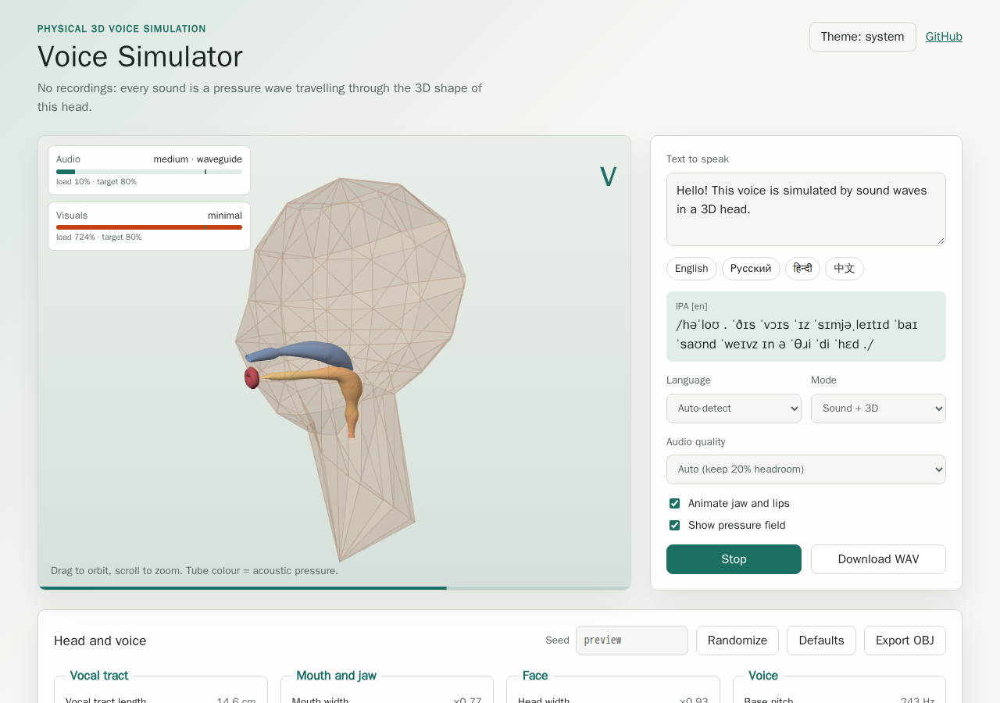
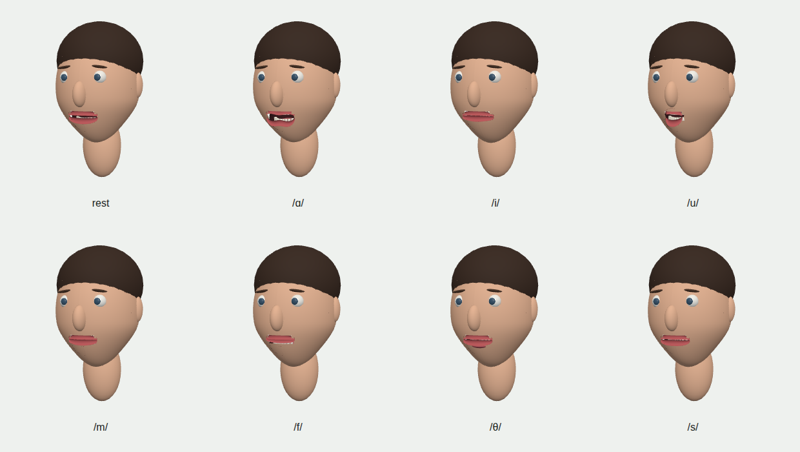

# voice-simulator

A physical 3D voice simulator. There are no recordings and no samples: text is transcribed to IPA, turned into a smooth articulation plan, and every sound is a pressure wave travelling through the 3D shape of a parametric low-poly head (vocal tract, nasal cavity, lips and the air in front of the mouth).



## Features

- **Text to IPA** for English, Russian, Hindi and Chinese, with automatic
  language detection per word (`textToIpa`). Numbers, dates, times, money,
  units and abbreviations are read out per language (`normalizeText`).
  English heteronyms get the reading that fits the sentence (`I will read`
  ɹid, `I read it yesterday` ɹɛd, `record the record` ɹəˈkɔɹd ˈɹɛkɚd) by
  written rules on the neighbouring words. Russian prepositions and the
  particles `не`, `ни`, `же`, `ли`, `бы` are spoken as part of the word they
  lean on, with a reduced vowel and the voicing of the next sound (`из дома`
  ɪz ˈdomə, `на работе` nə rɐˈbotʲə, `как же` kaɡ ʐɨ); each stays its own
  word for highlighting. Mandarin applies tone sandhi and erhua: 花儿 and
  `huār` are one syllable, `xwaɻ˥`. 一 and 不 follow their neighbours
  (看一看 `kʰan˥˩ i kʰan˥˩`, 是不是 `ʂɻ̩˥˩ pu ʂɻ̩˥˩`, 第一名 `ti˥˩ i˥ miŋ˧˥`),
  and words separated by spaces get sandhi as one phrase (`我 很 好` and
  `wǒ hěn hǎo` read like `我很好`); typed `bu4` and `yi1` keep their tone.
- **Pronunciation lexicons** from permissive sources (issue 47): 20 042
  English words from CMUdict (BSD-2-Clause) with every variant
  (`pronunciations('en', 'either')` is `ˈiðɚ`, `ˈaɪðɚ`), Chinese readings
  of 8 105 characters from Unihan (Unicode-3.0) and 2 000 words mined from
  AISHELL-3 (Apache-2.0) or written by hand, Hindi exceptions and the
  stress of 6 639 Russian stems and 3 691 forms with 67 homographs read by
  context, ё restored and other words guessed by ending (issue 48). Words
  built from known English words are read by morphology (`congresswoman`
  ˈkɑŋɡɹəsˌwʊmən). Your own words win over the shipped ones (`lexicon`,
  `addLexicon`, CLI `--lexicon`); see [lexicons](#pronunciation-lexicons).
- **Speech markup**: an SSML subset (`<speak>`, `break`, `prosody`,
  `emphasis`, `say-as`, `phoneme`, `lang`, `sub` and `vs:` elements for
  effort, phonation, emotion and sounds), inline tags such as
  `[whisper]Hello[/whisper]` or `[pause 0.5]` with `markup: true`, and
  ExtIPA/VoQS marks in IPA (`{W həˈloʊ W} ˈwɝld .`, `(.)`, `⸨laugh⸩`, `ˈˈ`).
  Rate, pitch, range, level, effort, phonation types, whisper, emotions,
  emphasis, tunes, pauses and sounds are heard ([docs/markup.md](docs/markup.md)). **Paralinguistic sounds** (issue 56): `[laugh]`, `[inhale]`, `[exhale]`, `[sigh]`, `[cough]`, `[throat]`, `[filler]`, `[um]` and `[click]` (also `<vs:sound name="laugh" duration="1.2s"/>`, `⸨laugh:1.2⸩`, `ǀ ǃ ǁ ʘ`) are made by the glottis and the tract from rules (`SOUNDS`, `FILLERS`), with no recordings; written fillers and laughter are read as sounds and stay words of the timeline (`textToIpa('Well [laugh] um, hahaha.', { markup: true }).ipa` is `ˈwɛl ⸨laugh⸩ ⸨um⸩ , ⸨laugh:0.6⸩ .`); the option `breaths` (`--breaths`) breathes in between sentences; `timeline.sounds` lists the sounds ([Sounds](docs/markup.md#sounds)).
- **Vocal effort**: `[soft]`, `[loud]`, `[shout]`, `[lombard]`,
  `[crescendo]` and `[diminuendo]` (and `<vs:effort>`, `{f … f}`) change
  more than the level: the pitch rises (+5 Hz per dB), the spectrum gets
  flatter, F1 rises and vowels get longer (`EFFORT_RULES`,
  `effortChanges()`). The output is lowered by the loudest effort so a
  shout does not clip (`headroom`, `levelOffsetDb`); `effortToSpl()` maps
  effort to dB SPL (0.5 is 60 dB SPL) and `loudnessTarget` (CLI
  `--loudness`) scales to an integrated loudness in LUFS (ITU-R BS.1770,
  `integratedLoudness()`).
- **Phonation types** (issue 54): `[breathy]`, `[creaky]`, `[pressed]`,
  `[lax]`, `[falsetto]`, `[harsh]`, `a̤` and `a̰` set Rd and the `breath`,
  `creak`, `falsetto` and `harsh` channels (`PHONATION`): breath noise, an
  octave down with double pulses, an octave up, or a noisy irregular voice.
  Hindi `bʱ dʱ ɖʱ ɡʱ dʒʱ` get a breathy release, `finalCreak` creaks the end
  of a statement, and `cpp()` and `jitterPercent()` measure the result
  ([docs/markup.md](docs/markup.md#phonation-types)). **Whisper** (issue 53,
  `[whisper]`, `{W … W}`, `ạ`, `ḁ`): glottal noise, 25 dB quieter, 1.3× as long ([Whisper](docs/markup.md#whisper)).
- **Emotions and attitudes** (issue 55): `[angry]`, `[happy 0.5]`, `[sad]`, `[afraid]`, `[bored]`, `[surprised]`, `[disgusted]`, `[tender]`, `[sarcastic]`, `[confident]`, `[hesitant]` and `<vs:emotion arousal="0.5" valence="-0.3">`
  set pitch, range, rate, effort, phonation, pauses, vowel precision, a glide, a final rise and a smile (`EMOTION_PRESETS`, `emotionChanges()`).
  The six rows from Burkhardt and Sendlmeier (2000) are `verified`; an inner tag wins (`[angry][soft]…` stays soft). Rule-based emotion is
  recognisable but less clear than an actor (50–80 % against 72–91 %; [Emotions](docs/markup.md#emotions-and-attitudes)).
- **Intonation per language** (issue 51): statements fall, yes/no
  questions rise, wh-questions fall, `Tea or coffee?` rises on the first
  item and falls on the second (`ˈti ↗ | ˈɔɹ ˈkɑfi ↘ ?`), list items and
  phrases before a comma or `|` rise, and question tags rise or fall.
  Russian uses the intonation constructions IK1 to IK7 (`Это мама?` rises
  on the stressed vowel of мама and falls after it), Hindi accent phrases,
  and Mandarin raises a question without breaking its tones. Focus
  (`*word*`) moves the nucleus; a tune can be named (`[tune IK4]…[/tune]`,
  `<vs:tune name="echo">`, `{IK3 … IK3}`). See
  [docs/markup.md](docs/markup.md#intonation).
- **English weak forms**: function words are weak and unstressed inside a
  phrase (`a cup of tea for you` ə ˈkʌp əv ˈti fɚ ju, `the end` ði ˈɛnd,
  `I have to go` aɪ ˈhæf tə ˈɡoʊ) and keep their strong form alone and at
  the end of a phrase (`Yes, I can.`). The table is `WEAK_FORMS`;
  `weakForms: false` (CLI `--strong-forms`) turns them off.
- **English accents**: General American, Southern British, Australian and
  Indian English (`accent: 'en-GB'`, or `lang: 'en-GB'`).
- **Regional and foreign accents**: Canadian English, northern (okanye)
  and southern (fricative г) Russian, eastern Hindi, Taiwan and southern
  Mandarin, and every pair of English, Russian, Hindi and Mandarin spoken
  with the sounds of another (`en-x-ru` is English with a Russian accent:
  `the thing` zə ˈsʲink). An accent is a code or an accent file of IPA
  rules, phonotactics, prosody and articulation (`loadAccent`), with a
  strength from 0 to 1 (`accentLevel`); `explainAccent` tells which accent
  explains a heard pronunciation. Every code, its rules and the file format
  are in [docs/accents.md](docs/accents.md).
- **Punctuation prosody**: commas, semicolons, dashes, parentheses, quotes,
  periods, exclamations, questions and ellipses each have their own pause,
  final pitch movement and lengthening; questions with a question word
  fall, yes/no questions rise, exclamations are higher and louder. Hindi
  question words fall wherever they stand, and sentence-initial क्या is
  read as the yes/no particle (`क्या तुम आओगे?` rises) unless the next word
  makes it mean "what" (`क्या हुआ?` falls).
- **Segment durations**: every sound lasts as long as the rules of Klatt
  (1979) say, `(inherent - minimum) * percent / 100 + minimum`, with a
  table per language (`DURATION_TABLES`: `en`, `ru`, `hi`, `zh` and
  `default`) and the rules of `DURATION_RULES` (end of a clause or phrase,
  position in the word, number of syllables, stress, emphasis, the next
  consonant, clusters, Russian vowel reduction in two degrees, Hindi vowel
  length, the Mandarin neutral tone). `segmentDuration(token, features,
table)` gives one sound from `durationFeatures(tokens, index)`, and
  `planUtterance(ipa, {durationTable})` takes another table. `speechRate`
  shortens the minimum with `RATE_MINIMUM` = 0.5 and the rest with
  `RATE_STRETCH` = 1.2 as exponent, and phrase pauses with `RATE_PAUSE` =
  1.5 (`scalePause`), so fast speech drops pauses first and no sound gets
  shorter than its minimum. The inherent durations are fitted to the
  golden recordings in `experiments/issue-11-fit-durations.txt`.
- **Lexical tones**: every level of a tone written with Chao tone letters is
  a pitch target that the voice approaches as a critically damped
  third-order system (the quantitative target approximation of Prom-on, Xu
  and Thipakorn 2009, `approachToneTargets`, `TONE_RATES`), starting from
  where the syllable before it ended: the Mandarin third tone `˨˩˦` dips
  before it rises, and `ma˥` after `ma˥˩` starts 2.8 st lower than after
  `ma˥`. A syllable without a tone takes its level from the tone before it
  (`NEUTRAL_LEVELS`: 妈妈 falls to 101 Hz, 爸爸 to 86 Hz) and lasts
  `NEUTRAL_DURATION` = 0.6 of a full one (0.55 in the zh table). The same
  model drives Cantonese, Thai and Vietnamese tones; speech without tone
  letters keeps its intonation.
- **Word and syllable timeline**: `utteranceTimeline` (also in
  `synthesize`) tells when every word and syllable is spoken; the app
  highlights the current word and syllable in the text and the IPA.
  Numbers, dates, times, money and units stay one word of the text with
  `spoken` set to what is said (`25` → `twenty five`); their syllables
  carry the spoken letters, and the part of the token they read
  (`partStart`/`partEnd`), so `3/4/2024` lights 3, then 4, then 2024.
- **Smooth articulation**: IPA becomes a time plan of tract shapes with
  coarticulated transitions, glottal source and pitch contour. Every
  articulator approaches its targets like a critically damped mass
  (`approachTargets` in `src/articulation/dynamics.js`, two one-pole
  filters forwards). `ARTICULATORS` holds its time constant and its lead
  (by default 1.68 time constants, which keeps the middle of a transition at
  the boundary between two sounds; the lips round `ROUNDING_LEAD` = 0.12 s
  and the velum opens `VELUM_LEAD` = 0.08 s ahead of their sound, but not
  before the end of the previous sound with its own target).
  `channelTargets(segments, name)` lists the targets
  `{value, start, end, strength}` of a channel: inside a consonant the vowel
  channels mix the consonant's own tongue position with the line between
  the vowels by its `COARTICULATION_RESISTANCE` (0 for `[p]`, 1 for `[ʃ]`),
  so labials let the vowels pass and palatals resist. The head parameters
  `articulationSpeed` (divides time constants and leads) and
  `coarticulation` (multiplies the leads) change both, and
  `planUtterance(ipa, {durations})` takes measured durations per token.
  The fit to the golden recordings is in
  `experiments/issue-11-fit-dynamics.txt`.
- **Free articulators** (issue 40): four channels of the plan move the jaw,
  the lips, the larynx and the tongue root on their own time constants.
  `jaw` is the gap between the incisors (cm, 0.1 to 1.8, 0.02 s; the
  planner writes the gap each sound needs), `lipProtrusion` pushes the
  lips forward (cm, -0.3 to 1.2, 0.02 s; `LIP_PROTRUSION` = 0.6 times the
  rounding), `larynxHeight` raises the larynx (cm, -1.5 to 1.5, 0.04 s;
  negative lowers it) and `tongueRoot` moves the root of the tongue
  (-1 pulled back to +1 pushed forward, 0.03 s). At their defaults the
  tract keeps the shape of the vowel and consonant channels; moved, a
  wider jaw widens the mouth (`JAW_AREA` = 0.8 per cm, 0.5 cm more gap
  raises F1 of `[ɛ]` by 9 %; the tongue and the lips make up for the jaw
  while they form a consonant), protrusion lengthens the last
  `LIP_REGION` = 1.5 cm and a lower larynx the first `LARYNX_REGION` = 3 cm
  of the tract (`stretchSections` keeps the volume, so 1 cm lower lowers
  F1 to F4 of `[ɑ]` by 1 to 9 % as in Lindblom & Sundberg 1971), and the
  tongue root scales the pharynx (`TONGUE_ROOT_AREA` = 0.4). The velum,
  the teeth and the noise source keep their distance from the lips.
  Speaker habits add to the channels: the head parameters `jawPosture`,
  `lipPosture`, `larynxPosture` and `tongueRootPosture`. Two couplings,
  off by default, change the pitch: `intrinsicPitch` (semitones between
  the closest and the most open vowel, about 1.5 in real speakers) and
  `larynxPitch` (cm the larynx rises per octave). `faceRig` reads
  `lipProtrusion` and returns `larynxHeight` too.
- **Physical acoustics** with three interchangeable solvers:
  - `waveguide`: a branched Kelly-Lochbaum tube (tract + nose) that follows
    the 3D centreline of the head; real time on any device. Its losses
    depend on frequency like the tract's: a viscothermal boundary-layer
    loss that grows with sqrt(f), yielding walls (mass, resistance and
    stiffness per area) that widen and raise F1 of close vowels, and a
    radiation load between a free pipe end and a baffled piston, so the
    formant bandwidths of Story's vowels come within 24 % of Hawks &
    Miller (1995) on average (35 % before).
  - `fdtd2d`: a 2D finite-difference time-domain solver on the midsagittal
    sheet of the tract (0.6 cm cells, a depth per cell), with the nose, the
    piriform fossae and the vallecula as 1D lines; about 0.5 times real
    time on one core. No tier uses it yet (see "Quality tiers").
  - `fdtd3d`: a sparse-voxel 3D finite-difference time-domain solver of the
    acoustic wave equation inside the voxelised head and the air around it;
    the default of the library, the CLI and the server (`studio` tier).
    The voxel tract goes on below the glottis by a quarter of its length
    and the source plane moves along it in whole cells with the tract
    length, so a longer tract no longer stretches the nose and the air
    around the head; the piriform fossae and the vallecula open where the
    larynx puts them.
- **Two voice sources**: the LF pulse (`source: 'lf'`, the default) and a
  two-mass model of the vocal folds driven by the lung pressure
  (`source: 'folds'`), whose pitch, loudness and voice quality follow
  from the lung pressure, the fold tension and the adduction; see
  [Voice source](#voice-source).
- **Low-poly head model** with only acoustically relevant detail (tract tube,
  nasal tube, lips, jaw, skin hull, teeth, tongue, hard and soft palate),
  four mesh LODs and OBJ, STL and glTF export (`npm run export:model`, opens
  in Blender). The tract bends like the MRI tracts of the Dresden Vocal
  Tract Dataset, the upper and lower lips outline the acoustic opening, the
  teeth lie on a dental arch fitted to 17 segmented CBCT scans, the jaw
  opens per phoneme as measured by MRI, and the hard palate and velum have
  the lengths, vault height and thickness measured on skulls, CT and MRI.
- **Anatomy checks**: `scripts/compare-anatomy.mjs` renders the model next
  to MRI vocal tracts and measures their agreement on midsagittal, coronal,
  axial and oblique cuts; `scripts/fetch-dvtd.mjs` and
  `scripts/fetch-anatomy.mjs` fetch MRI tracts, segmented teeth and the
  HuBMAP Visible Human mouth and larynx just in time, and
  `scripts/compare-hra.mjs` cuts the model and the HuBMAP organs like MRI
  slices and compares ten key points after a rigid fit; with
  `--atlas z-anatomy|bodyparts3d --dir DIR` it does the same against the
  Z-Anatomy and BodyParts3D atlases (see
  [the issue 9 case study](docs/case-studies/issue-9/README.md)).
- **Anatomy from any 3D source, part by part**: each articulator (upper
  and lower teeth, tongue, hard palate, velum) comes from the procedural
  model or from a segmented dataset (the HuBMAP Visible Human male and
  female, or any glTF binary), fitted onto the model's dental key points,
  carried by the jaw and reduced from full resolution to each LOD by vertex
  clustering:

  ```js
  import { headModel, hraSource, registerAnatomySource } from 'voice-simulator';

  registerAnatomySource(await hraSource('male')); // fetched just in time
  const meshes = headModel(head, {
    lod: 3,
    anatomy: { tongue: 'hra-male', palate: 'hra-male' }, // or 'hra-male'
  });
  ```

  `npm run export:model -- --anatomy hra-female --scale` exports the same,
  `anatomySourceFromGlb` reads a character's own mouth, and
  `zAnatomySource` and `bodyParts3dSource` read the Z-Anatomy STLs and
  BodyParts3D OBJs that `scripts/fetch-anatomy.mjs` downloads
  (`npm run export:model -- --atlas z-anatomy=DIR --anatomy z-anatomy`).

- **Talking animation for character models**: `visemeTrack(plan, head,
{ format, fps })` turns the articulation the solvers hear into ARKit
  blendshapes (the 52 curves of MetaHuman, Ready Player Me and face
  trackers), VRM 1.0 expressions (`aa ih ou ee oh`) or the 15 Oculus
  visemes. Each frame comes from the jaw angle that opens the incisors as
  far as the tract needs, the lip opening with the area of the last tract
  section, and where the lips and the tongue constrict: /m b p/ close the
  lips, /f v/ tuck the lower lip under the upper incisors, /θ ð/ show the
  tongue tip, and coarticulation carries over (`faceRig` gives the
  physical measures in cm and radians).
- **Bridges to any character model**: `bindRig(morphTargetNames)` reads
  the mouth shapes a model has and binds them to the face rig, whichever
  convention they follow: ARKit names (also MetaHuman
  `CTRL_expressions_*`, `blendShape1.*` and Ready Player Me), Oculus
  visemes (`viseme_PP`, VRChat `vrc.v_pp`), VRM 1.0 and 0.x vowels, VRoid
  `Fcl_MTH_*` and MMD `あいうえお`. `rigFrame(binding, faceRig(state, head))`
  gives the morph target weights of one frame, `characterTrack(plan, head,
names)` a whole utterance, and `vrmVowelBinds(gltfJson)` reads the morph
  targets a VRM file declares for its vowels. The example app's **Talking
  character** panel animates a procedural head or any `.vrm`, `.glb` or
  `.gltf` model the user loads.

  

- **Teeth and piriform fossae in the acoustics**: the incisors narrow the
  tract and turn the frication jet into a sibilant source; the piriform
  fossae add their side-branch antiresonance in both solvers, the
  vallecula in the 3D solver.
- **Turbulence noise driven by the air flow**: the lung pressure pushes air
  through the glottis and the narrowest place of the mouth; the mouth
  pressure that splits it between them sets the flow, and the noise at each
  orifice grows as dp^1.5 A^0.5 (Stevens 1971) once the jet is turbulent,
  with its band centred on the Strouhal frequency of the jet. Frication,
  aspiration and breath noise all come from this model, and the jump of the
  flow at the release of a stop adds a burst transient, so [s] peaks near
  7 kHz above [ʃ], aspirated stops get a voice onset time of about 60 ms and
  a louder lung pressure (`lungPressure`) gives louder noise.
- **Head and voice editor**: 137 parameters in six groups (`anatomy`,
  `folds`, `breathing`, `articulation`, `expression`, `microphone`),
  everything that changes the sound: tract length, pharynx, mouth, teeth,
  nose, fold mass and stiffness, lung pressure, glottal areas, the speed of
  every articulator, the strength of every duration rule, intonation,
  vibrato, microphone and room. Each one has a unit, a range, a source and
  a measured effect on the sound in
  [docs/VOICE-PARAMETERS.md](docs/VOICE-PARAMETERS.md). The app shows the
  basic ones, "Show all parameters" shows the rest, and "Import voice" and
  "Export voice" read and write voice files. Every page refresh starts from
  a new random seed; `?seed=` makes it reproducible.
- **Voice files**: a voice is a JSON file with one object per group
  (`loadVoice`, `saveVoice`, `schemas/voice.schema.json`); it names a
  preset and keeps only the values that differ from it; it may name an
  `accent` too. A broken file reports every problem at once.
- **Speaker presets**: `male`, `female`, `child`, `child5`, `teenMale`,
  `teenFemale`, `elderlyMale`, `elderlyFemale` and the singing voices
  `bass`, `baritone`, `tenor`, `alto`, `mezzo` and `soprano`, with f0 and
  formants fitted to the men's, women's and children's means of
  Hillenbrand et al. (1995), and a posterior glottal chink (`glottalChink`)
  that gives women and children their measured spectral tilt.
- **Copy a voice**: `fitVoice` estimates parameters and uncertainties; `matchVoice` analyses a recording (f0, formants,
  vocal-tract length, H1-H2, HNR, speaking rate) and searches for the head that sounds most like it; in the app, upload a file or record yourself.
- **Microphone and room**: place the microphone anywhere around the head
  (distance, azimuth, elevation, 1/r fall-off and delay), add a room
  reverb (eight presets or any shoebox with an RT60), or let the 3D solver
  simulate a box of air around the head.
- **Audio formats**: WAV (8-32-bit integer and 32/64-bit float), FLAC,
  AIFF, AU and raw PCM, for both writing and reading, with band-limited
  resampling (`encodeAudio`, `decodeAudio`, `resample`).
- **Automatic LODs** for audio and visuals: a startup benchmark (on the CPU
  and, for the 3D tiers, on WebGPU) plus a runtime governor keep about 20%
  headroom (target load 80%).
- **WebGPU**: the 3D solver can run on the GPU (`device` option), and the
  app uses it when the browser has WebGPU, with the CPU as fallback.
- **Modes**: sound only, 3D only, or both, with optional jaw/lip animation and
  a live pressure-field view.
- **Delivery**: GitHub Pages web app, JavaScript library, CLI, HTTP API with
  WAV streaming, and a Docker image with the server.

The full research, the list of requirements and the plan behind each of them
are in [docs/case-studies/issue-1](docs/case-studies/issue-1/README.md); the
second round (precision, anatomy, listening, presets, voice matching,
formats, linguistics) is in
[docs/case-studies/issue-5](docs/case-studies/issue-5/README.md), and the
third (full 3D by default, anatomy against MRI and segmented scans, female
and child voices, WebGPU) in
[docs/case-studies/issue-9](docs/case-studies/issue-9/README.md).

### Vision and roadmap

Where the project is going is written in [docs/VISION.md](docs/VISION.md): one physical model that both speaks (text → IPA → audio) and listens (audio → IPA → language → text), copies voices, uses no neural networks and stays in the public domain. Today the simulator speaks; listening and voice copying from real recordings are planned, not delivered.

The plan is [docs/ROADMAP.md](docs/ROADMAP.md): GitHub issues marked as bugs and features, grouped in six milestones, with the blockers between them. The analysis, the survey of similar projects and the research behind the plan are in [docs/case-studies/issue-11](docs/case-studies/issue-11/README.md).

## Quick Start

### Web app

The web app in [`examples/universal-app`](examples/universal-app) is deployed
to GitHub Pages. Run it locally:

```bash
npm install --prefix examples/universal-app
npm run example:web:dev
```

Synthesis runs in a Web Worker and is streamed to Web Audio in chunks; the 3D
view uses three.js and colours the tract (or every air voxel with the 3D
solver) by the simulated acoustic pressure.

Every published release stays online at its own path so all versions can be
compared: `/v1/`, `/v2/` (the release before issue 9) and so on, with the
current version at both `/` and the next path (`/v3/` for this one). The
header of the app links every version
(`https://konard.github.io/voice-simulator/v2/`).

### Library

```bash
npm install voice-simulator
```

```js
import {
  addLexicon,
  decodeAudio,
  encodeAudio,
  emotionChanges,
  encodeWav,
  englishDictionarySize,
  matchVoice,
  pronunciations,
  randomHeadConfig,
  spellingsOf,
  synthesize,
  synthesizeStream,
  textToIpa,
} from 'voice-simulator';

textToIpa('Привет, мир'); // { lang: 'ru', ipa: 'prʲɪˈvʲet | mʲir', ... }
textToIpa('water', { lang: 'en', accent: 'en-GB' }).ipa; // 'ˈwɔːtə'
textToIpa('город', { lang: 'ru', accent: 'ru-x-south' }).ipa; // 'ˈɣorət'
// A foreign accent at half strength (accentLevel: 0.5 does the same).
textToIpa('the thing', {
  lang: 'en',
  accent: { code: 'en-x-ru', strength: 0.5 },
}).ipa; // 'zə ˈsink'
textToIpa('a cup of tea for you', { lang: 'en' }).ipa; // 'ə ˈkʌp əv ˈti fɚ ju'
// weakForms: false keeps every English word in its stressed dictionary form.
textToIpa('I can do it', { lang: 'en', weakForms: false }).ipa; // 'ˈaɪ ˈkæn ˈdu ˈɪt'
// Speech markup (docs/markup.md): SSML is read by itself, inline tags on request.
textToIpa('<speak>Hello <emphasis>world</emphasis>.</speak>').ipa; // 'həˈloʊ ˈˈwɝld .'
textToIpa('[whisper]Hello[/whisper] world.', { markup: true }).ipa; // '{W həˈloʊ W} ˈwɝld .'
emotionChanges({ name: 'angry', intensity: 0.5 }).pitch; // 3.5 semitones; emotions change the voice, not the IPA
// The sentence type is written into the IPA (issue 51).
textToIpa('Tea or coffee?', { lang: 'en' }).ipa; // 'ˈti ↗ | ˈɔɹ ˈkɑfi ↘ ?'
textToIpa('А ты?', { lang: 'ru' }).ipa; // '{IK4 a tɨ IK4} ?'

// Your own pronunciations win over the shipped lexicons.
textToIpa('quinoa', { lang: 'en' }).ipa; // 'ˈkinwɑ'
textToIpa('quinoa', { lang: 'en', lexicon: { en: { quinoa: 'kiˈnoʊə' } } });
addLexicon('en', { quinoa: 'kiˈnoʊə' }); // for every later call
pronunciations('en', 'either'); // ['ˈiðɚ', 'ˈaɪðɚ']
spellingsOf('en', 'ˈðɛɹ'); // ['their', 'there', "they're"]
englishDictionarySize(); // 20042

const head = randomHeadConfig(42); // a different person for every seed
const result = synthesize('Hello world', { head, tier: 'medium' });
const wav = encodeWav(result.samples, result.sampleRate);

// A random woman, heard from 1 m in front in a small room, saved as FLAC.
const far = synthesize('Hello world', {
  head: 'random',
  preset: 'female',
  microphone: { distance: 100, compensate: true },
  room: 'small-room',
});
const flac = encodeAudio(far.samples, far.sampleRate, {
  format: 'flac',
  bitDepth: 24,
});

// Copy a voice: the head that sounds most like a recording.
const { samples, sampleRate } = decodeAudio(recordingBytes);
const { head: copied } = matchVoice(samples, sampleRate, {
  transcript: 'What the recording says',
});

// The vocal folds as the voice source (the default is source: 'lf').
const folds = synthesize('Hello world', { tier: 'medium', source: 'folds' });
// ... coupled to the vocal tract and the windpipe.
const coupled = synthesize('Hello world', {
  source: 'folds',
  interaction: true,
});

// When each word and syllable is spoken, in seconds of the audio.
for (const word of result.timeline.words) {
  console.log(word.start, word.end, word.text, word.syllables.length);
}

// Streaming: chunks of Float32Array as soon as they are simulated.
for await (const chunk of synthesizeStream('नमस्ते', { tier: 'low' })) {
  play(chunk);
}
```

On the GPU, pass a WebGPU device and render asynchronously; the GPU
follows the CPU kernel within 1e-5 relative RMS error:

```js
import {
  describeGpuDevice,
  requestGpuDevice,
  synthesizeAsync,
} from 'voice-simulator';

const device = await requestGpuDevice(); // null without WebGPU
const gpuResult = await synthesizeAsync('Hello world', { device });
// {description, vendor, architecture, fallback} of the adapter, or null
console.log(describeGpuDevice(device));
```

Lower-level building blocks are exported too: `planUtterance`,
`sampleState`, `tractShape`, `Waveguide`, `Fdtd2d`, `buildSheet`, `Fdtd3d`,
`buildVoxelModel`, `VoiceRenderer`, `headMesh`, `tubeMesh`, `headModelObj`,
`LodGovernor`, `StreamGovernor`, `AdaptiveStream`, `chooseTier`, `chooseTierWithGpu`, `measureAudioTier`,
`benchmarkAudioTiersAsync` and more; see
[`src/index.d.ts`](src/index.d.ts). A runnable example is in
[`examples/basic-usage.js`](examples/basic-usage.js).

### CLI

```bash
npx voice-simulator ipa "你好世界"
npx voice-simulator text "həˈloʊ ˈwɝld" --lang en  # hello world
npx voice-simulator ipa "Water, please." --accent en-GB
npx voice-simulator ipa --lang en --accent en-x-ru --accent-level 0.5 "the thing"
npx voice-simulator say "the three red rivers" --accent examples/accents/en-x-th-stopping.json -o th.wav
npx voice-simulator ipa "quinoa" --lang en --lexicon my-words.json  # {"quinoa": "kiˈnoʊə"}
npx voice-simulator ipa --markup "[whisper]Hello[/whisper] world."  # {W həˈloʊ W} ˈwɝld .
npx voice-simulator ipa "Where are you going?"   # ˈwɛɹ ɚ ju ˈɡoʊɪŋ ↘ ?
npx voice-simulator say "<speak>Wait<break time=\"1s\"/>now.</speak>" -o wait.wav
npx voice-simulator say --markup "[shout]Hey![/shout] [soft]Quiet.[/soft]" -o hey.wav
npx voice-simulator say --markup "[whisper]Hello.[/whisper]" --out w.wav
npx voice-simulator say --markup "[sad]I will see you on Monday.[/sad]" -o sad.wav
npx voice-simulator say "Hello world." --loudness=-23 -o broadcast.wav  # EBU R 128
npx voice-simulator timeline "Hello world, how are you?"   # word and syllable times
npx voice-simulator visemes "Hello world" -f vrm --fps 30 -o hello.json  # face animation
npx voice-simulator say "Hello world" -o hello.wav --seed 7
npx voice-simulator say "Привет" --tier high -o fdtd.wav   # 3D FDTD solver
npx voice-simulator say "Hello" --preset female --head random -o hi.flac -b 24
npx voice-simulator head --preset bass --voice-file > bass.json   # a voice file
npx voice-simulator say "Hello" --voice bass.json -o bass.wav
npx voice-simulator voice check bass.json
npx voice-simulator say "Hello" --mic-distance 100 --mic-azimuth 45 --room hall -o hall.wav
npx voice-simulator say "Hello" --tier high --box 30x44x30 -o box.wav  # simulated box
npx voice-simulator say "Hello" --source folds -o folds.wav  # vocal-fold source
npx voice-simulator say "Hello" --source folds --interaction -o coupled.wav
npx voice-simulator convert hello.flac -o hello.aiff --sample-rate 16000
npx voice-simulator match recording.wav --transcript "What it says" --json
npx voice-simulator compare recording.wav hello.wav --json   # distances from a reference
npx voice-simulator mesh --lod 3 -o head.obj
npx voice-simulator benchmark
npx voice-simulator benchmark --engine js --json   # {"engine":"js",...}
npx voice-simulator say "Hello" --engine js -o js.wav   # byte-stable output
npx voice-simulator serve --port 8080
npx voice-simulator --help
```

### Pronunciation lexicons

`ipaToText(ipa, { language: 'en', beam: 32, nbest: 1 })` reverses pronunciation with public-domain counts in `en`, `ru`, `hi` or `zh`. It returns `{ text, ipa, words }`, including timing, confidence and syllables. Timed input accepts `{ ipa, start, end, confidence }` sounds. Use `boundaries: 'search'` to recover words without spaces; pauses always separate words. See [IPA recognition](docs/ipa-to-text.md) for spelling fallbacks, data sources and measurements.

`identifyLanguage(ipa)` finds `en`, `ru`, `hi` and `zh` spans from sounds, with confidence, sound offsets and optional times. Pass its `spans` to `ipaToText` for mixed speech; `languageShares(result.words)` computes shares from the final transcription. The command `voice-simulator language '<ipa>'` prints one line per span. See [language identification](docs/language-id.md) for options, calibration and measurements.

Every word is looked up in this order: the lexicons you add, the shipped lexicon, English morphology, and the letter rules. `textToIpa` reports where each word came from (`source`: `user`, `dictionary`, `morphology` or `rules`). The shipped lexicons are in `src/g2p/lexicon/` and their sources and licences in [`src/g2p/lexicon/NOTICE.md`](src/g2p/lexicon/NOTICE.md) and [`data/lexicon/sources.json`](data/lexicon/sources.json); only sources whose licence allows use, change and redistribution are taken (`node scripts/check-policy.mjs` fails on any other, such as CC-BY-SA-4.0).

| Language | Shipped                                         | Source                                                                     |
| -------- | ----------------------------------------------- | -------------------------------------------------------------------------- |
| English  | 20 042 words, every variant                     | CMUdict (BSD-2-Clause), Common Voice word counts (CC0-1.0), `en-extra.txt` |
| Chinese  | 8 105 characters with all readings, 2 000 words | Unihan (Unicode-3.0), AISHELL-3 (Apache-2.0), `zh-phrases.txt`             |
| Hindi    | 230 words the schwa rules read wrongly          | `hi-words.txt` (written for this project)                                  |
| Russian  | 6 639 stems and 3 691 forms with their stress   | `ru-stress.txt` (written for this project), Common Voice counts (CC0-1.0)  |

English words that the morphology of
[`src/g2p/english-morphology.js`](src/g2p/english-morphology.js) derives
from the words before them (a suffix on a known stem, `atrocities`,
`conditioners`; a prefix, `unhappiness`; or two known words,
`congresswoman`) are left out of the shipped lexicon and read by
morphology instead. They are therefore not returned by
`pronunciations()`, `lexiconWords()` and `spellingsOf()`
(`pronunciations('en', 'conditioners')` is `[]`), while
`textToIpa('conditioners')` reads them as CMUdict does.

Your own lexicons are plain JSON, `{"word": "ipa"}` (toned pinyin such as
`chóng qìng` for Chinese), given per call (`lexicon: { en: {...} }`), for
the whole program (`addLexicon(lang, entries)`), or on the command line
(`--lexicon file.json`, repeatable; the last one wins). The build script
rebuilds the shipped lexicons from the downloaded sources and writes the
full ones, which are too large to ship:

```bash
node scripts/build-lexicon.mjs build en --from <dir with cmudict.dict>
node scripts/build-lexicon.mjs build en --from <dir> --full --out en-full.json
node scripts/build-lexicon.mjs build zh --from <dir with Unihan.zip> --aishell <content.txt>
node scripts/build-lexicon.mjs counts en --text <dir of .txt files>
node scripts/build-lexicon.mjs coverage en --text <dir of .txt files>
node scripts/build-lexicon.mjs convert --lang en --in words.tsv --out words.json
```

`build` with the default options writes the same files as are committed.
The web app reads `lexicons/<lang>-full.json` next to its page when a
server provides one. `npm run test:heavy -- --suite lexicon` measures how
much of the FLEURS and held-out AISHELL-3 text the lexicons read.

### Comparing recordings

`compareRecordings(reference, test)` measures how far a recording is from a reference, and `voice-simulator compare <reference> <test> [--json]` does the same for two audio files. Both recordings are resampled to min(16000 Hz, both rates), the silence at both ends is cut (frames more than 40 dB below the loudest), both are scaled to an RMS of 0.1 and aligned by dynamic time warping (DTW; Sakoe & Chiba 1978) on the mel cepstra c1 to c13. Every metric is then taken along the alignment. Frames are 0.025 s long with a Hann window, taken every 0.01 s, with a 512-point FFT. Before a logarithm, bin powers and mel filter energies weaker than 60 dB below the strongest one of the same recording are raised to that level (`DYNAMIC_RANGE_DB`, option `range`), so an empty band costs at most the dynamic range. LSD and MCD skip the pairs whose reference frame is silent (40 dB below the loudest reference frame): pauses and the background noise are not speech to compare with.

| Metric                                       | Field                             | Unit     | Formula                                                                           |
| -------------------------------------------- | --------------------------------- | -------- | --------------------------------------------------------------------------------- |
| Log-spectral distance (LSD)                  | `lsd`                             | dB       | per frame pair √(mean over bins of (10 log10 Pr − 10 log10 Pt)²), mean over pairs |
| Mel-cepstral distortion (MCD; Kubichek 1993) | `mcd`                             | dB       | per pair (10 / ln 10) √(2 Σ₁¹³ (cr[n] − ct[n])²), mean over pairs                 |
| f0 root mean square error                    | `f0.rmseCents`                    | cents    | √mean e², e = 1200 log2(f0 test / f0 reference) over frames voiced in both        |
| Mean f0 error                                | `f0.meanCents`                    | cents    | mean e (positive: the test is higher)                                             |
| Gross pitch error (GPE)                      | `f0.gpe`                          | fraction | share of frames voiced in both with \|test / reference − 1\| > 0.2                |
| Voicing decision error (VDE)                 | `f0.vde`                          | fraction | share of all frames voiced in only one recording                                  |
| f0 frame error (FFE; Chu & Alwan 2009)       | `f0.ffe`                          | fraction | (gross errors + voicing errors) / frames                                          |
| f0 correlation                               | `f0.correlation`                  | −1 to 1  | Pearson correlation of log f0 over frames voiced in both                          |
| Formant errors                               | `formants.f1` … `f3`              | Hz and % | mean \|F test − F reference\| over voiced frames with formants in both            |
| Timing error                                 | `timing.rmsSeconds`, `maxSeconds` | s        | per pair d = j·hop − i·hop·(Tt / Tr)                                              |

Comparison pitch comes from YIN (de Cheveigné & Kawahara 2002) at 11025 Hz on 0.04 s windows; a frame is unvoiced when it is quieter than 10 % of the 95th percentile level or its aperiodicity is 0.35 or more. Comparison formants come from LPC on 0.03 s of each voiced frame.

`errorRate(reference, hypothesis, unit)` compares two transcripts by the Levenshtein distance: the word error rate (WER, `unit = 'word'`), the character error rate (CER, `'char'`) and the phoneme error rate (PER, `'phone'`, IPA without stress marks and tones), each a fraction of the reference length.

```js
import { compareRecordings, errorRate, decodeAudio } from 'voice-simulator';

const result = compareRecordings(decodeAudio(refBytes), decodeAudio(testBytes));
result.mcd; // dB
result.f0.ffe; // fraction of frames
errorRate('The cat sat on the mat.', 'the cat sit on mat').rate; // 0.333
errorRate('你好吗', '你好', 'char').rate; // 0.333
```

The lower-level functions `fft`, `powerFrames`, `melFilterbank`, `mfcc`,
`dtw`, `logSpectralDistance`, `melCepstralDistortion`, `pitchTrack`,
`f0Errors`, `formantTrack`, `formantErrors`, `editDistance`, `tokenize` and
`constantCepstrumDistortion` (MCD from a recording's own mean cepstrum) are
exported too.

Mel-cepstral distortion depends on how the cepstrum is computed (here: 26 mel
filters, 13 coefficients, 16 kHz). Values are comparable inside this project
and only roughly with published ones. In particular this cepstrum is taken
from the natural logarithm of the filter energies (power, not amplitude) with
an orthonormal DCT, so its values are larger than those of tools that use the
SPTK mel-generalised cepstrum: the female and the male preset head saying the
same sentence on the `minimal` tier are 47 to 52 dB apart here, and two
renderings with seeds 1 and 2 are 10 to 11 dB apart
(`node experiments/issue-19-voice-pairs.mjs`).

### Voice matching

`fitVoice(samples, sampleRate, options)` estimates a full head configuration from one speaker. It is experimental: the [accuracy gates remain unmet](docs/reports/issue-63-validation.md). Optional `transcript`, `language` and `ipa` tell the refinement what was said; without text it renders `MATCH_TEXT`. Input can be telephone speech at 8000 Hz. At least 20 voiced frames are required.

```js
import { fitVoice, createVoiceFitter, saveVoice } from 'voice-simulator';
const fit = fitVoice(samples, sampleRate, { transcript, maxRenders: 40 });
const voiceFile = saveVoice({ head: fit.head });
const listener = createVoiceFitter();
listener.update(firstChunk, sampleRate).update(nextChunk, sampleRate);
const estimate = listener.result(); // statistics only
```

The result contains `head`, `parameters`, `preset`, `features`, `rendered`, `distance`, `renders`, `voicedDuration` and JSON `state`. Each parameter has `value`, `sd`, `frames` and `source` (`statistics`, `refined` or `default`). The SD is a rough indicator, **not a confidence interval**. Unheard head shape parameters keep defaults. `refine: false` uses statistics without rendering; `parts` selects `tract`, `pitch`, `source` and/or `rate`.

Refinement uses a bounded deterministic simplex, waveguide renders at 16000 Hz, and aligned mel-cepstral distortion when text is supplied. `seed` defaults to 1 and `maxRenders` to 40. `onStep` runs after every render; `fitVoiceSteps` yields stage A and each improvement, then returns the result. No-refinement results have `rendered: null`, `distance: Infinity`.

Stage A reads the source and rate through tables measured once on the default head (`src/analysis/voice-fit-calibration.js`, reproducible with `experiments/issue-63/*-calibrate.mjs`). Breathiness comes from the median inverse-filter CPP at the measured pitch, tenseness from the median rd at the measured pitch and breathiness, and, with a transcript, speech rate, pitch range and pitch from the speaking time, f0 range and median f0 that the planner gives the text. Without a transcript the words are unknown, so the rate is the `findLandmarks` syllable rate and the tract the formant-spacing reading, each relative to the default head's median over twelve texts (`TEXT_SYLLABLE_RATIO`, `TEXT_TRACT`; the tract sd includes the 2.9 % spread between texts), and the objective, which renders `MATCH_TEXT`, weighs the formant terms at 0.1. With a transcript, refinement first renders the stage A head once and scales the tract by the ratio of the recording's and the render's formant reading, compares speaking times in place of syllable rates, and leaves the speech rate of stage A out of the search: the aligned distortion does not see timing. The fitted `preset` stays the one of the stage A head while the tract stays within 1 cm of that preset's range, as `matchVoice` kept its first person.

Resume with `createVoiceFitter({ state: JSON.parse(savedState) })` or pass `state` to `fitVoice` to add another stretch. State holds fixed histograms and sums plus the last 2 s of sound as 16-bit samples, so that the syllable nuclei of the next stretch are counted as in the whole recording; it does not grow with the sound. `listener.result({ refine: true, samples, sampleRate })` refines an explicitly supplied stretch. `source: 'folds'` searches physical fold settings. The public `hnr` diagnostic retains pitch straightening; the fitting objective uses the reliable inverse-filter HNR histogram. `matchVoice` and `matchVoiceSteps` keep their five result keys and map each legacy `iterations` round to ten renders; the CLI `match` uses this wrapper.

### Analysis front end

`createFrameAnalyzer(sampleRate, options)` turns sound into analysis frames
while it arrives; it is the first stage of reverse simulation (Roadmap 4).
It resamples to a working rate (`workingRate`: the largest of 8000, 11025
and 16000 Hz not above the input rate; it never up-samples) with
`createResampler`, which matches `resample()` within 1e-6. Every 5 ms (or
10 ms) it measures a 25 ms frame: `energy`, `zcr`, `gravity`, `tilt`, six
Liu (1996) `band` levels, `periodicity` (Boersma 1993), 24 log `mel`
energies, 13 `cepstrum` coefficients, LPC `lpc`, `reflection` and `gain`
(Burg, autocorrelation or covariance method), the `noise` floor (minimum
statistics, Martin 2001) and a `speech` flag with 40 ms hangover. The
defaults are `FRONTEND_DEFAULTS`. All rows live in one frame set of flat
`Float32Array`s (`speech` is a `Uint8Array`) with `capacity` rows allocated
once; nothing is allocated per frame.

```js
import { analyzeFrames, createFrameAnalyzer } from 'voice-simulator';

const analyzer = createFrameAnalyzer(44100);
analyzer.push(chunk); // frames added so far
analyzer.flush(); // the frames that need zeros after the end
const { frames } = analyzer;
frames.energy[frames.count - 1]; // dB
frames.cepstrum.subarray(0, frames.cepstra); // row 0
analyzer.trim(100); // drop the first 100 frames (0.5 s) and their samples
analyzeFrames(samples, 16000).count; // one call for a whole recording
```

Later stages follow one pattern: `createX(frames, options)` returns an object with `advance(final = false)`, which processes the frames added since the last call, and an output whose arrays have `frames.capacity` rows and a field `committed` (rows before it never change; type `FrameStage`). After `trim()` a stage is invalid and is created again. `createFft`, `lpcBurg`, `lpcAutocorrelation`, `lpcCovariance`, `predictorFromReflection` and `lpcLevel` are exported too.

Measured with `node experiments/issue-58-rtf.mjs` (10 s of speech, one thread): 0.0138 of real time at 16000 Hz, 0.0059 at 8000 Hz and 0.0199 for 44100 Hz input (the budget is 0.05 and 0.03). The added delay is 12.5 ms at 8000 and 16000 Hz and 13.5 ms at 44100 and 48000 Hz (`node experiments/issue-58-delay.mjs`; the budget is 20 ms).

### Pitch, voicing and formant trackers

`trackPitch(frames, options)` and the stage `createPitchTracker(frames, options)` find f0 and voicing in every frame of the front end: Boersma (1993) autocorrelation candidates on the sound decimated to about 4 kHz (Hann window of 3 / `minF0`), refined at the working rate, and a Viterbi path through the candidates and "unvoiced". A stream fixes frame t when frame t + `lag` (20, 100 ms plus 25 ms of window) has been scored. The track holds `f0` (0 when unvoiced), `voicing`, `strength`, the period `marks`, `jitter` and `shimmer` (percent, `null` below 20 periods; `jitterToHead` converts them to the head setting) and the `median`, `low` and `high` f0; defaults in `PITCH_DEFAULTS`. `trackPitch(analyzeFrames(samples, 16000)).f0` is f0 per 5 ms. On the six synthetic voices it has no gross errors and a voicing error of at most 0.0078 (`node experiments/issue-59-pitch-set.mjs`), costs 0.034 of real time at 16000 Hz (`node experiments/issue-59-rtf.mjs`), and keeps the frame error at or below 0.0091 in white noise at 10 dB (`tests/recognition-pitch.test.js`).

`trackFormants(frames, options)` and the stage `createFormantTracker(frames, options)` follow F1 to F4 (F1 to F3 at 8000 Hz) in every frame of the front end: the roots of the LPC models of orders p, p - 2 and p - 4 (Aberth-Ehrlich iteration) are the candidates, a dynamic programming search numbers them F1 .. F4 against the resonances (2k - 1) c / (4 L) of a uniform tube of length L (Talkin 1987), and a Kalman filter with a Rauch-Tung-Striebel smoother per formant gives continuous tracks with a variance. L is the option `vocalTractLength` or is estimated from the vowel-like frames (`tractLengthFromFormants`); a stream fixes frame t when frame t + `lag` (10, 50 ms) has been scored. The track holds `frequency`, `bandwidth`, `variance` and `level` (4 columns per frame), `valid`, the `nasal` flag of nasal murmurs and `vocalTractLength`; defaults in `FORMANT_DEFAULTS`, and `trackFormants(frames, { pitch: trackPitch(frames) })` widens the variance under a high f0. In `tests/recognition-formants.test.js` it estimates 13, 16.5 and 19 cm tracts as 13.82, 17.24 and 19.43 cm, flags 72 % of the frames of the nasals of `ama` and `ini` and 4 % of their vowel frames, gives a stream within 30 Hz of the batch in 99.6 % of the frames, and costs about 0.03 of real time at 16000 Hz (`formants rtf`). On the golden set 99.6 % of the voiced frames have F1, F2 and F3 and 0.4 % of the F2 steps jump by more than 300 Hz ([docs/reports/recognition-formants.md](docs/reports/recognition-formants.md)). The root finder and `tractLengthFromFormants` are also in the Rust core (`vs_formant_candidates`, `vs_formant_tract_length`, [RUST-ENGINE.md](docs/RUST-ENGINE.md)) with the same candidates; the tracker itself runs in JavaScript.

`inverseFilter(frames, { pitch: trackPitch(frames) })` estimates vocal-fold flow, closure times, Rd/OQ/NAQ, H1-H2, HNR and CPP on finished speech. See the [batch source-analysis API and limits](docs/INVERSE-FILTER.md).

## Recognition (speech to text)

`recognize` accepts mono samples and returns IPA, text, timed words and
syllables, language shares, and speech modes. The decoder is experimental.

```js
import { createRecognizer, recognize } from 'voice-simulator';

const result = recognize(samples, sampleRate, { languages: ['en'] });
const live = createRecognizer({ sampleRate, level: 'auto' });
live.on('syllable', ({ start, end }) => highlight(start, end));
live.on('final', ({ text }) => console.log(text));
for await (const chunk of audioChunks) live.push(chunk); // Float32Array
const complete = live.flush();
```

```sh
voice-simulator recognize speech.wav --lang en --json
curl --data-binary @speech.wav 'http://localhost:8080/api/recognize?lang=en'
```

Use `recognize - --format raw` for live PCM on standard input, or
`POST /api/recognize?stream=1&rate=16000` for 16-bit little-endian PCM and
NDJSON. Partial events replace the preceding partial. Final events commit
words in input time. See the [recognition API](docs/RECOGNIZER.md).

### Speech-mode recognition

`recognizeModes(samples, sampleRate, result, { voice })` adds manner of speech to timed IPA words. A span is `{ start, end, from, to, effort: 0.75, notation: 'f', confidence: 0.8 }`: seconds, end-exclusive word indexes and only the decided mode fields. Phonation and tempo use synthesis brace marks; emotions use `notation: null`; sounds have `sound` instead of word indexes.
`toPlanModes(result.modes)` supplies word spans, including emotions, to `planUtterance(result.ipa, { modes })`. It retains activation already covered by physical modes as an observation (`emotion.realized: true`) to avoid applying it twice. See [the API and acoustic rules](docs/RECOGNITION-MODES.md) for baseline, abstention, diagnostics and limits.

### Articulatory codebook

`buildCodebook(head, { size: 20000, seed: 1, cache })` builds a deterministic simulator-generated table of tract positions, formants and spectral envelopes. `frameEnvelope(frames, t, table, out)` reads an analysis frame; `table.query(envelope, 16, out)` returns candidate rows and envelope costs without allocating. `CODEBOOK_CHANNELS` defines the twelve tract controls; `serializeCodebook` and `parseCodebook` support a caller-owned binary cache. Tables use 0.5 cm length buckets and are generated on demand. See [API, layout, source limits and verification](docs/CODEBOOK.md).

### Acoustic-to-articulatory inversion and IPA decoding

`invertArticulation` and `createArticulationInverter` recover 21 simulator controls from analysis frames. Use `articulationPlan(track)` to render them. See [inversion usage and accuracy](docs/CODEBOOK.md#acoustic-to-articulatory-inversion).
`audioToIpa(samples, sampleRate, { voice, language: 'en', nbest: 5 })` returns experimental timed phonemes and syllables, ranked readings, a lattice, and analysis tracks. It fits the head when `voice` is omitted. `createIpaDecoder(sampleRate, options)` returns fixed phonemes and nuclei as audio arrives. See the [decoder API and measured accuracy](docs/CODEBOOK.md#audio-to-ipa). Experimental syllable nuclei and broad sound classes are available through `findLandmarks`, `createLandmarkDetector` and `BROAD_CLASSES`. See the [landmark API, streaming contract and measured quality limits](docs/RECOGNITION-LANDMARKS.md).
`rescoreHypotheses(decoded)` compares uncertain n-best stretches with waveguide renders in the fitted voice and returns revised timed IPA, scored alternatives and render statistics. See the [rescoring API and evaluation](docs/CODEBOOK.md#analysis-by-synthesis-rescoring).

### Quality

[docs/reports/baseline-quality.md](docs/reports/baseline-quality.md) is the
first measurement of how far the synthetic voice is from human speech: every
sentence of the golden set (24 LibriVox recordings in English, Russian, Hindi
and Chinese) is rendered on every tier and compared with its recording by
`compareRecordings`, next to two anchors (the recording low-passed at 3.5 kHz,
and white noise). Three numbers of the [run of 15 November 2026](https://github.com/konard/voice-simulator/actions/runs/43705076861)
sum it up. **MCD** of the best tier (`high`) is 68.0 dB (all tiers 68 to
73 dB), between 49.2 dB for `lowpass` and 89.7 dB for `noise`: the voice is
about halfway between a recording and noise. **Pitch** is the largest gap: the
f0 RMSE is about 630 cents and the gross pitch error about 53 % on every tier,
partly because every sentence is rendered with the female preset head while
the manifest does not record the sex of the speaker (`en-02` is more than an
octave off). **PER** of the text front end is 9.0 % in English and 11.4 % in Russian and below 0.5 % in
Hindi and Chinese (against IPA that nobody has reviewed yet).
`node scripts/quality-report.mjs [--lang en --limit 2] [--baseline docs/reports/baseline-quality.json]`
measures again; a pull request that claims an improvement puts that table
into its description. The baseline itself is regenerated only by the
`quality` suite of the `Heavy checks` workflow.

### Listening tests

Only people can judge whether the voice sounds natural, so a blind listening
test is required before a claim about naturalness is written anywhere (the
README, a release note, a pull request or a report). Objective metrics such
as those of `compare` do not replace it.

[examples/listening-test/](examples/listening-test/README.md) is a page that
runs from a folder on disk, with no server and no network
(`Content-Security-Policy: connect-src 'none'`). It has four kinds of
trial: MUSHRA (ITU-R BS.1534-3: rate versions of a sentence from 0 to 100
against a reference, with a hidden reference and 3.5 kHz and 7 kHz
anchors), ABX (is X the same as A or as B?), intelligibility (type what
you heard; scored by the word error rate) and choice (name the emotion you hear, issue 55; [emotions](docs/listening-tests/emotions.md)).

```bash
node scripts/listening-test.mjs build --sentences examples/listening-test/sentences.example.json --out examples/listening-test
node scripts/listening-test.mjs sus --lang en --count 20 --seed 1    # sentences for intelligibility
node scripts/listening-test.mjs analyze results/*.json --out docs/reports/listening/<test id>/report.md
node scripts/listening-test.mjs --help
```

- At least 8 listeners take part; with fewer the report says that its
  numbers support no claim.
- The result files and the report are committed to
  `docs/reports/listening/<test id>/`.
- Listeners who rate the hidden reference below 90 in more than 15 % of
  their MUSHRA trials are dropped (BS.1534-3 post-screening).
- The result file holds no name, address or browser details. The start
  screen shows this consent sentence: "Your answers are saved in a file on
  this computer only. It holds your ratings, the time you spent on each
  trial, whether you use headphones and, if you give it, your native
  language; it holds no name, address or browser details. By pressing
  "Start" you agree that this file may be published as part of the results
  of the test."
- Audio of other synthesisers may be a condition, supplied by the tester
  through `extra` in the sentences file. It is never committed (`stimuli/`
  is ignored by git) and no code in this repository runs them.

### HTTP API and streaming

`voice-simulator serve` (or `createVoiceServer` from the separate
`voice-simulator/server` export, which keeps `node:http` out of browser
bundles) serves a small test page at `/` and these endpoints. Parameters can
be passed as a query string or as a JSON `POST` body.

| Endpoint               | Result                                                        |
| ---------------------- | ------------------------------------------------------------- |
| `GET /api/health`      | `{ status, version }`                                         |
| `GET /api/languages`   | Supported languages with sample sentences                     |
| `GET /api/tiers`       | Audio and visual LOD tiers                                    |
| `GET /api/ipa`         | `text`, `lang`, `accent` → IPA transcription                  |
| `GET /api/timeline`    | `text`, `lang`, `accent` → word and syllable times            |
| `GET /api/visemes`     | `text`, `format` (arkit, vrm, oculus), `fps` → face animation |
| `GET /api/head/random` | `seed` → random head configuration                            |
| `GET /api/mesh.obj`    | `head`, `seed`, `lod` → OBJ model                             |
| `GET /api/synthesize`  | `text`, `lang`, `tier`, `seed`, `head`, `sampleRate` → WAV    |
| `GET /api/stream`      | Same parameters → chunked WAV that starts playing right away  |

Synthesis also accepts `accent` (a code such as `en-GB` or `ru-x-south`,
`{code, strength}`, or an accent object in a JSON body; never a file path)
and `accentLevel` (0 to 1),
`preset` (`male`, `female`, `child`, used with `head=random`), `micDistance`
(cm), `micAzimuth` and `micElevation` (degrees), `micCompensate`, `room` (a
preset name, or a `{width, height, depth, rt60}` object in a JSON body), and
the encoding: `format` (`wav`, `flac`, `aiff`, `au`, `raw`; `/api/stream`
streams `wav`, `au` and `raw`), `bitDepth` and `float`.
Every text route takes `markup` (`true` reads inline tags, `false` reads
`<speak>` as plain text; see [docs/markup.md](docs/markup.md)); the
marked-up input may be 8000 characters and markup that cannot be read is a
400 error.

```bash
curl -o hello.wav "http://127.0.0.1:8080/api/stream?text=Hello&tier=medium"
```

### Streaming playback in the browser

`voice-simulator/playback` holds the pieces of a gapless streaming player
on one `AudioWorkletNode`: the processor module (`PLAYER_PROCESSOR_URL`,
registered as `PLAYER_PROCESSOR_NAME`, no imports, so `addModule` loads it
as it is) and the ring buffer it reads (`createRing`, `ringWrite`,
`ringEnd`, `ringReset`, …). `createStreamResampler(fromRate, toRate)` of the
main export converts the chunks to the device rate one at a time and joins
them into exactly the samples `resample` gives for the whole utterance.

```javascript
import { createStreamResampler } from 'voice-simulator';
import {
  PLAYER_PROCESSOR_NAME,
  PLAYER_PROCESSOR_URL,
} from 'voice-simulator/playback';

const context = new AudioContext();
await context.audioWorklet.addModule(PLAYER_PROCESSOR_URL);
const node = new AudioWorkletNode(context, PLAYER_PROCESSOR_NAME, {
  numberOfInputs: 0,
  outputChannelCount: [1],
});
node.connect(context.destination);
const resampler = createStreamResampler(16000, context.sampleRate);
// For every chunk of the utterance:
const samples = resampler.push(chunk);
node.port.postMessage({ type: 'chunk', samples }, [samples.buffer]);
// After the last one:
const rest = resampler.flush();
node.port.postMessage({ type: 'chunk', samples: rest }, [rest.buffer]);
node.port.postMessage({ type: 'end' });
```

The processor waits for 50 ms of audio, then plays. When it runs dry before
the end it fades the last block out, counts an underrun and fades in again
once 100 ms are buffered, so a slow device hears a short pause, not a
click. On a cross-origin isolated page the samples go through a
`SharedArrayBuffer` ring (`{type: 'ring', buffer}`) and the processor
posts nothing; otherwise it reports `{type: 'position', played, underruns,
…}` every 8 blocks. The header comment of `src/playback/worklet-processor.js`
lists every message.

The web app plays this way (`WorkletPlayer`); the HUD shows the mode —
`worklet-shared`, `worklet-port`, or `buffer` (one buffer source per chunk,
used where `AudioWorklet` is missing) — and the underruns of the utterance.
`VITE_CROSS_ORIGIN_ISOLATION=1 npm run example:web:dev` serves the app with
COOP/COEP headers so it takes the shared ring. Measured in headless
Chromium and Firefox, the worklet adds at most 21.4 ms between a chunk and
its first sample on the audio clock, against 110.2-150.4 ms for buffer sources
(`node experiments/issue-27-latency.mjs`, results in
`experiments/issue-27-latency.txt`).

### Rust engine

`npm run build:wasm` builds the Rust engine into
`src/engine/voice-simulator.wasm`. With it, `RustVoiceRenderer` and
`renderPlanRust` render every CPU tier in WebAssembly, including the 2D and
3D solvers, folds and whisper. Samples match `VoiceRenderer` and `renderPlan`
within 1e-4; planning and geometry construction stay in JavaScript.
Rust is the default engine (see [Engines](#engines)); the functions below use it directly.

```javascript
import {
  loadEngineModule,
  prepareUtterance,
  renderPlan,
  renderPlanRust,
} from 'voice-simulator';

const engine = await loadEngineModule(); // null without the .wasm file
const { plan, renderOptions } = prepareUtterance('Hello world.', {
  tier: 'minimal',
  seed: 1,
});
const samples = engine
  ? renderPlanRust(engine, plan, renderOptions)
  : renderPlan(plan, renderOptions);
```

`npm run build:wasm` also builds `voice-simulator-simd.wasm` with
WebAssembly SIMD; `loadEngineModule(undefined, { simd })` picks it with
`simd: 'auto'` when it is shipped and the runtime compiles it, and falls
back to the scalar file otherwise (`engine.simd` tells which one loaded).
It is not shipped for now: it measured only 1.06 times faster than the
scalar file on `high`, below the 1.15 required to ship it.

The 3D solver can run on several threads (issue 24).
`node scripts/build-wasm.mjs --threads` builds
`src/engine/voice-simulator-threads.wasm` with a pinned nightly compiler
(see [docs/RUST-ENGINE.md](docs/RUST-ENGINE.md#the-threads-build-issue-24)),
and `loadEngineModule(undefined, { threads: 4 })` (or `threads: 'auto'`)
loads it with a pool of Web Workers or `worker_threads` that share its
memory. Without that file, without `SharedArrayBuffer` or on a page that is
not cross-origin isolated it falls back to one thread; `engine.threads`
tells how many threads it got, `renderer.threads` how many a render uses,
and `engine.close()` stops the workers. A render uses a team above
`THREAD_MIN_LINKS`; the [thread benchmark](docs/reports/performance-threads.md)
keeps that threshold at `usize::MAX` until two threads are 1.3 times faster.
`threadMinLinks: 0` forces a team on any grid. Samples are bit-identical on
any thread count; one thread stays the default. The native CLI accepts
`render-job <job> --threads <n|auto> --thread-min-links <n>`; `createThreadPool`
and `withTeam` expose the underlying pool and team operations.

Custom solvers and WebGPU devices use `engine: 'js'`; passing them directly
to Rust throws `ENGINE_UNSUPPORTED`. Historical pangram measurements are in
the [waveguide](docs/reports/performance-rust-waveguide.md) and
[3D](docs/reports/performance-rust-fdtd.md) reports; the current gate covers
[every feature and tier](docs/reports/engine-parity.md).
`node scripts/write-render-job.mjs <text> <tier> <out>` writes a render job
and `voice-simulator-cli render-job <out>` (`cargo build --release -p
voice-simulator-cli`) renders it natively and prints the SHA-256 of the
samples, which equals that of the WebAssembly render. See
[docs/RUST-ENGINE.md](docs/RUST-ENGINE.md). The RTF of every tier per commit: [docs/reports/performance.md](docs/reports/performance.md).

### Engines

Everything that renders (`synthesize`, `synthesizeAsync`,
`synthesizeStream`, `renderPlan`, the benchmark, the CLI, the HTTP server
and the app's worker) takes an `engine` option:

| `engine`           | Renders with                                                                                                                                       |
| ------------------ | -------------------------------------------------------------------------------------------------------------------------------------------------- |
| `'auto'` (default) | the Rust engine (`src/engine/voice-simulator.wasm`) when it loads, else JavaScript; `renderer.fallbackReason` and `engine.reason` say why not Rust |
| `'rust'`           | the Rust engine; an Error with `code === 'ENGINE_UNAVAILABLE'` when it does not load                                                               |
| `'js'`             | JavaScript, without loading WebAssembly: byte-stable output (Rust and JavaScript differ by up to 1e-4 per sample)                                  |

Rust includes the waveguide, 2D and 3D solvers, LF and physical fold sources,
tract interaction, subglottal feedback and whisper. Custom registered solvers
and a WebGPU `device` require `engine: 'js'`; the app's worker selects that
backend when using WebGPU. Unsupported options raise `ENGINE_UNSUPPORTED`.
`createEngine` loads an engine once (cached by `engine|threads|simd`) and every renderer
it makes says which engine renders:

```javascript
import { createEngine, prepareUtterance, synthesize } from 'voice-simulator';

const engine = await createEngine(); // {name: 'rust' | 'js', simd, threads, reason}
const { samples } = synthesize('Hello.', { engine }); // or 'auto' | 'rust' | 'js'
const { plan, renderOptions } = prepareUtterance('Hello.', { tier: 'minimal' });
const renderer = engine.createRenderer(plan, renderOptions);
console.log(renderer.engine, renderer.fallbackReason); // 'rust' null
renderer.free?.(); // a Rust renderer holds WebAssembly memory
```

`engine.features()` returns the compiled Rust ids (or `ENGINE_FEATURES` ids
for JavaScript). `engine.fallbacks` counts renderers handed to JavaScript
because WebAssembly could not load; `engine.fallbackReasons` records why.
A new engine feature is one entry in `ENGINE_FEATURES`, one line in
`features.rs` and one parity probe; the check fails otherwise.
`npm run check:engine-parity` needs no Rust build. The numerical probes and
[single-thread speed report](docs/reports/engine-parity.md) keep the engines
within the declared tolerance and Rust at least as fast.

In Node.js, Bun and Deno `synthesize` (synchronous) loads the engine on
first use; in a browser the engine loads asynchronously, so `'auto'` in
`synthesize` is JavaScript until `await createEngine()` has run, while
`synthesizeAsync`, `synthesizeStream` and the worker load it themselves.
The CLI takes `--engine auto|rust|js` and `--threads <n|auto>` (default 1;
above 1 it loads the threads build when it is there, see the 3D solver on
several threads above), `benchmark` prints the engine first
(`"engine"` with `--json`), and the server takes `engine=js` per request.
`voice-simulator/worker` is the synthesis worker the app uses:
`new Worker(new URL('voice-simulator/worker', import.meta.url), {type:
'module'})`; its messages are in
[docs/RUST-ENGINE.md](docs/RUST-ENGINE.md#worker).

### Docker

```bash
docker build -t voice-simulator .
docker run --rm -p 8080:8080 voice-simulator
```

The image runs `voice-simulator serve` on port 8080 with a health check on
`/api/health`.

### Quality tiers

| Audio tier   | Solver    | Detail        | Sample rate | Relative cost |
| ------------ | --------- | ------------- | ----------- | ------------- |
| `telephone`  | waveguide | 12 sections   | 8 kHz       | 0.56          |
| `narrowband` | waveguide | 16 sections   | 11.025 kHz  | 0.76          |
| `wideband`   | waveguide | 22 sections   | 16 kHz      | 0.95          |
| `minimal`    | waveguide | 22 sections   | 22.05 kHz   | 1             |
| `low`        | waveguide | 32 sections   | 32 kHz      | 1.6           |
| `medium`     | waveguide | 44 sections   | 48 kHz      | 2.6           |
| `high`       | fdtd3d    | 1 cm voxels   | 48 kHz      | 10            |
| `ultra`      | fdtd3d    | 0.6 cm voxels | 48 kHz      | 65            |
| `studio`     | fdtd3d    | 0.5 cm voxels | 48 kHz      | 105           |
| `reference`  | fdtd3d    | 0.4 cm voxels | 48 kHz      | 220           |

The 2D solver `fdtd2d` (`--solver fdtd2d`, `{ solver: 'fdtd2d' }`) is not a
tier: at 0.6 cm it renders in 0.43 times the time of `high`, but its 4 to
8 kHz band is further from the 3D solver than the waveguide's (13.22 against
10.20 dB, `experiments/issue-11-fdtd2d-compare.txt`). Like the 3D solver it
takes the burst transient of a stop through the plane of the noise source
without its DC: the burst of [t] is 4.37 dB above the peak of its frication,
against 4.92 dB in the waveguide
(`node experiments/issue-35-burst-solvers.mjs`).

The three narrow-band tiers below `minimal` low-pass the voice with an
eighth-order Butterworth filter at 3.4, 4.8 and 7 kHz (`bandLimit`), once at
the solver rate so nothing folds back at the low output rate and once at the
output rate so that the band above 1.1 times the limit is more than 70 dB
down, and update the tract about every
1.5 ms (`blockSize` 12, 16 and 24 samples). They keep F1 to F3 of the
48 kHz render, and `analyzeVoice` measures only F1 to F3 at 8 kHz. The
server renders them at their own rate when the request names no
`sampleRate`. `wideband` costs almost the same CPU time as `minimal`; it
exists for the 16 kHz output rate. Auto in the web app starts at `minimal`
(`BASE_AUDIO_LEVEL`) and falls back to the narrow-band tiers only when a
device cannot keep up.

`studio` is the default of the library, the CLI and the server
(`DEFAULT_AUDIO_TIER`): full 3D acoustics whose 0.5 cm cells resolve the
incisors, the piriform fossae, the vallecula and transverse modes well
above 5 kHz. It renders about 12 times slower than real time on a desktop
CPU. The web app starts in Auto: it benchmarks the tiers on the CPU, then
the 3D tiers above the CPU's choice on WebGPU, and uses the most detailed
tier whose load stays under 80%, so a fast GPU gets the 3D tiers and a laptop or phone the real-time waveguide.
The benchmark is silent, takes at most 1 s of CPU time in the worker and is cached per device ([docs/device-benchmark.md](docs/device-benchmark.md)). Every tier stays in the menu;
when a slower one is chosen, the app renders ahead: it shows the progress
and starts playback as soon as the rest of the utterance is predicted to be
ready before the player reaches it, so the voice never breaks up. Choose
`--tier medium` (or `tier: 'medium'`) for the real-time 1D waveguide.

The 3D tiers also run on the GPU: give `synthesizeAsync`,
`renderPlanAsync` or `new Fdtd3d` a WebGPU `device` (`requestGpuDevice()`
finds one). One workgroup runs a whole chunk of steps per dispatch, so the
field stays on the GPU and only the output samples come back. The web app
uses WebGPU whenever the browser offers it (Acoustics → Simulation turns it
off) and says the utterance again on the CPU if the GPU fails; the audio
meter shows `studio · fdtd3d · GPU` or `studio · fdtd3d`.

The GPU solver is checked against the CPU kernel in CI: the Deno test jobs on
macOS and Windows run `tests/fdtd-gpu.test.js` with `REQUIRE_GPU=1`, so a
missing adapter fails the job, and suite `gpu` of the `Heavy checks` workflow
(`npm run test:heavy -- --suite gpu`, which needs Deno) runs a 20 000-step
comparison and the word `həˈloʊ` at tiers `high` and `ultra` on Linux through
Mesa's software adapter. The last report is
[docs/reports/gpu-solver.md](docs/reports/gpu-solver.md).

The web app (`benchmarkDevice`) and `voice-simulator benchmark`
pick the most detailed tier whose measured load stays under 80%. On a
machine with WebGPU, the GPU is only tried for the 3D tiers above the CPU's
choice, so a slow integrated or software adapter never lowers it. The benchmark does not run tiers whose
load, predicted from the cheaper tier, is far above the target, and it stops
measuring a tier as soon as it is clearly too slow; the app remembers the result per device. `--quick` runs the app's benchmark and prints its CPU time. `voice-simulator benchmark` first renders the cheap tiers
for 0.5 s so the just-in-time compiler is warm, then reports the median of
`--repeats` (default 5) measurements of `--seconds` (default 0.3) per tier. While speaking,
the tier changes without a restart (issue 29): `StreamGovernor` steps down when
0.1 s of chunks load the CPU above 0.8 or the player runs dry, and one tier up
after 3 s of headroom; `AdaptiveStream` starts the new tier at the switch with
the old voice source state and crossfades over 25 ms at a matched level (`aː`
within 0.2 dB, `experiments/issue-29-switch-levels.txt`). Visual tiers
(mesh LOD 0-3, pressure-field points) are governed the same way from the
measured frame time.

### Voice source

`source: 'lf'` (`DEFAULT_SOURCE`, CLI `--source lf`) draws every glottal
pulse with the LF model (Fant, Liljencrants and Lin 1985) at the pitch of
the plan. `source: 'folds'` (CLI `--source folds`) simulates the vocal folds
instead: `VocalFolds` in
[`src/acoustics/folds.js`](src/acoustics/folds.js) is the symmetric
two-mass model of Steinecke and Herzel (1995), a simplified form of
Ishizaka and Flanagan (1972), in cgs units at 44100 inner steps per second.
The air from the lungs pushes the lower mass of each fold apart, the folds
close again on their springs and collide, and the flow through the glottis
follows Bernoulli; the source is the derivative of that flow. Any other
value throws `Unknown source: <value>`.

The plan drives the folds with three channels: `lungPressure`
(`head.lungPressure * loudness ** (2 / 3)`, default 800 Pa), `adduction`
(0 open, 0.5 modal, 1 pressed; lower in breathy voice and `h`, 1 in a
glottal stop) and `foldTension` (the factor Q of Ishizaka and Flanagan).
`tensionForPitch(f0, lungPressure, head)` finds the tension for the pitch
of the plan from a table of simulated pitches, so the voice keeps its
intonation. The head parameters `lungPressure`, `foldLength`, `foldMass`,
`foldStiffness` and `foldDamping` (group `source`) set the larynx; the
presets give men 1.4 to 1.6 cm long folds, women 0.9 to 1.1 cm and children
0.6 to 0.8 cm (Titze 1989).

Measured with constant controls and no noise
([experiments/issue-11-folds.txt](experiments/issue-11-folds.txt),
`node experiments/issue-11-folds.mjs`):

- the folds start by themselves above 125 Pa and reach 1 % of their
  amplitude at 800 Pa from 175 Pa (the phonation threshold; people need
  about 200 to 500 Pa, Titze 1988);
- the pitch at 800 Pa is 65.6, 147.5, 278.8 and 549.2 Hz for Q 0.5, 1, 2
  and 4;
- the open quotient falls from 0.88 to 0.56 and H1-H2 from 7.7 to 2.3 dB
  when the adduction rises from 0.3 to 0.9;
- doubling the pressure from 800 to 1600 Pa raises the level by 8.6 dB
  ([experiments/issue-33-folds-tests.txt](experiments/issue-33-folds-tests.txt)).

The folds reach half of their steady amplitude 14 ms after the pressure is
on, and the flow is below 1 % of it 20 ms after the pressure is off. With
the CLI `match` of a rendered word the pitch of the folds is 2.5 % from
that of LF, and tier `medium` renders it as fast as LF
([experiments/issue-33-folds-match.txt](experiments/issue-33-folds-match.txt),
[experiments/issue-33-folds-speed.txt](experiments/issue-33-folds-speed.txt)).
LF stays the default and renders bit for bit as before.

With the folds, the glottal area that drives the turbulence noise (the air
flow of `src/acoustics/aerodynamics.js`) is the mean area of the folds
(`VocalFolds.meanArea`, three one-pole stages of 5 ms), so [h] and
aspiration open the glottis by the adduction of the plan, and the breath
noise of the folds grows with the source strength of that area. The stages
keep the cycles of the folds out of the burst transient, so the vowels of
the folds stay within 0.15 dB of their level before (ˈasa -17.91 dB, was
-18.03 dB; one stage of 10 ms cost 1.8 dB) while [h] gets 5.9 dB quieter
([experiments/issue-35-folds-airflow.txt](experiments/issue-35-folds-airflow.txt),
`node experiments/issue-35-folds-airflow.mjs`).

#### Source-tract interaction

`interaction: true` (CLI `--interaction`, `DEFAULT_INTERACTION = false`;
folds only, with `source: 'lf'` it throws
`Interaction needs source: 'folds'`) lets the glottal flow depend on the
sound pressure above and below the glottis (Titze 2008). The solver
reports the wave that arrives at the glottis (`glottalLoad()`, the glottal
end then reflects fully), `IncidentPressure` turns it back into a pressure
(a leaky integrator with a 20 Hz corner, `PRESSURE_CORNER`), and
`interactiveFlow(a, A_s, A_e, D)` in `src/acoustics/folds.js` solves the
flow from both pressures with the pressure coefficient
`GLOTTAL_PRESSURE_COEFFICIENT = 1.1`; the folds feel the same pressures.
`subglottal` (default: as `interaction`) adds the windpipe below the
glottis: `Subglottal` in
[`src/acoustics/subglottal.js`](src/acoustics/subglottal.js), a
Kelly-Lochbaum line of 10 cm of 2.5 cm² and 8 cm that widens to 20 cm²
(`subglottalShape(head)`, both lengths scaled by `vocalTractLength / 16.5`
and the head parameter `subglottalLength`), stepped every second solver
step and ending in the radiation of its end area.

On static vowels at 120 Hz
([experiments/issue-11-interaction.txt](experiments/issue-11-interaction.txt),
`node experiments/issue-11-interaction.mjs`) the pulse leans to the right
(skew 0.526 without, 0.659, 0.561 and 0.634 with interaction for [ɑ], [i]
and [u]), the first resonance leaves a ripple on the flow, and the windpipe
resonates at 626, 1485 and 2299 Hz with -3 dB bandwidths of about 200 to
300 Hz (`SUBGLOTTAL_LOSS = 7`). The ripple rings at 1175 Hz for [ɑ], the
first resonance of the tract with an open, absorbing glottal end (1208 Hz,
[experiments/issue-34-open-f1.txt](experiments/issue-34-open-f1.txt)),
not at the F1 of the closed tract (815 Hz). `node bin/voice-simulator.js
say "Hello." --source folds --interaction` has a pitch of 122 Hz in
`voice-simulator match`, 126 Hz without `--interaction`. Without
interaction, every source and solver renders bit for bit as before
([experiments/issue-34-identity.txt](experiments/issue-34-identity.txt)).

The checklist for making the folds with interaction the default, on tier
`medium`:

| Check                                                         | Result                                                                                                                                                                                                                                                                               |
| ------------------------------------------------------------- | ------------------------------------------------------------------------------------------------------------------------------------------------------------------------------------------------------------------------------------------------------------------------------------ |
| tests of #33 and #34 pass                                     | the ripple of [ɑ] is 44 % above the 815 Hz F1 of the closed tract (the test allows 20 %); it passes against the open-glottis F1                                                                                                                                                      |
| audit sentence at most 35 % slower than LF                    | 1.13 to 1.30 times LF ([issue-34-interaction-speed.txt](experiments/issue-34-interaction-speed.txt))                                                                                                                                                                                 |
| vowel tests of `tests/head-presets.test.js`                   | pitch and F2 pass; the spectral tilt of the child fails (H1*-H2* -51.7 dB, 2 to 7 asked), as the child preset does not voice with the folds ([issue-34-preset-vowels.txt](experiments/issue-34-preset-vowels.txt), [issue-34-child-probe.txt](experiments/issue-34-child-probe.txt)) |
| [aba] voices 40 ms into the closure, [apa] stops within 30 ms | 41.2 ms and 4.8 ms ([issue-34-closure-voicing.txt](experiments/issue-34-closure-voicing.txt))                                                                                                                                                                                        |

So `DEFAULT_SOURCE` stays `'lf'` and `DEFAULT_INTERACTION` stays `false`.

### Development

```bash
# Install dependencies
bun install

# Run tests
bun test --timeout 30000

# Or with other runtimes:
npm test
deno test -A --parallel

# Lint code
bun run lint

# Format code
bun run format

# Check all (lint + format + file size)
bun run check

# Optional: build the Rust engine into src/engine/voice-simulator.wasm
# (needs rustup; without cargo it prints a note and the JavaScript engine is used)
npm run build:wasm

# Build the web app
npm install --prefix examples/universal-app
npm run example:web:build
npm run example:desktop:package
```

## Project Structure

```
.
├── bin/voice-simulator.js # CLI
├── crates/                # Rust engine: core (no_std), wasm (vs_* exports), cli
├── Cargo.toml             # Rust workspace (Cargo.lock, rust-toolchain.toml)
├── datasets/              # Speech dataset registry (data is fetched, never committed)
├── Dockerfile             # Server image
├── docs/case-studies/     # Research, requirements and plans
├── examples/
│   ├── basic-usage.js     # Library example
│   ├── listening-test/    # Blind listening test page (MUSHRA, ABX, intelligibility)
│   └── universal-app/     # Web app (GitHub Pages, Electron, Capacitor)
├── experiments/           # Measurement and debugging scripts
├── scripts/               # Repository tools (listening-test.mjs, golden.mjs, ...)
├── src/
│   ├── g2p/               # Text normalisation, accents, text to IPA
│   ├── accent/            # Accent files, rules, regional and foreign accents
│   ├── ipa/               # IPA parsing, phone inventory, syllables
│   ├── articulation/      # Plan, prosody, timeline and tract shapes
│   ├── geometry/          # Head model, centrelines and meshes
│   ├── animation/         # ARKit, VRM and Oculus face animation
│   ├── acoustics/         # Glottis, waveguide, voxel model, 3D FDTD,
│   │                      # microphone and room
│   ├── analysis/          # Voice features and voice matching
│   ├── metrics/           # Objective speech metrics and recording comparison
│   ├── perf/              # Benchmarks and LOD governor
│   ├── audio/             # WAV, FLAC, AIFF, AU, raw and resampling
│   ├── server/            # HTTP API (voice-simulator/server)
│   ├── engine/            # Rust engine: loader, layouts, RustVoiceRenderer (the .wasm is built, never committed)
│   ├── index.js           # Library entry point
│   └── index.d.ts         # TypeScript definitions
└── tests/                 # test-anywhere tests (Node, Bun, Deno)
    └── fixtures/golden/   # 24 public-domain sentences with text and IPA
```

## Design Choices

### Multi-Runtime Support

The library and its tests run on Node.js, Bun and Deno:

- **Bun**: native test support (`bun test`)
- **Node.js**: built-in test runner (`node --test`)
- **Deno**: `deno test`

The [test-anywhere](https://github.com/link-foundation/test-anywhere) framework provides a unified testing API that works identically across all runtimes.

### Web App Example

`examples/universal-app` is a Vite React app that imports the library from
`src/index.js`. The same static build is used by:

- GitHub Pages (`npm run example:web:build`)
- Electron desktop packaging (`npm run example:desktop:package`)
- Capacitor Android/iOS sync (`npm run example:mobile:sync`)

The app has its own `package.json` and lockfile so React, three.js, Electron
and Capacitor stay out of the library package.

See [examples/universal-app/README.md](examples/universal-app/README.md) for
local web, desktop, Android, and iOS testing instructions.

### Code Quality

- **ESLint**: Configured with recommended rules + Prettier integration
- **Prettier**: Consistent code formatting
- **Husky + lint-staged**: Pre-commit hooks ensure code quality
- **File size limit**: Files must stay under 1500 lines for maintainability (enforced via ESLint and CI)

### Release Workflow

The release workflow uses [Changesets](https://github.com/changesets/changesets) for version management:

1. **Creating a changeset**: Run `bun run changeset` to document changes
2. **PR validation**: CI checks for valid changeset in each PR
3. **Automated versioning**: Merging to `main` triggers version bump
4. **npm publishing**: Automated via OIDC trusted publishing (no tokens needed)
5. **Optional Docker Hub publishing**: When configured, waits for the exact npm version and tags the Docker image with that version
6. **GitHub releases**: Auto-created with formatted release notes

> **First release of a brand-new package**: OIDC trusted publishing cannot
> create a package that does not exist yet (the first publish fails with
> `E404`, because a trusted publisher can only be configured for an existing
> package). To bootstrap, add a repository secret named `NPM_TOKEN` (a
> granular/automation token with publish access). The release workflow passes
> it as `NODE_AUTH_TOKEN` automatically. Once the package exists and OIDC
> trusted publishing is configured on npmjs.com, the token becomes optional and
> can be removed.

#### Manual Releases

Two manual release modes are available via GitHub Actions:

- **Instant release**: Immediately bump version and publish
- **Changeset PR**: Create a PR with changeset for review

### CI/CD Pipeline

The GitHub Actions workflow (`.github/workflows/release.yml`) implements a fast-fail pipeline:

**Fast checks** (~7-30s each, run first for fastest feedback):

1. **Test compilation**: Syntax-checks all `.mjs` files with `node --check`
2. **Lint, format & secrets scan**: ESLint, Prettier, jscpd, and [secretlint](https://github.com/secretlint/secretlint) for credential leak detection, plus the policy check (`npm run check:policy`: no neural network libraries or model files, permissive licences only; see [Policy check](docs/CONTRIBUTING.md#policy-check))
3. **File line limits**: Enforces the 1500-line limit on JavaScript (`.js`, `.mjs`, `.cjs`) and Markdown (`.md`) files plus `release.yml`
4. **Changeset check**: Validates PR has exactly one changeset (added by that PR)
5. **Version check**: Blocks manual version changes in `package.json`
6. **Documentation validation**: Checks required doc files (doc line limits are enforced by the file line limits check)

**Slow checks** (only run after all fast checks pass):

7. **Test matrix**: 3 runtimes × 3 OS = 9 test combinations
   - **Rust engine** (job `rust`): `cargo fmt`, `cargo clippy -D warnings`, `cargo test`, the WebAssembly build with its size budget and the Rust-against-JavaScript parity tests; the release jobs publish the file it builds (see [RUST-ENGINE.md](docs/RUST-ENGINE.md))
8. **Broken link checks**: Validates all links in Markdown/HTML files (separate workflow)

**Release** (on merge to main):

9. **Changeset merge**: Combines multiple pending changesets at release time
10. **Release**: Automated versioning and npm publishing
11. **Optional Docker publish**: Publishes Docker Hub `latest` and npm-version tags after the npm package is visible

#### Reasonable Timeouts

Every CI job declares an explicit `timeout-minutes` so hung steps fail
in minutes instead of reaching the GitHub Actions default of six hours.
Fast checks use 5-10 minute caps, release jobs use 50 minutes, and the
link checker uses 10 minutes for external network variance.

That cap is a backstop, never the deadline: GitHub reports a job it
kills as **cancelled**, not **failed**. Long steps therefore own an
explicit budget via `scripts/run-with-budget-warning.sh`, which warns at
70% of the budget and fails the step with exit code 124 when it expires.
See [CI-TIMEOUT-BUDGETS.md](docs/CI-TIMEOUT-BUDGETS.md).

Individual tests are also capped inside supported runners:
`npm test` runs `node --test --test-timeout=30000`, and the CI Bun
runner uses `bun test --timeout 30000`. Both bound a _single test_, not
the suite, which is why the suite budget above exists. Deno does not
provide a single global per-test timeout flag, so Deno tests are
protected by their step budget and the matrix job backstop.

See [BEST-PRACTICES.md](docs/BEST-PRACTICES.md) for detailed explanations of each practice.

#### Robust Changeset Handling

The CI/CD pipeline is designed to handle concurrent PRs gracefully:

- **PR Validation**: Only validates changesets **added by the current PR**, not pre-existing ones from other merged PRs. This prevents false failures when multiple PRs merge before a release cycle completes.

- **Release-time Merging**: If multiple changesets exist when releasing, they are automatically merged into a single changeset with:
  - The highest version bump type (major > minor > patch)
  - All descriptions preserved in chronological order

This design decouples PR validation from the need to pull changes from the default branch, reducing conflicts and ensuring that even if CI/CD fails, all unpublished changesets will still get published when the error is resolved.

### Deploying the example app

The `example-app.yml` workflow deploys the voice simulator web app to GitHub
Pages on every push to `main`. Before the first run on `main`, open **Settings → Pages** and set
**Source = GitHub Actions**. This is a one-time manual step and cannot be
configured from a workflow because the Pages source defaults to
_Deploy from a branch_. Without it, the `pages-deploy` job fails on
`actions/deploy-pages` with `Get Pages site failed` /
`Failed to create deployment`. After flipping the source, the workflow
provisions the Pages site on its first run.

`scripts/check-pages.sh` checks the setting before the build: pull requests
get a warning, and `main` fails with the settings link until the source is
GitHub Actions. The `web-build` job grants `pages: read` explicitly because the
Pages API answers a request it does not authorise with the same 404 as a
disabled site.

### Enabling dependency review

`actions/dependency-review-action` needs the repository's **Dependency graph**,
which only a maintainer can enable: **Settings → Advanced Security →
Dependency graph → Enable**. Until it is enabled, the Security workflow skips
dependency review on pull requests with a warning, and its
`Dependency graph enabled` job fails on `main` with the same instruction
(`scripts/check-dependency-graph.sh`).

See the [preview screenshot workflow](docs/CONTRIBUTING.md#auto-regenerated-preview-screenshots) for local regeneration and CI.

### Broken Link Checker

The link checker workflow (`.github/workflows/links.yml`) validates all links in Markdown and HTML files:

1. **Detection**: Uses [lychee](https://github.com/lycheeverse/lychee-action) to scan all `*.md` and `*.html` files
2. **Web Archive fallback**: For any broken links found, automatically checks the [Wayback Machine](https://web.archive.org) for archived versions
3. **Actionable suggestions**: Reports one of three outcomes for each broken link:
   - **Archived**: Suggests the Web Archive URL as a replacement
   - **Not archived**: Clearly reports the link is unrecoverable
4. **Scheduled checks**: Runs weekly to catch links that break over time (even if no files changed)
5. **Issue creation**: On scheduled runs, creates a GitHub Issue with the full broken links report

Add regex patterns to `.lycheeignore` to exclude URLs from checks (e.g., local dev URLs, example.com, known rate-limited sites).

## Configuration

### Package Name

The package is published as `voice-simulator` (see `package.json`). Release
scripts derive the package name from `package.json` at runtime, so renaming
the package only needs `package.json` and `.changeset/config.json`.

### Protected-Branch Release Pull Requests

If `main` requires pull requests and the `Pipeline Status` check, the release
and instant-release jobs can use their built-in `GITHUB_TOKEN` to open a release
PR. Enable **Allow GitHub Actions to create and approve pull requests** in
repository Actions settings. The helper verifies that the version commit is a
direct child of the validated workflow SHA and contains only package metadata
and consumed changesets. It then creates a successful `Pipeline Status` check
on that exact commit, linked to the validating run, waits for every required
check, and merges the PR only after they pass. The release jobs alone receive
`checks: write`. Set `RELEASE_METADATA_PATHS` to a comma-separated list of
additional exact metadata paths for other package layouts.

An optional `RELEASE_PR_TOKEN` secret keeps the existing dedicated-token path
and takes precedence when set. Give that actor Contents and Pull requests write
access and Checks read access. The manual changeset-PR and generated-preview
paths still require the dedicated token. A short-lived GitHub App installation
token can be wired to the same inputs instead of a PAT.

### Optional Docker Hub Publishing

Pull requests build the server image from the `Dockerfile` as a check.
Publishing to Docker Hub is disabled by default. To enable it, configure these
GitHub Actions settings:

| Setting              | Type               | Description                                                                           |
| -------------------- | ------------------ | ------------------------------------------------------------------------------------- |
| `DOCKERHUB_IMAGE`    | Variable           | Docker Hub image name, for example `namespace/image`. This enables Docker publishing. |
| `DOCKERHUB_USERNAME` | Variable           | Docker Hub username used by `docker/login-action`.                                    |
| `DOCKERHUB_TOKEN`    | Secret             | Docker Hub access token used for registry authentication.                             |
| `DOCKER_CONTEXT`     | Variable, optional | Docker build context. Defaults to `.`.                                                |
| `DOCKERFILE`         | Variable, optional | Dockerfile path. Defaults to `./Dockerfile`.                                          |

When enabled, the release workflow waits until the exact published npm version
is visible in the npm registry, then publishes Docker Hub tags for `latest` and
that same version. The Docker build also receives `NPM_PACKAGE_VERSION` as a
build argument so Dockerfiles can install the matching published package.

### ESLint Rules

Customize ESLint in `eslint.config.js`. Current configuration:

- ES Modules support
- Prettier integration
- No console restrictions (common in CLI tools)
- Strict equality enforcement
- Async/await best practices
- **Strict unused variables rule**: No exceptions - all unused variables, arguments, and caught errors must be removed (no `_` prefix exceptions)

### Prettier Options

Configured in `.prettierrc`: single quotes, semicolons, 2-space indentation, 80-character line width, ES5 trailing commas and LF line endings.

## Scripts Reference

| Script                               | Description                                           |
| ------------------------------------ | ----------------------------------------------------- |
| `bun test --timeout 30000`           | Run tests with Bun and a 30s per-test cap             |
| `npm test`                           | Run tests with Node.js and a 30s per-test cap         |
| `npm run test:heavy`                 | Run the slow tests of `tests/heavy/` (CONTRIBUTING)   |
| `npm run datasets -- list`           | List, fetch or verify speech datasets (CONTRIBUTING)  |
| `node scripts/golden.mjs verify`     | Check the golden set of `tests/fixtures/golden/`      |
| `node scripts/quality-report.mjs`    | Score the tiers against the golden set (Quality)      |
| `bun run lint`                       | Check code with ESLint                                |
| `bun run lint:fix`                   | Fix ESLint issues automatically                       |
| `bun run format`                     | Format code with Prettier                             |
| `bun run format:check`               | Check formatting without changing files               |
| `bun run check`                      | Run all checks (lint + format)                        |
| `npm run example:web:dev`            | Start the universal app Vite dev server               |
| `npm run example:web:build`          | Build the universal app static web bundle             |
| `npm run example:web:preview-images` | Regenerate preview screenshots via browser-commander  |
| `npm run example:desktop:package`    | Package the Electron desktop app locally              |
| `npm run example:mobile:sync`        | Build and sync the app bundle into Capacitor projects |
| `npm run build:wasm`                 | Build the Rust engine into `src/engine/` (optional)   |
| `bun run changeset`                  | Create a new changeset                                |

## Contributing

See [CONTRIBUTING.md](docs/CONTRIBUTING.md) for detailed contribution guidelines. Quick steps:

1. Fork the repository
2. Create a feature branch: `git checkout -b feature/my-feature`
3. Make your changes
4. Create a changeset: `bun run changeset`
5. Commit your changes (pre-commit hooks will run automatically)
6. Push and create a Pull Request

## Best Practices

This repository implements CI/CD best practices for AI-driven development. See [BEST-PRACTICES.md](docs/BEST-PRACTICES.md) for details on:

- File size limits for AI readability
- Automated formatting and linting
- Multi-runtime and cross-platform testing
- Changeset-based versioning
- Concurrency control for CI/CD pipelines

## License

[Unlicense](LICENSE) - Public Domain
