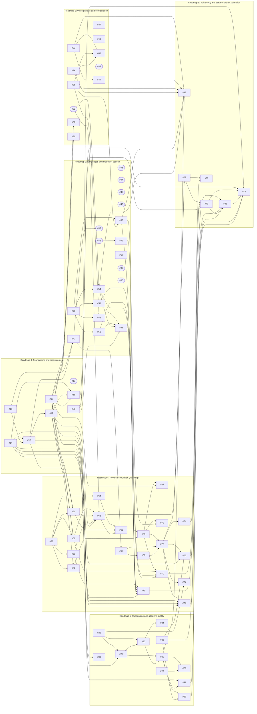

# Roadmap

This is the step-by-step plan that takes voice-simulator from what it is today
to the [vision](VISION.md): a physical model of the human voice that speaks and
listens, without neural networks, in the public domain.

Every step is a GitHub issue. Every issue is marked as a **Bug** or a
**Feature**, belongs to one milestone, and names the issues that block it. The
issues were planned in
[issue 11](https://github.com/konard/voice-simulator/issues/11); the analysis
behind them is the
[issue 11 case study](case-studies/issue-11/README.md).

## How to use the roadmap

1. Pick an open issue from the tables below whose "Blocked by" issues are all
   closed. Inside a milestone, take bugs before features.
2. Read the issue from top to bottom. Each one has the same sections: Goal,
   Why, Current state, What to do, Tests, Acceptance criteria, Out of scope and
   References. The issue names the files, the functions and the numbers, so no
   other document is needed to start.
3. Follow the [rules](#rules-for-every-roadmap-issue). Deliver one pull request
   per issue.
4. The issue is done when every box under "Acceptance criteria" is ticked and
   the checks pass. If a number in an acceptance criterion cannot be reached,
   do not lower it silently: report the measured value in the pull request and
   ask in the issue.

GitHub shows the same dependencies in the "Blocked by" and "Blocking" fields of
every issue, and the milestones show the progress of each stage.

## Stages

The milestones are stages of one plan. Later stages depend on earlier ones only
through the blockers listed per issue, so several stages can move at once.

| Stage                                         | What it delivers                                                                                                                                                          | Why it is at this place                                                                                                                            |
| --------------------------------------------- | ------------------------------------------------------------------------------------------------------------------------------------------------------------------------- | -------------------------------------------------------------------------------------------------------------------------------------------------- |
| 0. Foundations and measurement                | The manually triggered workflow for expensive checks, the policy check (no neural networks, permissive licences), public recordings, metrics and the first quality report | Nothing can be called better before it is measured, and the rules of the vision have to be enforced by a machine                                   |
| 1. Rust engine and adaptive quality           | The Rust core as WebAssembly in a background worker as the default engine, multicore with a single-core fallback, narrow-band tiers, quality that follows the device      | Performance is what keeps most devices away from the accurate tiers today                                                                          |
| 2. Voice physics and configuration            | Simulated vocal folds, source-tract coupling, physical noise, losses, articulator dynamics, durations and many more voice parameters                                      | Listening studies place the remaining gap to natural speech in the source, the noise and the movements, not in the detail of the tract (see below) |
| 3. Languages and modes of speech              | Fixes of wrong tones, stress and readings; lexicons; tone and intonation models; markup; loudness, whisper, voice qualities, emotions, accents                            | Every mode has to be spoken before it can be recognised                                                                                            |
| 4. Reverse simulation (listening)             | Audio → IPA → language → text by inverting the simulator, with syllable highlighting, in the library, the command line, the server and the app                            | Needs the metrics and recordings of stage 0, and the voice parameters of stage 2 to fit a speaker                                                  |
| 5. Voice copy and state-of-the-art validation | The multi-pass session that copies a voice while it recognises it, certification at the lowest settings, and the public evaluation against real speech                    | The last stage: it joins both directions and reports honestly where the system stands                                                              |

### What decides the order of quality work

Listening studies with a physical synthesiser decide it. Birkholz and Drechsel
(2021) added three anatomical details to the tract (piriform fossae, coupling
through the velum, sound radiated by the neck); listeners did not rate the
result as more natural, and the authors conclude that the voice source matters
more. Blandin, Didone and Birkholz (2024) compared 1D and 3D acoustics for seven
sounds and found no significant effect on rated naturalness. An earlier study
of the same group (Blandin and others 2023) did find that listeners prefer 3D
for the vowels /o/ and /u/, so 3D stays the reference tier, but it is not
where most of the gap to natural speech is.

The roadmap therefore improves, in this order: the vocal folds and their
coupling to the tract, turbulence and plosive bursts, articulator dynamics and
durations, then the losses in the 1D solver, and only then finer grids. Details
and sources are in
[the performance and physics research](case-studies/issue-11/research/5-performance-and-physics.md).

<!-- roadmap:begin -->

### Roadmap 0: Foundations and measurement

Clean up, policy checks, manually triggered heavy checks, public datasets, objective metrics and listening tests. Everything later is measured with these.

The first measurement of [#19](https://github.com/konard/voice-simulator/issues/19) is [reports/baseline-quality.md](reports/baseline-quality.md) (`scripts/quality-report.mjs`, suite `quality` of the heavy checks). An issue that claims an improvement runs the script with `--baseline docs/reports/baseline-quality.json` and puts the table into its pull request; the baseline files stay unchanged until [#83](https://github.com/konard/voice-simulator/issues/83).

| Issue                                                      | Type    | Title                                                                 | Blocked by                                                                                                                                                                         | Requirements |
| ---------------------------------------------------------- | ------- | --------------------------------------------------------------------- | ---------------------------------------------------------------------------------------------------------------------------------------------------------------------------------- | ------------ |
| [#13](https://github.com/konard/voice-simulator/issues/13) | Bug     | Template case studies occupy `docs/case-studies/issue-N` folders      | nothing                                                                                                                                                                            | R16, R21     |
| [#14](https://github.com/konard/voice-simulator/issues/14) | Feature | Manually triggered workflow for expensive checks                      | nothing                                                                                                                                                                            | R11          |
| [#15](https://github.com/konard/voice-simulator/issues/15) | Feature | Policy check: no neural networks, permissive licences only            | nothing                                                                                                                                                                            | R18, R19     |
| [#16](https://github.com/konard/voice-simulator/issues/16) | Feature | Speech dataset registry and fetcher with checksums and a licence gate | [#14](https://github.com/konard/voice-simulator/issues/14), [#15](https://github.com/konard/voice-simulator/issues/15)                                                             | R8, R18      |
| [#17](https://github.com/konard/voice-simulator/issues/17) | Feature | Golden set of public-domain recordings with transcripts and IPA       | [#16](https://github.com/konard/voice-simulator/issues/16)                                                                                                                         | R8, R13      |
| [#18](https://github.com/konard/voice-simulator/issues/18) | Feature | Objective speech metrics and a `compare` command                      | nothing                                                                                                                                                                            | R1, R8, R18  |
| [#19](https://github.com/konard/voice-simulator/issues/19) | Feature | Baseline quality report against real recordings                       | [#14](https://github.com/konard/voice-simulator/issues/14), [#17](https://github.com/konard/voice-simulator/issues/17), [#18](https://github.com/konard/voice-simulator/issues/18) | R1, R8, R11  |
| [#20](https://github.com/konard/voice-simulator/issues/20) | Feature | Listening-test harness: MUSHRA, ABX and intelligibility               | nothing                                                                                                                                                                            | R1, R19      |

### Roadmap 1: Rust engine and adaptive quality

Simulation core in Rust (WebAssembly and native), multicore with a single-core fallback, load-time benchmark, lowest-settings tiers and quality that adapts while streaming.

The workspace, the WebAssembly build, the loader, the CI job `rust` and the parity tests of [#21](https://github.com/konard/voice-simulator/issues/21) are described in [RUST-ENGINE.md](RUST-ENGINE.md); the ports below add their code to that pipeline.

The tiers `telephone` (8 kHz), `narrowband` (11.025 kHz) and `wideband` (16 kHz) of [#26](https://github.com/konard/voice-simulator/issues/26) are in `AUDIO_TIERS` below `minimal`, which stays the start level of automatic quality (`BASE_AUDIO_LEVEL`); the README section "Quality tiers" lists them and `experiments/issue-26-narrow-band.txt` holds their formant, aliasing and band-limit measurements.

The waveguide renderer of [#22](https://github.com/konard/voice-simulator/issues/22) runs in the Rust engine: `RustVoiceRenderer` and `renderPlanRust` (opt-in until [#25](https://github.com/konard/voice-simulator/issues/25)) give the same samples as `VoiceRenderer` (largest difference 1.7e-18) on every waveguide tier, including the `blockSize` and `bandLimit` of the narrow-band tiers, and `voice-simulator-cli render-job` renders the same jobs natively with the same SHA-256. The suite `performance` of the heavy checks measures it: [reports/performance-rust-waveguide.md](reports/performance-rust-waveguide.md) (1.5 to 2.0 times faster than JavaScript; 22 % to 51 % of the Rust render is the frame preparation in JavaScript, which [#82](https://github.com/konard/voice-simulator/issues/82) decides about). Layouts, deviations and measurements are in [RUST-ENGINE.md](RUST-ENGINE.md#waveguide-renderer-issue-22).

The 3D FDTD solver of [#23](https://github.com/konard/voice-simulator/issues/23) runs in the Rust engine too: `RustVoiceRenderer` and `renderPlanRust` take `solver: 'fdtd3d'` (the tiers `high` and above) with the voxel model built in JavaScript and handed over packed once, and give the same samples as `VoiceRenderer` (largest difference 0 on `'Hello.'` at `high`, 1.1e-19 with `teeth: false`); `voice-simulator-cli render-job` of a `high` job prints the same SHA-256 as the WebAssembly render. [reports/performance-rust-fdtd.md](reports/performance-rust-fdtd.md) measures the scalar build 1.43, 1.11 and 1.12 times faster than JavaScript on `high`, `ultra` and `studio`. The WebAssembly SIMD build is 1.06 times faster than the scalar one on `high`, below the 1.15 the issue requires, so it is built and tested but not shipped. Deviations and measurements are in [RUST-ENGINE.md](RUST-ENGINE.md#3d-fdtd-solver-issue-23).

The WebGPU solver of [#30](https://github.com/konard/voice-simulator/issues/30) is compared with the CPU kernel in suite `gpu` of the heavy checks, on Linux through Mesa's software adapter: [reports/gpu-solver.md](reports/gpu-solver.md). The Deno jobs on macOS and Windows set `REQUIRE_GPU=1`, so a runner image without an adapter fails instead of skipping the GPU tests.

The AudioWorklet player of [#27](https://github.com/konard/voice-simulator/issues/27) is the export `voice-simulator/playback` (processor, ring buffer) with the stream resampler `createStreamResampler`; its latency and underrun measurements are in `experiments/issue-27-latency.txt`, and the resampler is ported to the Rust core with class B parity tests.

| Issue                                                      | Type    | Title                                                                         | Blocked by                                                                                                             | Requirements  |
| ---------------------------------------------------------- | ------- | ----------------------------------------------------------------------------- | ---------------------------------------------------------------------------------------------------------------------- | ------------- |
| [#21](https://github.com/konard/voice-simulator/issues/21) | Feature | Rust workspace and WebAssembly build pipeline                                 | nothing                                                                                                                | R2, R12, R19  |
| [#22](https://github.com/konard/voice-simulator/issues/22) | Feature | Port the waveguide, the glottal source and the voice renderer to Rust         | [#21](https://github.com/konard/voice-simulator/issues/21), [#14](https://github.com/konard/voice-simulator/issues/14) | R2, R12, R13  |
| [#23](https://github.com/konard/voice-simulator/issues/23) | Feature | Port the 3D FDTD solver to Rust with WebAssembly SIMD                         | [#21](https://github.com/konard/voice-simulator/issues/21), [#22](https://github.com/konard/voice-simulator/issues/22) | R1, R2, R12   |
| [#24](https://github.com/konard/voice-simulator/issues/24) | Feature | Multicore 3D solver with a single-core fallback                               | [#23](https://github.com/konard/voice-simulator/issues/23)                                                             | R12           |
| [#25](https://github.com/konard/voice-simulator/issues/25) | Feature | Rust engine in a background worker as the default, JavaScript as the fallback | [#22](https://github.com/konard/voice-simulator/issues/22), [#23](https://github.com/konard/voice-simulator/issues/23) | R2, R12, R13  |
| [#26](https://github.com/konard/voice-simulator/issues/26) | Feature | Narrow-band tiers: 8, 11.025 and 16 kHz                                       | nothing                                                                                                                | R13, R3       |
| [#27](https://github.com/konard/voice-simulator/issues/27) | Feature | AudioWorklet playback with a ring buffer                                      | nothing                                                                                                                | R3, R13       |
| [#28](https://github.com/konard/voice-simulator/issues/28) | Feature | Silent load-time device benchmark that sets the precision                     | [#25](https://github.com/konard/voice-simulator/issues/25), [#26](https://github.com/konard/voice-simulator/issues/26) | R4, R3, R13   |
| [#29](https://github.com/konard/voice-simulator/issues/29) | Feature | Change quality in the middle of an utterance while streaming                  | [#25](https://github.com/konard/voice-simulator/issues/25), [#27](https://github.com/konard/voice-simulator/issues/27) | R3, R1        |
| [#30](https://github.com/konard/voice-simulator/issues/30) | Feature | Run the WebGPU solver in CI                                                   | [#14](https://github.com/konard/voice-simulator/issues/14)                                                             | R11, R1       |
| [#31](https://github.com/konard/voice-simulator/issues/31) | Feature | Performance tracking: real-time factor per tier in CI                         | [#14](https://github.com/konard/voice-simulator/issues/14), [#25](https://github.com/konard/voice-simulator/issues/25) | R11, R12, R13 |

### Roadmap 2: Voice physics and configuration

Physical vocal folds and lungs, noise sources, losses, articulation dynamics, durations and a much larger voice configuration.

The 2D solver of [#37](https://github.com/konard/voice-simulator/issues/37) (`fdtd2d`: `sheet-model.js`, `fdtd2d.js`, the nose and the pouches as 1D lines in `nose-line.js`) is registered and has its own vowel table (`VOWEL_CORRECTIONS_2D`), but no tier uses it: in `experiments/issue-11-fdtd2d-compare.txt` its mean log-spectral distance to `fdtd3d` at 4 to 8 kHz is 13.22 dB against 10.20 dB for the waveguide, although it renders in 0.43 times the time of `high`. Most of the difference comes from the 1D vallecula, whose dip near 5 kHz the 3D voxel pouch hardly shows (`experiments/issue-37-vallecula-zero.mjs`).

The two-mass vocal folds of [#33](https://github.com/konard/voice-simulator/issues/33) are the voice source `source: 'folds'` (`src/acoustics/folds.js`), driven by the plan channels `lungPressure`, `adduction` and `foldTension`; LF stays the default. The measurements are in [experiments/issue-11-folds.txt](../experiments/issue-11-folds.txt) and the section [Voice source](../README.md#voice-source) of the README. The later issues of this roadmap build on these channels and on `VocalFolds`.

The source-tract interaction of [#34](https://github.com/konard/voice-simulator/issues/34) is the option `interaction: true` (CLI `--interaction`, folds only): the glottal flow follows `interactiveFlow()` of Titze (2008) from the pressures above the glottis (`glottalLoad()` of the waveguide, the 2D sheet and the 3D grid) and below it (`Subglottal` in `src/acoustics/subglottal.js`, the windpipe with resonances at 626, 1485 and 2299 Hz). The checklist for flipping the defaults is in the section [Source-tract interaction](../README.md#source-tract-interaction) of the README: the ripple test holds only against the F1 of the open glottis (44 % above the closed-tract F1) and the child preset does not voice with the folds, so `DEFAULT_SOURCE` stays `'lf'` and `DEFAULT_INTERACTION` stays `false`. The Rust port is [#82](https://github.com/konard/voice-simulator/issues/82).

The turbulence noise of [#35](https://github.com/konard/voice-simulator/issues/35) comes from the air flow (`src/acoustics/aerodynamics.js`): the head parameter `lungPressure` drives the flow through the glottis and the constriction, the noise strength follows dp^1.5 A^0.5 above a critical Reynolds number, the frication band follows the Strouhal frequency and the flow derivative at a release adds the burst transient. The measurements are in `experiments/issue-11-turbulence.txt`; the Rust port of the source strengths and the mouth pressure is in [RUST-ENGINE.md](RUST-ENGINE.md). With `source: 'folds'` the glottal area of the aerodynamics is the mean area of the vocal folds (three one-pole stages of 5 ms, which keep the cycles of the folds out of the burst transient).

The articulator dynamics of [#38](https://github.com/konard/voice-simulator/issues/38) replace the zero-phase smoothing of the articulation channels: every channel is a list of targets (`channelTargets()`) that a critically damped system approaches forwards in time (`approachTargets()` in `src/articulation/dynamics.js`), with a time constant and a lead per channel in `ARTICULATORS`, early lip rounding and velum opening (`ROUNDING_LEAD`, `VELUM_LEAD`) and a coarticulation resistance per consonant (`COARTICULATION_RESISTANCE`). The fit to the golden set in [experiments/issue-11-fit-dynamics.txt](../experiments/issue-11-fit-dynamics.txt) lowered the held-out formant error by only 3.1 %, below the 5 % the issue asks for, so the starting values are kept; `experiments/issue-11-align.mjs` (`alignToRecording()`) and the `durations` option of `planUtterance()` are ready for the durations of [#39](https://github.com/konard/voice-simulator/issues/39).

The segment durations of [#39](https://github.com/konard/voice-simulator/issues/39) come from the rules of Klatt (1979) in `src/articulation/durations.js`: an inherent and a minimum duration per sound class in `DURATION_TABLES` (`en`, `ru`, `hi`, `zh`, `default`), the percentages of `DURATION_RULES` and the speech-rate exponents `RATE_MINIMUM`, `RATE_STRETCH` and `RATE_PAUSE`. The fit to the golden set in [experiments/issue-11-fit-durations.txt](../experiments/issue-11-fit-durations.txt) lowers the error per sound by 39 % for Hindi, but only by 0.9 % for English and 8.8 % for Russian, short of the 20 % the issue asks for: the alignment of `alignToRecording()` pulls the measured durations towards the plan that was rendered, so the fit compares against the median of three alignments, and on that reference neither the start values nor a refit move far from today's error. Mandarin has 173 aligned sounds, below the 200 of the criterion. The audit sentence is 3.723 s long (3.980 s before), and `matchVoice()` uses the speech-rate slopes measured under the new rules (`experiments/issue-39-rate-slopes.txt`).

The free articulators of [#40](https://github.com/konard/voice-simulator/issues/40) are four more channels of the plan: `jaw` (gap between the incisors), `lipProtrusion`, `larynxHeight` and `tongueRoot`, with the speaker habits `jawPosture`, `lipPosture`, `larynxPosture` and `tongueRootPosture` and the couplings `intrinsicPitch` and `larynxPitch` (off by default). At the values the planner writes they give the shape of the vowel and consonant channels; moved, they widen the mouth (`JAW_AREA` = 0.8 per cm, 9 % more F1 of `[ɛ]` for 0.5 cm; time constant 0.02 s, so that a short `[z]` still reaches its gap), lengthen the lips or the pharynx (`stretchSections()`, the velum, the teeth and the noise source keep their distance from the lips) and scale the pharynx ([experiments/issue-40-articulators.txt](../experiments/issue-40-articulators.txt)). In the 3D solver the voxel tract goes on below the glottis by `LARYNX_TRAVEL` = 0.25 of its length and the source plane moves in whole cells with the tract length, so the time step stretches by at most half a cell: `[u]` and `[æ]` differ by 3.6 % in step, 10.8 % before ([experiments/issue-40-fdtd3d.txt](../experiments/issue-40-fdtd3d.txt)). The ratio of nasal to vowel of `[ˈama]` becomes 0.99 and 1.08 at 1 and 0.6 cm cells, against 0.87 and 1.19 before, closer to the 1.09 of the waveguide ([experiments/issue-40-ama-3d.txt](../experiments/issue-40-ama-3d.txt)). `matchVoice` reads the tract length from F1 to F3, which rises with the length where the reading with F4 reverses ([experiments/issue-40-length-feature.txt](../experiments/issue-40-length-feature.txt)). The nose line and the side branches of the 1D solvers still get longer with the tract.

The voice configuration of [#41](https://github.com/konard/voice-simulator/issues/41) is one flat head of 137 values in six groups (`HEAD_GROUPS`: `anatomy` 28, `folds` 14, `breathing` 13, `articulation` 67, `expression` 7, `microphone` 8; the tables are in `src/parameters/`). Every entry has a unit, a range, a default, a source and an `effect`: the measure of `ˈmama ˈsasa` (or a named utterance, tier, options or head) that rises or falls from its minimum to its maximum. `tests/head-parameters.test.js` renders all 137 effects in 29 s on Node.js ([experiments/issue-41-effects.txt](../experiments/issue-41-effects.txt)); [docs/VOICE-PARAMETERS.md](VOICE-PARAMETERS.md) and `schemas/voice.schema.json` are generated from the tables by `node scripts/voice-parameters.mjs`. Four values keep sign 0 because the model does not use them yet: `speedLarynxHeight` and `speedTongueRoot` (no sound sets a target of these channels; the postures are added after the smoothing), `durationEmphasis` (no input marks a token as emphasised) and `durationTone1` (the factor of the first tone is 1). Voice files (`loadVoice`, `saveVoice`, CLI `--voice`, `head --voice-file` and `voice check`) write one object per group and only the values that differ from their preset; the presets add `child5`, the teenagers, the elderly and six singing voices (`bass` renders "Hello." at 98 Hz by `voice-simulator match`). The app editor shows the groups as sections with the basic values, "Show all parameters", "Import voice" and "Export voice".

| Issue                                                      | Type    | Title                                                                    | Blocked by                                                                                                                                                                         | Requirements     |
| ---------------------------------------------------------- | ------- | ------------------------------------------------------------------------ | ---------------------------------------------------------------------------------------------------------------------------------------------------------------------------------- | ---------------- |
| [#32](https://github.com/konard/voice-simulator/issues/32) | Bug     | `breathiness` hardly changes the measured noise level                    | nothing                                                                                                                                                                            | R5, R9, R18      |
| [#33](https://github.com/konard/voice-simulator/issues/33) | Feature | Physical vocal-fold model driven by lung pressure                        | nothing                                                                                                                                                                            | R1, R5, R9, R18  |
| [#34](https://github.com/konard/voice-simulator/issues/34) | Feature | Source-tract interaction and the subglottal tract                        | [#33](https://github.com/konard/voice-simulator/issues/33)                                                                                                                         | R1, R5, R9, R18  |
| [#35](https://github.com/konard/voice-simulator/issues/35) | Feature | Physically based turbulence noise: frication, aspiration and bursts      | nothing                                                                                                                                                                            | R1, R5, R9, R18  |
| [#36](https://github.com/konard/voice-simulator/issues/36) | Feature | Frequency-dependent losses in the 1D solver                              | nothing                                                                                                                                                                            | R1, R5, R9, R18  |
| [#37](https://github.com/konard/voice-simulator/issues/37) | Feature | 2D acoustic tier between the waveguide and 3D                            | nothing                                                                                                                                                                            | R1, R3, R12, R18 |
| [#38](https://github.com/konard/voice-simulator/issues/38) | Feature | Articulator dynamics and coarticulation calibrated on real data          | [#18](https://github.com/konard/voice-simulator/issues/18), [#17](https://github.com/konard/voice-simulator/issues/17)                                                             | R1, R9, R17, R18 |
| [#39](https://github.com/konard/voice-simulator/issues/39) | Feature | Rule-based segment duration model per language                           | [#17](https://github.com/konard/voice-simulator/issues/17), [#18](https://github.com/konard/voice-simulator/issues/18)                                                             | R1, R9, R17, R18 |
| [#40](https://github.com/konard/voice-simulator/issues/40) | Feature | Explicit jaw, larynx height and lip protrusion articulators              | nothing                                                                                                                                                                            | R1, R5, R17, R18 |
| [#41](https://github.com/konard/voice-simulator/issues/41) | Feature | Expanded voice configuration: voice files, groups, presets and an editor | [#33](https://github.com/konard/voice-simulator/issues/33), [#35](https://github.com/konard/voice-simulator/issues/35), [#36](https://github.com/konard/voice-simulator/issues/36) | R5, R9, R17, R18 |
| [#84](https://github.com/konard/voice-simulator/issues/84) | Bug     | Nasal consonants are about four times louder in the 3D solver            | nothing                                                                                                                                                                            | R1, R18          |

### Roadmap 3: Languages and modes of speech

Pronunciation bugs, lexicons, tones, intonation, markup, loudness, whisper, voice qualities, emotions, paralinguistic sounds and accents for speaking.

The speech markup of [#50](https://github.com/konard/voice-simulator/issues/50) reads an SSML subset (any text that starts with `<speak`), inline tags such as `[whisper]…[/whisper]` (with `markup: true` or `--markup`) and the ExtIPA/VoQS marks of IPA (`{W … W}`, `{f … f}`, `{allegro … allegro}`, `(.)`, `(1.2)`, `⸨laugh⸩`, `ˈˈ`). All three become mode spans with every field of `MODE_DEFAULTS` (effort, gain, rate, pitch, range, emphasis, phonation, emotion, tune, lang), and `textToIpa` writes the marks of every change that has a symbol, so a marked-up text and its IPA give the same `plan.modes` (spans in seconds, `modeAt(plan, time)`) and `plan.sounds`. Rate, pitch, range, gain and effort (limited to -20 … +6 dB until [#52](https://github.com/konard/voice-simulator/issues/52)) are heard now, timed pauses last exactly their length and a sound is 0.3 s of silence until [#56](https://github.com/konard/voice-simulator/issues/56); phonation, emotion, emphasis and tune are carried for [#51](https://github.com/konard/voice-simulator/issues/51), [#53](https://github.com/konard/voice-simulator/issues/53), [#54](https://github.com/konard/voice-simulator/issues/54) and [#55](https://github.com/konard/voice-simulator/issues/55). The SSML reader is written by hand, fetches nothing and expands no entities; DOCTYPE, CDATA, processing instructions and inputs over `MARKUP_LIMITS` (20 000 characters, depth 32, 2000 elements, breaks of 10 s) throw `MarkupError`, which the server answers with 400. Text without markup gives the same IPA and samples as before. The tables, with one example per row, are in [docs/markup.md](markup.md).

| Issue                                                      | Type    | Title                                                                       | Blocked by                                                                                                                                                                                                                                     | Requirements     |
| ---------------------------------------------------------- | ------- | --------------------------------------------------------------------------- | ---------------------------------------------------------------------------------------------------------------------------------------------------------------------------------------------------------------------------------------------- | ---------------- |
| [#42](https://github.com/konard/voice-simulator/issues/42) | Bug     | Mandarin third tone is spoken as a plain rise because the dip is dropped    | nothing                                                                                                                                                                                                                                        | R17, R19         |
| [#43](https://github.com/konard/voice-simulator/issues/43) | Bug     | Mandarin erhua is spoken as a separate syllable                             | nothing                                                                                                                                                                                                                                        | R17, R19         |
| [#44](https://github.com/konard/voice-simulator/issues/44) | Bug     | English heteronyms are always read the same way                             | nothing                                                                                                                                                                                                                                        | R17, R19         |
| [#45](https://github.com/konard/voice-simulator/issues/45) | Bug     | Hindi yes/no questions that start with क्या get a falling contour           | nothing                                                                                                                                                                                                                                        | R17, R19         |
| [#46](https://github.com/konard/voice-simulator/issues/46) | Bug     | Expanded numbers and dates are highlighted as one word                      | nothing                                                                                                                                                                                                                                        | R10, R17         |
| [#47](https://github.com/konard/voice-simulator/issues/47) | Feature | Pronunciation lexicons at scale from permissive sources                     | [#15](https://github.com/konard/voice-simulator/issues/15), [#16](https://github.com/konard/voice-simulator/issues/16)                                                                                                                         | R7, R17, R18     |
| [#48](https://github.com/konard/voice-simulator/issues/48) | Bug     | Russian stress is wrong outside the small dictionary and for homographs     | [#47](https://github.com/konard/voice-simulator/issues/47)                                                                                                                                                                                     | R17, R19         |
| [#49](https://github.com/konard/voice-simulator/issues/49) | Feature | Tone model with targets, the neutral tone and tone coarticulation           | [#42](https://github.com/konard/voice-simulator/issues/42)                                                                                                                                                                                     | R17, R19         |
| [#50](https://github.com/konard/voice-simulator/issues/50) | Feature | Speech markup: an SSML subset, inline tags and voice-quality symbols in IPA | nothing                                                                                                                                                                                                                                        | R17, R7, R10, R5 |
| [#51](https://github.com/konard/voice-simulator/issues/51) | Feature | Intonation models per language: sentence types, focus and Russian contours  | [#50](https://github.com/konard/voice-simulator/issues/50)                                                                                                                                                                                     | R17, R7, R19     |
| [#52](https://github.com/konard/voice-simulator/issues/52) | Feature | Vocal effort and loudness dynamics                                          | [#50](https://github.com/konard/voice-simulator/issues/50)                                                                                                                                                                                     | R17, R5, R7      |
| [#53](https://github.com/konard/voice-simulator/issues/53) | Feature | Whisper                                                                     | [#50](https://github.com/konard/voice-simulator/issues/50), [#35](https://github.com/konard/voice-simulator/issues/35)                                                                                                                         | R17, R7, R18     |
| [#54](https://github.com/konard/voice-simulator/issues/54) | Feature | Phonation types: breathy, creaky, pressed and falsetto                      | [#50](https://github.com/konard/voice-simulator/issues/50), [#32](https://github.com/konard/voice-simulator/issues/32)                                                                                                                         | R17, R5, R7      |
| [#55](https://github.com/konard/voice-simulator/issues/55) | Feature | Emotions and attitudes                                                      | [#51](https://github.com/konard/voice-simulator/issues/51), [#52](https://github.com/konard/voice-simulator/issues/52), [#54](https://github.com/konard/voice-simulator/issues/54), [#20](https://github.com/konard/voice-simulator/issues/20) | R17, R5, R18     |
| [#56](https://github.com/konard/voice-simulator/issues/56) | Feature | Paralinguistic sounds: breaths, laughter, sighs and hesitations             | [#50](https://github.com/konard/voice-simulator/issues/50), [#35](https://github.com/konard/voice-simulator/issues/35)                                                                                                                         | R17, R7, R18     |
| [#57](https://github.com/konard/voice-simulator/issues/57) | Feature | Accents beyond English and foreign accents                                  | nothing                                                                                                                                                                                                                                        | R17, R5, R7      |
| [#85](https://github.com/konard/voice-simulator/issues/85) | Bug     | English function words are spoken as full stressed words                    | nothing                                                                                                                                                                                                                                        | R17, R19         |
| [#86](https://github.com/konard/voice-simulator/issues/86) | Bug     | Russian prepositions and particles are read as separate stressed words      | nothing                                                                                                                                                                                                                                        | R17, R19         |

### Roadmap 4: Reverse simulation (listening)

Audio to IPA to language to text by inverting the simulation: analysis front end, inversion, decoding, language identification, API, app and benchmarks.

| Issue                                                      | Type    | Title                                                                          | Blocked by                                                                                                                                                                                                                                                                                                                                                             | Requirements                    |
| ---------------------------------------------------------- | ------- | ------------------------------------------------------------------------------ | ---------------------------------------------------------------------------------------------------------------------------------------------------------------------------------------------------------------------------------------------------------------------------------------------------------------------------------------------------------------------- | ------------------------------- |
| [#58](https://github.com/konard/voice-simulator/issues/58) | Feature | Streaming analysis front end                                                   | nothing                                                                                                                                                                                                                                                                                                                                                                | R6, R7, R12, R13, R18           |
| [#59](https://github.com/konard/voice-simulator/issues/59) | Feature | Robust pitch and voicing tracker                                               | [#58](https://github.com/konard/voice-simulator/issues/58), [#18](https://github.com/konard/voice-simulator/issues/18), [#16](https://github.com/konard/voice-simulator/issues/16)                                                                                                                                                                                     | R6, R9, R12, R13, R18           |
| [#60](https://github.com/konard/voice-simulator/issues/60) | Feature | Formant tracker                                                                | [#58](https://github.com/konard/voice-simulator/issues/58), [#18](https://github.com/konard/voice-simulator/issues/18), [#17](https://github.com/konard/voice-simulator/issues/17)                                                                                                                                                                                     | R6, R9, R12, R13, R18           |
| [#61](https://github.com/konard/voice-simulator/issues/61) | Feature | Glottal inverse filtering and source parameters                                | [#58](https://github.com/konard/voice-simulator/issues/58)                                                                                                                                                                                                                                                                                                             | R6, R9, R12, R13, R18           |
| [#62](https://github.com/konard/voice-simulator/issues/62) | Feature | Syllable nuclei, landmarks and broad sound classes                             | [#58](https://github.com/konard/voice-simulator/issues/58), [#17](https://github.com/konard/voice-simulator/issues/17)                                                                                                                                                                                                                                                 | R6, R10, R12, R13, R18          |
| [#63](https://github.com/konard/voice-simulator/issues/63) | Feature | Voice configuration fit on real speakers (pass 1)                              | [#59](https://github.com/konard/voice-simulator/issues/59), [#60](https://github.com/konard/voice-simulator/issues/60), [#61](https://github.com/konard/voice-simulator/issues/61), [#17](https://github.com/konard/voice-simulator/issues/17), [#32](https://github.com/konard/voice-simulator/issues/32)                                                             | R6, R8, R9, R12, R13, R18, R19  |
| [#64](https://github.com/konard/voice-simulator/issues/64) | Feature | Articulatory codebook generated by the simulator                               | [#58](https://github.com/konard/voice-simulator/issues/58)                                                                                                                                                                                                                                                                                                             | R6, R12, R13, R18, R19          |
| [#65](https://github.com/konard/voice-simulator/issues/65) | Feature | Acoustic-to-articulatory inversion (pass 2)                                    | [#64](https://github.com/konard/voice-simulator/issues/64), [#60](https://github.com/konard/voice-simulator/issues/60), [#63](https://github.com/konard/voice-simulator/issues/63)                                                                                                                                                                                     | R6, R9, R12, R13, R18, R19      |
| [#66](https://github.com/konard/voice-simulator/issues/66) | Feature | Decode articulation into IPA with times                                        | [#65](https://github.com/konard/voice-simulator/issues/65), [#62](https://github.com/konard/voice-simulator/issues/62)                                                                                                                                                                                                                                                 | R6, R7, R10, R12, R13, R18, R19 |
| [#67](https://github.com/konard/voice-simulator/issues/67) | Feature | Analysis-by-synthesis rescoring                                                | [#66](https://github.com/konard/voice-simulator/issues/66), [#18](https://github.com/konard/voice-simulator/issues/18)                                                                                                                                                                                                                                                 | R6, R7, R12, R13, R18, R19      |
| [#68](https://github.com/konard/voice-simulator/issues/68) | Feature | IPA to text per language                                                       | [#47](https://github.com/konard/voice-simulator/issues/47)                                                                                                                                                                                                                                                                                                             | R6, R7, R19                     |
| [#69](https://github.com/konard/voice-simulator/issues/69) | Feature | Language identification and mixed-language speech from IPA                     | [#68](https://github.com/konard/voice-simulator/issues/68)                                                                                                                                                                                                                                                                                                             | R6, R7, R19                     |
| [#70](https://github.com/konard/voice-simulator/issues/70) | Feature | Recognise tones, stress and sentence type                                      | [#66](https://github.com/konard/voice-simulator/issues/66), [#59](https://github.com/konard/voice-simulator/issues/59), [#49](https://github.com/konard/voice-simulator/issues/49), [#51](https://github.com/konard/voice-simulator/issues/51)                                                                                                                         | R6, R17, R18, R19               |
| [#71](https://github.com/konard/voice-simulator/issues/71) | Feature | Recognise loudness, whisper, voice quality and emotion                         | [#61](https://github.com/konard/voice-simulator/issues/61), [#52](https://github.com/konard/voice-simulator/issues/52), [#53](https://github.com/konard/voice-simulator/issues/53), [#54](https://github.com/konard/voice-simulator/issues/54), [#55](https://github.com/konard/voice-simulator/issues/55), [#17](https://github.com/konard/voice-simulator/issues/17) | R6, R17, R18, R19               |
| [#72](https://github.com/konard/voice-simulator/issues/72) | Feature | Recognise whispered speech                                                     | [#66](https://github.com/konard/voice-simulator/issues/66), [#53](https://github.com/konard/voice-simulator/issues/53)                                                                                                                                                                                                                                                 | R6, R13, R17, R18, R19          |
| [#73](https://github.com/konard/voice-simulator/issues/73) | Feature | Recognition API, command and server route with streaming results               | [#66](https://github.com/konard/voice-simulator/issues/66), [#68](https://github.com/konard/voice-simulator/issues/68), [#69](https://github.com/konard/voice-simulator/issues/69)                                                                                                                                                                                     | R3, R4, R6, R7, R10, R13        |
| [#74](https://github.com/konard/voice-simulator/issues/74) | Feature | App: recognition from the microphone and files with live syllable highlighting | [#73](https://github.com/konard/voice-simulator/issues/73)                                                                                                                                                                                                                                                                                                             | R6, R7, R10                     |
| [#75](https://github.com/konard/voice-simulator/issues/75) | Feature | Round-trip tests: text to audio to text in the heavy workflow                  | [#73](https://github.com/konard/voice-simulator/issues/73), [#14](https://github.com/konard/voice-simulator/issues/14), [#26](https://github.com/konard/voice-simulator/issues/26)                                                                                                                                                                                     | R6, R7, R11, R13, R18           |
| [#76](https://github.com/konard/voice-simulator/issues/76) | Feature | Recognition benchmark on public recordings                                     | [#73](https://github.com/konard/voice-simulator/issues/73), [#16](https://github.com/konard/voice-simulator/issues/16), [#18](https://github.com/konard/voice-simulator/issues/18), [#14](https://github.com/konard/voice-simulator/issues/14)                                                                                                                         | R6, R8, R11, R13, R19           |
| [#77](https://github.com/konard/voice-simulator/issues/77) | Feature | Recognition in Rust and on several cores with a single-core fallback           | [#73](https://github.com/konard/voice-simulator/issues/73), [#21](https://github.com/konard/voice-simulator/issues/21)                                                                                                                                                                                                                                                 | R2, R6, R12, R13                |

### Roadmap 5: Voice copy and state-of-the-art validation

Multi-pass voice copy with continuous recognition, copy synthesis of real recordings, lowest-settings certification and the final evaluation.

| Issue                                                      | Type    | Title                                                              | Blocked by                                                                                                                                                                                                                                                                                                                                                                                                                         | Requirements     |
| ---------------------------------------------------------- | ------- | ------------------------------------------------------------------ | ---------------------------------------------------------------------------------------------------------------------------------------------------------------------------------------------------------------------------------------------------------------------------------------------------------------------------------------------------------------------------------------------------------------------------------- | ---------------- |
| [#78](https://github.com/konard/voice-simulator/issues/78) | Feature | Multi-pass voice session: fit, invert, stabilise, keep recognising | [#63](https://github.com/konard/voice-simulator/issues/63), [#73](https://github.com/konard/voice-simulator/issues/73)                                                                                                                                                                                                                                                                                                             | R9, R8, R12      |
| [#79](https://github.com/konard/voice-simulator/issues/79) | Feature | Copy synthesis: reproduce a real recording                         | [#78](https://github.com/konard/voice-simulator/issues/78), [#70](https://github.com/konard/voice-simulator/issues/70), [#71](https://github.com/konard/voice-simulator/issues/71), [#20](https://github.com/konard/voice-simulator/issues/20)                                                                                                                                                                                     | R8, R9           |
| [#80](https://github.com/konard/voice-simulator/issues/80) | Feature | App: copy a voice while the person keeps speaking                  | [#78](https://github.com/konard/voice-simulator/issues/78), [#74](https://github.com/konard/voice-simulator/issues/74)                                                                                                                                                                                                                                                                                                             | R9, R10, R3      |
| [#81](https://github.com/konard/voice-simulator/issues/81) | Feature | Lowest-settings certification: 8 kHz and one core                  | [#75](https://github.com/konard/voice-simulator/issues/75), [#76](https://github.com/konard/voice-simulator/issues/76), [#79](https://github.com/konard/voice-simulator/issues/79), [#26](https://github.com/konard/voice-simulator/issues/26)                                                                                                                                                                                     | R13, R12, R11    |
| [#82](https://github.com/konard/voice-simulator/issues/82) | Feature | Rust parity for everything added after the port                    | [#25](https://github.com/konard/voice-simulator/issues/25), [#33](https://github.com/konard/voice-simulator/issues/33), [#34](https://github.com/konard/voice-simulator/issues/34), [#35](https://github.com/konard/voice-simulator/issues/35), [#36](https://github.com/konard/voice-simulator/issues/36), [#53](https://github.com/konard/voice-simulator/issues/53), [#54](https://github.com/konard/voice-simulator/issues/54) | R2, R12          |
| [#83](https://github.com/konard/voice-simulator/issues/83) | Feature | State-of-the-art evaluation and public report                      | [#19](https://github.com/konard/voice-simulator/issues/19), [#20](https://github.com/konard/voice-simulator/issues/20), [#79](https://github.com/konard/voice-simulator/issues/79), [#81](https://github.com/konard/voice-simulator/issues/81), [#31](https://github.com/konard/voice-simulator/issues/31), [#28](https://github.com/konard/voice-simulator/issues/28)                                                             | R19, R1, R8, R14 |

### Dependency graph

An arrow points from an issue to the issues it blocks. Bugs have rounded boxes.

<!-- roadmap:end -->

## Rules for every roadmap issue

The same rules are printed at the end of every issue.

- Read [VISION.md](VISION.md), this file and [CONTRIBUTING.md](CONTRIBUTING.md)
  first.
- **No neural networks** in the library, the app, the tests or the tools, and
  no playback of recorded speech. Allowed: physics, closed-form signal
  processing, search, optimisation, dynamic programming and small documented
  tables.
- **Public domain.** New code is Unlicense. New dependencies need a permissive
  licence (MIT, BSD, Apache-2.0, ISC, Zlib, CC0, Unlicense). Committed data is
  public domain or CC0; anything else is downloaded at test time and never
  committed.
- One pull request per issue. Do not start before every issue under "Blocked
  by" is closed.
- Work in the JavaScript reference implementation in `src/` unless the issue
  says otherwise. If the directory `crates/` exists when you start, implement
  the same numerical code in the Rust core too and extend the parity tests,
  following the interface rules, the determinism rules and the parity classes
  of [RUST-ENGINE.md](RUST-ENGINE.md).
- Same input, seed and options must give the same samples on Node.js, Bun and
  Deno. Take randomness only from `src/random.js`.
- Add tests in `tests/` that fail before the change and pass after it. Tests
  that need more than about 10 seconds or a download run only in the manually
  triggered workflow.
- Keep every source and Markdown file under 1500 lines, run `npm run check` and
  `npm test`, and add a changeset (`npm run changeset`) when code changes.
- Update `README.md`, `src/index.d.ts`, the command line help and this file
  when behaviour or the public API changes. Put experiment scripts in
  `experiments/` and name them after the issue's number.
- Report measured numbers with the command that produced them. Do not write a
  claim that was not measured.

## How the roadmap is maintained

- The text of every issue is kept in
  [case-studies/issue-11/plan](case-studies/issue-11/plan/README.md), one file
  per issue, with the names that the issues share (files, functions, formats).
- `node experiments/issue-11-create-issues.mjs check` validates the plan: every
  issue has all sections, every blocker exists and the dependencies have no
  cycle. `create` made the GitHub issues, milestones and "blocked by" links;
  `update` sends an issue again after its plan file was edited; `roadmap`
  writes the tables and the graph above from
  [the list of created issues](case-studies/issue-11/data/created-issues.json).
- A pull request that finishes an issue ticks nothing here: the state of an
  issue lives on GitHub. A pull request that changes the direction updates
  [VISION.md](VISION.md) and adds or edits issues, then this file.
