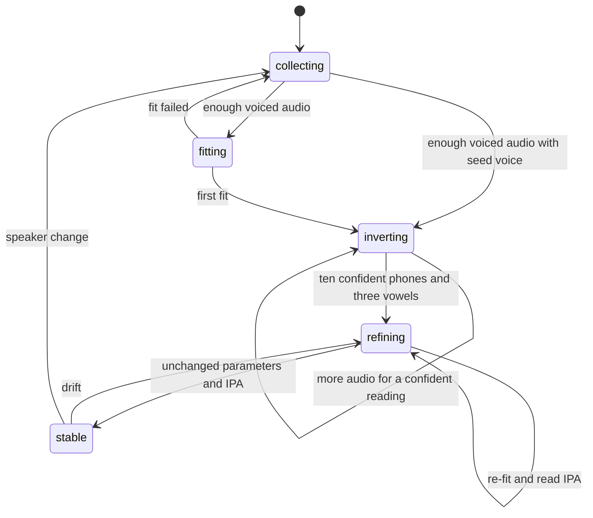

# Voice sessions

`createVoiceSession` accepts clean mono speech from one speaker at a time. The
session recognises incoming chunks while estimating a [voice configuration](VOICE-PARAMETERS.md).
`copyVoice` runs the same session offline with a window the length of the
recording and an iteration limit of 12 refinements before waiting for more
voiced speech.

```js
import { copyVoice, createVoiceSession } from 'voice-simulator';

const session = createVoiceSession({ sampleRate, languages: ['en'] });
session.on('voice', ({ voice, uncertainty, converged }) => {
  console.log({ voice, uncertainty, converged });
});
session.on('final', ({ text, voice }) => console.log(text, voice));
for (const chunk of monoChunks) session.push(chunk);
const recognition = session.flush();
if (session.voice) {
  const spoken = session.speak('Hello.', { tier: 'minimal', seed: 1 });
}

const copied = copyVoice(samples, sampleRate, { languages: ['en'] });
```

Each chunk is a `Float32Array`. Call `reset()` before starting a new input.
`speak` uses the most recent voice and throws `No voice yet` before the first
voice event. The voice is a serializable voice file. The first fit and inversion
can publish provisional estimates. In the standard path, `converged` becomes
true when both the parameters and the IPA reading settle, and `uncertainty`
gives one jackknife standard error per parameter. `history` contains the pass
number, state, objective distance, normalised parameter changes and IPA
reading. A speaker change starts a new history. `partial` and `syllable` have
the recognizer's event shapes. Each `final` event includes the current voice,
and `flush` returns the aggregate recognition result with that voice.
Flushing finishes already queued work even if background work was paused.

| Option            | Default                    | Meaning                                                  |
| ----------------- | -------------------------- | -------------------------------------------------------- |
| `sampleRate`      | Required                   | Rate of the input chunks in Hz                           |
| `languages`       | `['en', 'ru', 'hi', 'zh']` | Candidate recognition languages                          |
| `preset`          | `'auto'`                   | Initial speaker preset selection                         |
| `voice`           | None                       | Seed voice to start inversion without the first fit      |
| `minVoiced`       | 2                          | Initial voiced seconds before fitting                    |
| `window`          | 20                         | Seconds of input audio kept                              |
| `tolerance`       | 0.02                       | Maximum change relative to a parameter's range           |
| `stablePasses`    | 2                          | Consecutive unchanged refinements for convergence        |
| `maxIterations`   | 8                          | Refinements before waiting for 5 more voiced seconds     |
| `halfLife`        | 30                         | Voiced seconds for stable estimates to lose half weight  |
| `driftFactor`     | 1.5                        | Recent distance relative to convergence before refitting |
| `realtime`        | `false`                    | Schedule pass generators behind the recognizer           |
| `backgroundShare` | 0.25                       | Background work share, assign 0 to pause fits            |
| `level`           | `'auto'`                   | Recognition level                                        |
| `schedule`        | `setTimeout(fn, 0)`        | Schedule a background callback                           |



Standard refinement measures the middle half of confident phones. It uses vowel formants
for tract length, stressed vowel frames for source parameters and planned
durations for speech rate. Vowel habits appear as
`voice.articulationOffsets`, keyed by IPA. `planUtterance` and `synthesize`
accept the same mapping. In `stable`, the recognizer applies parameter updates
when it detects a pause of at least 200 ms.

At 8000 Hz with `realtime: true` and `level: 'low'` or `'auto'`, the session
uses the telephone word decoder with a bounded search. It uses timed phones
from the live reading for the confidence gate and emits aligned syllables at
phrase commits. The first fit estimates the voice source. Subsequent
refinements require fresh voiced evidence. The `stablePasses` count uses the normalised
change in pitch and vocal tract length, and the same change is reported as
the refinement distance. Uncertainty comes from the pooled acoustic
statistics. Speaker tracking checks recent pitch and tract length and applies
smoothed updates at pauses.

The telephone session emits relative mode labels by default. Set
`includeModeLabels: true` to use synthesized voice references for expressive
labels such as named emotions. This takes additional foreground processing.
Set `includeModeLabels: false` to skip the mode classifier.

The recognizer's confidence gate can leave a session in `inverting` through
the end of input. The measured recovery results and reproduction commands are
in the [validation report](reports/issue-78-validation.md). The scheduler
yields between generator steps. Batch renders and phoneme reads can take
longer than one scheduling slice.
The `voicedSeconds` property reports the voiced duration for the current
speaker. The example app uses it to show progress toward the first fit.
Set `includeModeLabels: false` to keep timed recognition and skip the extra
reference renders used to classify expressive modes in live results.
`engine` (default `'js'`) renders the voice fits; the recognizer uses the
engine of the same name (default `'auto'`). The lowest-settings matrix
([report](reports/lowest-settings.md)) runs sessions with `'js'` and with
`'rust'` on one thread without SIMD.
