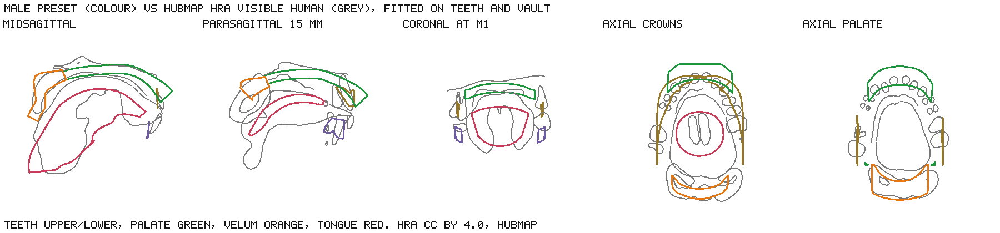
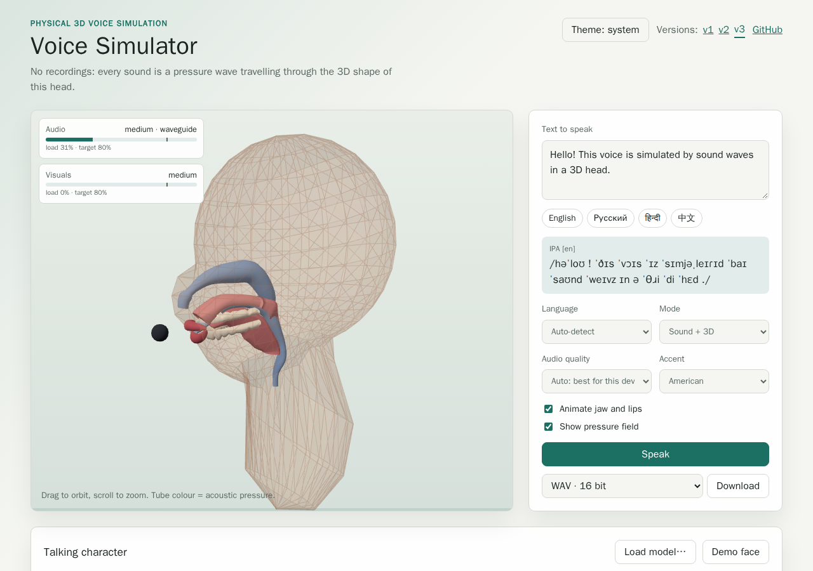
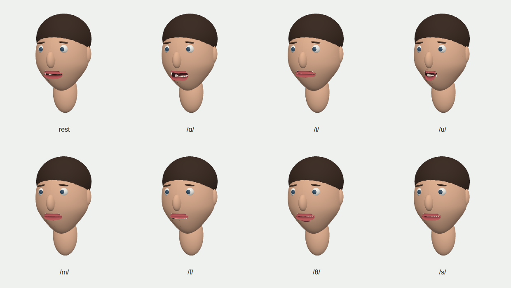
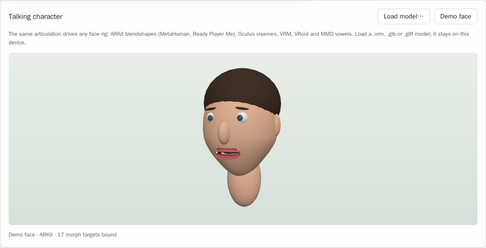

# Case study: issue #9, we need to improve quality

Issue: [konard/voice-simulator#9](https://github.com/konard/voice-simulator/issues/9).
Pull request: [konard/voice-simulator#10](https://github.com/konard/voice-simulator/pull/10).

The issue's screenshot showed the app's 3D view: a mouth too coarse to
change the sound, parts in the wrong places and round lips. It asks for
anatomy that agrees with real anatomy on every slice, full 3D acoustics
by default, female and child voices that do not sound male, sound after
the tab was in the background, every release online at its own path, and
a check of what issues 1 and 5 left undelivered. Four review comments on
the pull request add more sources (Z-Anatomy, G-OBIM, Open-Full-Jaw and
the HuBMAP Human Reference Atlas), switching anatomy part by part, and
bridges to character rigs.

## Contents

- [data](data): the issue, its screenshot, issues 1 and 5, and the pull
  request with its comments, as fetched with `gh`.
- [research](research/README.md): online research with sources, in seven
  parts: anatomical datasets, anatomical dimensions, 3D acoustics and
  competitors, the path past neural TTS, female and child voices, browser
  audio in background tabs, and tools.
- [anatomy](anatomy): the model next to MRI vocal tracts before and after,
  per slice, with the metrics, and the model cut against the HuBMAP organs.
- [measurements](measurements): transfer functions, formants, timings and
  key-point distances that the sections below quote.
- [blender](blender/README.md): the head model in Blender, with renders and
  the glTF validator report.

## Requirements

| #   | Requirement (issue text, condensed)                                                       | Status | Where                                                                           |
| --- | ----------------------------------------------------------------------------------------- | ------ | ------------------------------------------------------------------------------- |
| R1  | Mouth detailed enough to change the acoustics, parts in the right places, realistic lips  | Done   | [Anatomy](#r1-r2-r7-anatomy-against-real-anatomy)                               |
| R2  | Render our model, compare it with real anatomy at all slices; clean-room sources, JIT     | Done   | [Anatomy](#r1-r2-r7-anatomy-against-real-anatomy)                               |
| R3  | Sound must come back after the tab was in the background                                  | Done   | [Background tabs](#r3-background-tabs)                                          |
| R4  | Lift the limits: 1D up to 5 kHz, fossae only in 1D, 1-voxel incisors, schematic palate    | Done   | [3D acoustics](#r4-r5-r6-full-3d-acoustics-by-default)                          |
| R5  | Keep a setting for the 1D waveguide                                                       | Done   | [3D acoustics](#r4-r5-r6-full-3d-acoustics-by-default)                          |
| R6  | Full 3D sound by default at much higher quality, configurable back to the old detail      | Done   | [3D acoustics](#r4-r5-r6-full-3d-acoustics-by-default)                          |
| R7  | Double-check sources; Blender or code for a 3D model as accurate as possible              | Done   | [Anatomy](#r1-r2-r7-anatomy-against-real-anatomy), [Blender](blender/README.md) |
| R8  | Female and child voices still sound male                                                  | Done   | [Female and child voices](#r8-female-and-child-voices)                          |
| R9  | A breakthrough past the SOTA of 3D acoustic simulation, a way to beat neural TTS          | Partly | [SOTA](#r9-state-of-the-art-and-neural-tts)                                     |
| R10 | Double-check every undelivered requirement of issues 1 and 5                              | Done   | [Audit](#r10-audit-of-issues-1-and-5)                                           |
| R11 | The current version at `./v2`, and every later version at its own path                    | Done   | [Versions](#r11-every-version-online)                                           |
| R12 | Collect the data in `docs/case-studies/issue-9`, research online, plan every requirement  | Done   | This document                                                                   |
| C1  | Use Z-Anatomy for the parts of the mouth and airway that shape the sound                  | Done   | [Review comments](#review-comments)                                             |
| C2  | Rebuild the model after G-OBIM (PMC12440228)                                              | Done   | [Review comments](#review-comments)                                             |
| C3  | Open-Full-Jaw as the most detailed teeth, scaled down from there                          | Done   | [Review comments](#review-comments)                                             |
| C4  | HuBMAP atlas, MRI-like slicing with key points, per-part sources, rig bridges, LOD to GPU | Done   | [Review comments](#review-comments)                                             |

R9 is marked partly: the simulator is now ahead of the surveyed 3D vocal
tract solvers in speed in the browser, but no listening test shows it
beating neural TTS, and the research below explains why the remaining gap
is in control and prosody, not in the acoustics.

## R1, R2, R7: anatomy against real anatomy

**Sources.** Every source was checked for a licence that allows it to be
used in tests (see [research/1-anatomical-datasets.md](research/1-anatomical-datasets.md)):

| Source                                       | Licence         | Used for                                                    | Committed           |
| -------------------------------------------- | --------------- | ----------------------------------------------------------- | ------------------- |
| Dresden Vocal Tract Dataset (Birkholz 2020)  | CC0             | MRI tract surfaces: centrelines, area functions, slices     | Derived template    |
| Open-Full-Jaw (17 CBCT patients)             | CC BY-NC-SA 4.0 | Arch shape, crown widths and thicknesses                    | Numbers only        |
| BodyParts3D 4.0                              | CC BY 4.0       | Teeth (one OBJ per tooth)                                   | Numbers only        |
| Z-Anatomy atlas                              | CC BY-SA 4.0    | Teeth, exported from its `.blend` with Blender              | Numbers only        |
| HuBMAP Human Reference Atlas (Visible Human) | CC BY 4.0       | Teeth, palate, velum, tongue, larynx of a male and a female | Numbers and renders |
| G-OBIM (Calka et al. 2025)                   | CC BY 4.0       | Jaw opening per phoneme matched to MRI                      | Numbers             |

Everything is fetched just in time by `scripts/fetch-dvtd.mjs` and
`scripts/fetch-anatomy.mjs`, reading only the members or byte ranges that
are needed from the remote zips and GLBs. Only measurements and renders
the licences allow are committed; Open-Full-Jaw, which is non-commercial,
never leaves the download directory.

**Slices against MRI.** `scripts/compare-anatomy.mjs` voxelises the model
and the DVTD MRI tracts of two speakers for /a/, /i/ and the schwa, cuts
both on the midsagittal plane, three coronal, two axial and three oblique
planes, and measures the distance between the outlines. Before the work
the model's tract was too short and straight; after it the tract bends
like the MRI ones and its length matches within 0.8 cm:

| Tract (speaker, vowel) | Length before / MRI (cm) | Length after / MRI (cm) | Centreline RMS before → after (cm) | Midsagittal before → after (cm) |
| ---------------------- | ------------------------ | ----------------------- | ---------------------------------- | ------------------------------- |
| s1 /a/                 | 16.37 / 17.43            | 17.43 / 17.43           | 0.64 → 0.19                        | 0.47 → 0.32                     |
| s1 /i/                 | 15.39 / 18.69            | 17.90 / 18.69           | 0.96 → 0.28                        | 0.62 → 0.46                     |
| s1 schwa               | 16.15 / 18.69            | 18.69 / 18.69           | 0.89 → 0.22                        | 0.58 → 0.44                     |
| s2 /a/                 | 14.12 / 14.24            | 14.24 / 14.24           | 0.50 → 0.26                        | 0.32 → 0.26                     |
| s2 /i/                 | 13.27 / 14.83            | 14.82 / 14.83           | 0.63 → 0.18                        | 0.39 → 0.25                     |
| s2 schwa               | 13.93 / 15.67            | 15.66 / 15.67           | 0.59 → 0.12                        | 0.39 → 0.21                     |

All the cuts are in [before-metrics.md](anatomy/before-metrics.md) and
[after-metrics.md](anatomy/after-metrics.md), with the images beside them
(for example [after-s1-bahn-tense-a-slices.png](anatomy/after-s1-bahn-tense-a-slices.png)).
`tests/anatomy-compare.test.js` and `tests/tract-template.test.js` hold the
model to them.

**Mouth.** The mouth was rebuilt around the MRI-bent tract:

- the upper and lower lips outline the acoustic opening, so they part and
  round with it ([mouth-before.png](anatomy/mouth-before.png),
  [mouth-after.png](anatomy/mouth-after.png); `tests/lips.test.js`);
- the teeth lie on a beta-function arch fitted to the 17 Open-Full-Jaw
  scans, with crown widths from the same scans, the crowns laid across the
  arch and the incisors leaning out as the HuBMAP crowns do
  (`tests/dental.test.js`, `tests/anatomy.test.js`);
- the jaw opens per phoneme as G-OBIM measured on MRI (`tests/teeth.test.js`);
- the hard palate reaches the posterior nasal spine and the velum has its
  MRI length and thickness, after skull, CT and MRI norms
  ([palate-before.png](anatomy/palate-before.png),
  [palate-after.png](anatomy/palate-after.png); `tests/palate.test.js`).

**Key points against the Human Reference Atlas.** `scripts/compare-hra.mjs`
fetches the HuBMAP Visible Human mouth and larynx of both sexes, cuts the
model and the organs like MRI slices (midsagittal, parasagittal at 15 mm,
coronal at the first molars, axial through the crowns and the palate) and
finds ten key points on both automatically: the incisal edges, the first
and second molars, the posterior nasal spine (staphylion), the palatal
vault, the uvula, the tongue tip and dorsum, and the glottis. After a
rigid fit on the dental points the male RMS is 2.96 mm
([hra-comparison.txt](measurements/hra-comparison.txt)):

`tests/reference-anatomy.test.js` checks the key points against the
committed numbers (`tests/fixtures/anatomy/hra.json`) and re-measures the
atlas live when the network is there. Where the atlas differs from a
living speaker this is said rather than fitted: the cadaver's velum is
slack, its palate is mucosa only (no anterior nasal spine), its tongue
includes the root, its incisal edges are about 4 mm apart vertically, and
the female body is the male one scaled up by about 1.1.

**Model and Blender.** The model is built in code (`src/geometry`), in four
levels of detail, and exports to glTF, OBJ and STL; Blender opens,
renders, decimates and re-exports it (see [blender](blender/README.md)).

## R3: background tabs

Browsers suspend or interrupt the `AudioContext` of hidden tabs; Safari
reports the non-standard state `interrupted`, which the app never resumed,
so the sound and the animation clock stopped. The player now resumes any
context that is not running, replaces one that is closed or does not
resume in time, revives it on visibility change, page show, focus and the
next gesture, and moves an utterance whose clock stalled to a fresh
context (`examples/universal-app/src/engine/audio-player.js`,
`tests/universal-app-audio.test.js`; background in
[research/6-7-browser-audio-and-tools.md](research/6-7-browser-audio-and-tools.md)).

## R4, R5, R6: full 3D acoustics by default

| Limitation in the issue                          | Now                                                                                                                                  |
| ------------------------------------------------ | ------------------------------------------------------------------------------------------------------------------------------------ |
| The waveguide tiers are 1D, accurate up to 5 kHz | The default is the 3D `studio` tier (0.5 cm cells, 48 kHz), which models transverse modes; 1D stays as `minimal`, `low` and `medium` |
| Only the 3D tiers model transverse modes         | The 3D tiers are the default                                                                                                         |
| The piriform fossae exist in the waveguide only  | The 3D model has its own piriform fossae and vallecula (`tests/piriform.test.js`, `tests/fdtd3d.test.js`)                            |
| At 1 cm the incisors are one voxel thick         | The incisor slot opens by area and the default cell is 0.5 cm (`reference`: 0.4 cm)                                                  |
| The palate and velum meshes are schematic        | Shaped after skull, CT and MRI norms and checked against the HuBMAP organs                                                           |

The audio tiers, from the README:

| Tier        | Solver    | Detail        | Relative cost |
| ----------- | --------- | ------------- | ------------- |
| `minimal`   | waveguide | 22 sections   | 1             |
| `low`       | waveguide | 32 sections   | 1.6           |
| `medium`    | waveguide | 44 sections   | 2.6           |
| `high`      | fdtd3d    | 1 cm voxels   | 10            |
| `ultra`     | fdtd3d    | 0.6 cm voxels | 65            |
| `studio`    | fdtd3d    | 0.5 cm voxels | 105 (default) |
| `reference` | fdtd3d    | 0.4 cm voxels | 220           |

`studio` is the default of the library, the CLI and the server. It renders
slower than real time on a CPU
([fdtd-grid-size.txt](measurements/fdtd-grid-size.txt): 6.7 s per second
of audio in WASM), so the web app starts in Auto and picks the most
detailed tier this device renders with 20% headroom
(`benchmarkAudioTiersAsync`, `chooseTierWithGpu` in `src/perf/lod.js`): it
measures the tiers on the CPU, then the 3D tiers above the CPU's choice on
WebGPU, so a fast GPU gets the 3D tiers while a slow or software adapter
cannot pull the choice below the CPU's. Any tier can still be chosen in
the menu; a slow one is rendered ahead, with playback starting once the
rest is predicted to be ready in time. In headless Chromium without WebGPU
the benchmark measured loads of 0.66, 0.34 and 0.31 for the waveguide
tiers and 3.68 for `high`, and chose `medium`; under Deno's software WebGPU
adapter `high` took 1.66 on the CPU and 9.38 on the GPU, and the choice
stayed `medium` on the CPU ([issue-9-gpu-tiers.txt](../../../experiments/issue-9-gpu-tiers.txt);
`tests/library.test.js`, `tests/fdtd-gpu.test.js`,
`tests/universal-app-engine.test.js`).

The
3D vowels are calibrated to Hillenbrand et al. (1995): at 0.5 cm the RMS
log formant error over the male, female and child presets is 4.9 % (1D:
4.4 %, [presets-3d-dx0.5.txt](measurements/presets-3d-dx0.5.txt)), and the
release CI checks them ([ci-3d-vowels-measured.txt](measurements/ci-3d-vowels-measured.txt)).
The transfer functions before and after are in
[transfer-before.txt](measurements/transfer-before.txt) and
[transfer-after.txt](measurements/transfer-after.txt).

## R8: female and child voices

Two causes were found ([research/5-female-child-voices.md](research/5-female-child-voices.md)):

1. The female and child tracts had male proportions scaled down, so their
   formants did not follow the women's and children's means. Their anatomy
   is now fitted to the Hillenbrand women's and children's formants
   ([presets-tube.txt](measurements/presets-tube.txt)).
2. Their glottal source had the male spectral tilt. A posterior glottal
   chink (`glottalChink`) and a laxer source now give them the measured
   tilt. In the default 3D tier, from male to female, the raw H1-H2 rises
   by 2.7 dB and H1-A3 by 9.3 dB, where Hanson and Chuang (1999) measured
   3.1 and 9.6 dB between men and women ([preset-source-3d-dx0.5.txt](measurements/preset-source-3d-dx0.5.txt);
   1 cm cells and the waveguide in [preset-source-3d-dx1.txt](measurements/preset-source-3d-dx1.txt)
   and [preset-source-waveguide.txt](measurements/preset-source-waveguide.txt)).
   The bare source matches Fant's H1-H2 for each voice within 0.5 dB
   ([source-spectrum.txt](measurements/source-spectrum.txt);
   `tests/head-presets.test.js`, `tests/acoustics.test.js`).

## R9: state of the art and neural TTS

The research ([research/3-3d-acoustics-sota.md](research/3-3d-acoustics-sota.md),
[research/4-path-to-sota.md](research/4-path-to-sota.md)) found:

- no surveyed 3D vocal tract solver runs in real time; the fastest dynamic
  3D result found (Gully et al. 2018) takes about 3 h of GPU time per
  second of audio. This one renders a second of 3D speech in 7 to 12 s on
  a CPU, in a browser, and also runs on WebGPU;
- published voxel solvers used 0.6 to 1.5 mm cells; with 4 to 5 mm cells
  this one keeps its vowel formants within about 5 % RMS of Hillenbrand's
  means by calibrating the tract to them;
- the gap to neural TTS is in control (articulation learnt from real
  speech), prosody and the glottal source, not in the acoustics. The
  plan, in order of leverage: learn articulation from inverted speech or
  EMA trajectories (SPARC), make the 1D path differentiable and fit it to
  recordings, fit the source, take prosody from data, and add a small
  neural residual. Measuring that needs Whisper WER and UTMOS against a
  browser TTS such as Kokoro, which is future work.

## R10: audit of issues 1 and 5

All 25 requirements of issues 1 and 5 were checked against the code. The
table lists those that were not fully delivered at the start of this work
and what became of them:

| #   | Requirement                         | Finding                                                                                                                                                                                                                          |
| --- | ----------------------------------- | -------------------------------------------------------------------------------------------------------------------------------------------------------------------------------------------------------------------------------- |
| 6   | Auto-adjust with about 20% headroom | Delivered: the app starts in Auto and benchmarks the CPU and, for the 3D tiers, WebGPU (`chooseTierWithGpu`, `benchmarkAudioTiersAsync`); the governor and the overload detector keep the 80% target while speaking              |
| 8   | GPU and CPU optimisation            | Delivered: CPU in a worker with a WASM kernel; the WebGPU solver matches the CPU within 1e-3 and the benchmark measures it. CI has no GPU adapter, so the GPU tests run locally on Deno's software adapter and are skipped in CI |
| 25  | Competitors and science video       | Blocked: covered by the issue 5 research from articles that embed the video, but YouTube answers "Sign in to confirm you're not a bot" to `yt-dlp` and to a browser here, so neither the video nor its captions could be read    |

The other gaps the audit found are listed in [Known limitations](#known-limitations).

## R11: every version online

`examples/universal-app/previous-versions.json` lists the releases kept
online: `/v1/` (before issue 5) and `/v2/` (before issue 9). The Pages
build (`scripts/build-previous-versions.mjs`) builds each at its own path
and the current version at both `/` and the next path, and the app's
header links every version (`tests/universal-app.test.js`).

## Review comments

- **Z-Anatomy** ([comment](https://github.com/konard/voice-simulator/pull/10#issuecomment-6248264362)):
  `scripts/fetch-anatomy.mjs z-anatomy` downloads the atlas and
  `scripts/blender/z_anatomy_export.py` appends only the mouth, pharynx and
  larynx objects from its `.blend` (opened with `--factory-startup
--disable-autoexec`; its bundled scripts never run) and writes them as
  STL. Its teeth are measured into `tests/fixtures/anatomy/dentition.json`.
  Z-Anatomy builds on BodyParts3D, so it is not an independent sample.
- **G-OBIM** ([comment](https://github.com/konard/voice-simulator/pull/10#issuecomment-6248312336)):
  the jaw opens per phoneme as G-OBIM measured on MRI
  (`src/articulation/teeth.js`, `tests/teeth.test.js`), and the face rigs
  below take their jaw angle from it.
- **Open-Full-Jaw** ([comment](https://github.com/konard/voice-simulator/pull/10#issuecomment-6248419847)):
  the 17 patients are fetched at run time, their arches give the arch
  shape and crown sizes, and their statistics are committed as numbers.
  Detailed sources are scaled down to every level of detail by vertex
  clustering (`clusterVertices`).
- **Human Reference Atlas and the rest** ([comment](https://github.com/konard/voice-simulator/pull/10#issuecomment-6250686218)):
  - the HuBMAP Visible Human mouth and larynx are read from the remote GLBs
    with range requests (`fetchHra`), sliced like MRI, and compared on ten
    key points found automatically (above);
  - every part (upper and lower teeth, tongue, palate, velum) can come from
    the procedural model or from any registered source (`hra-male`,
    `hra-female`, or any glTF through `anatomySourceFromGlb`), fitted onto
    the model's dental key points, carried by the jaw and decimated to the
    LOD (`src/geometry/anatomy-sources.js`, `tests/anatomy-sources.test.js`);
  - `visemeTrack` bridges the articulation to ARKit blendshapes (the 52
    curves of MetaHuman and Ready Player Me), VRM 1.0 expressions and the
    Oculus visemes, from the library, the CLI and the server
    (`src/animation/visemes.js`, `tests/visemes.test.js`);
  - `bindRig` reads the morph target names of any character model and binds
    whichever convention it has: ARKit (also MetaHuman
    `CTRL_expressions_*`, `blendShape1.*` and Ready Player Me), Oculus
    visemes (`viseme_PP`, VRChat `vrc.v_pp`), VRM 1.0 and 0.x vowels, VRoid
    `Fcl_MTH_*` and MMD `あいうえお`. `vrmVowelBinds` follows the morph
    targets a VRM file declares for its vowels, and `characterTrack` gives
    a whole utterance as weights per morph target
    (`src/animation/rig-bridge.js`, `tests/rig-bridge.test.js`);
  - the app's **Talking character** panel is the head-only adapter demo
    the comment asks for, after
    [anime-avatar](https://github.com/konard/anime-avatar): the same
    articulation the solvers hear drives a procedural face with ARKit-named
    morph targets, or any `.vrm`, `.glb` or `.gltf` model the user loads.
    The jaw opens as far as the tract needs, /m b p/ seal the lips, /f v/
    tuck the lower lip and /u/ rounds them
    (`tests/universal-app-character.test.js`):

    

    

  - from the most detailed level down: four mesh LODs, seven audio tiers
    from a 22-section waveguide to 0.4 cm voxels, and the 3D solver on
    WebGPU when there is one.

## Existing components and libraries

| Component              | Licence         | Role here                                                              |
| ---------------------- | --------------- | ---------------------------------------------------------------------- |
| three.js               | MIT             | The app's 3D view                                                      |
| Blender (bpy)          | GPL (tool only) | Opening, rendering and decimating the exported model; Z-Anatomy export |
| Khronos glTF validator | Apache 2.0      | Checking the exported GLBs                                             |
| VocalTractLab, VTL3D   | GPL-3.0         | Reference only; no code taken                                          |
| Pink Trombone          | MIT             | Comparison of the 1D waveguide                                         |
| k-Wave                 | LGPL-3.0        | Reference for FDTD; not used                                           |

More, with licences checked, in
[research/3-3d-acoustics-sota.md](research/3-3d-acoustics-sota.md) and
[research/6-7-browser-audio-and-tools.md](research/6-7-browser-audio-and-tools.md).

## Known limitations

- The `studio` default of the library, the CLI and the server is slower
  than real time on a CPU; the app picks a real-time tier per device and
  renders ahead when a slower one is chosen.
- The WebGPU solver is not exercised in CI, which has no GPU adapter.
- The HuBMAP organs are a cadaver: the staphylion, uvula, tongue and glottis key
  points disagree by 6 to 21 mm for reasons of posture, not of the model.
- Accents are English only, and voice matching does not match
  breathiness (from the issue 5 case study).
- No listening test compares the voices with neural TTS.

## Attribution

- Dresden Vocal Tract Dataset: Birkholz P et al. (2020), CC0.
- Open-Full-Jaw: Gholamalizadeh T et al. (2022), CC BY-NC-SA 4.0; numbers only.
- BodyParts3D: The Database Center for Life Science, CC BY 4.0.
- Z-Anatomy: CC BY-SA 4.0.
- HuBMAP Human Reference Atlas: Schlehlein H (2024), doi:10.48539/HBM568.RFGM.978, CC BY 4.0, HuBMAP.
- G-OBIM: Calka et al. (2025), PLOS.
- Hillenbrand J, Getty LA, Clark MJ, Wheeler K (1995), J. Acoust. Soc. Am. 97, 3099-3111.
