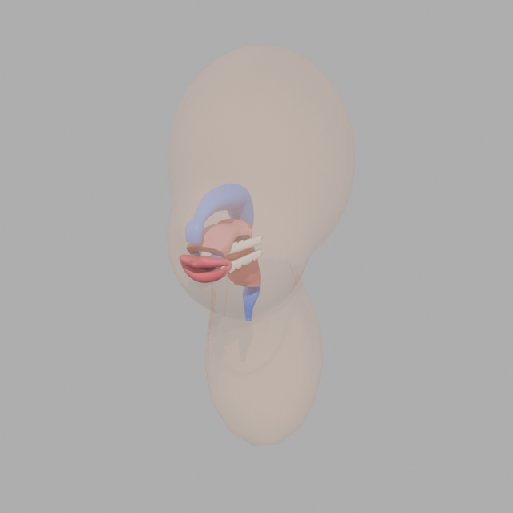
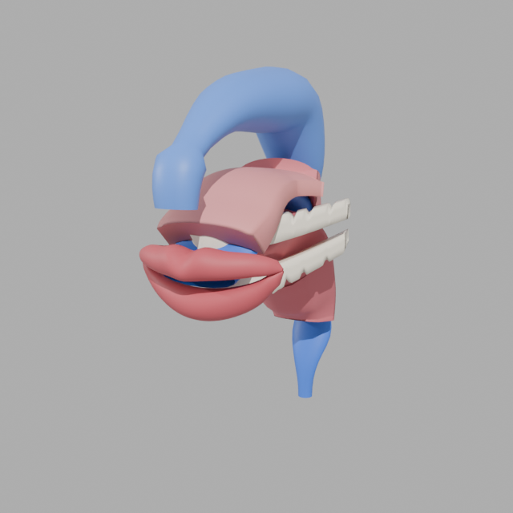
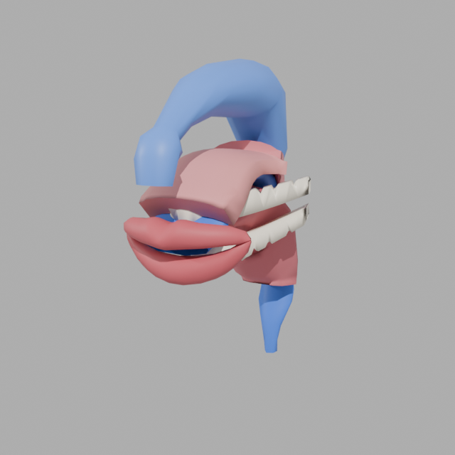

# Head model in Blender

The low-poly head model can be exported and opened in Blender (issue #5
asked for a Blender model). `scripts/export-head-model.mjs` writes every
level of detail as binary glTF (one object and material per part, metres),
Wavefront OBJ (centimetres) and binary STL (millimetres):

```sh
npm run export:model -- --out models --preset male --vowel ə
```

| LOD | Triangles (male, /ə/) | GLB size |
| --- | --------------------- | -------- |
| 0   | 1968                  | 56 KB    |
| 1   | 3260                  | 87 KB    |
| 2   | 7496                  | 189 KB   |
| 3   | 16840                 | 413 KB   |

`scripts/blender/head_model.py` imports a GLB into Blender, smooths the
shading, can decimate every part (to scale a detailed model down), saves a
`.blend` scene, renders a three-quarter view and can write the scene back
out as glTF:

```sh
blender --background --factory-startup \
  --python scripts/blender/head_model.py -- \
  --glb models/head-male-lod3.glb --blend head.blend --render head.png \
  [--decimate 0.25] [--export head-decimated.glb] [--hide head]
```

## Evidence

Rendered with Blender 4.2.3 LTS (Cycles, CPU, 32 samples):

| Whole head (LOD 3, 16840 triangles) | Skin hidden                       | Decimated to 25 % (4209 triangles)            |
| ----------------------------------- | --------------------------------- | --------------------------------------------- |
|               |  |  |

- [validator.txt](validator.txt): the Khronos glTF validator
  (`gltf-validator` 2.0.0-dev.3.10) reports no errors, warnings or infos
  for all four exported levels of detail and for the decimated file that
  Blender wrote back out.
- [blender-log.txt](blender-log.txt): the decimation run, with the
  triangles per part before and after.
- `tests/gltf.test.js` checks the GLB container layout and that every
  part reads back with the same geometry, unit normals and its material.

The decimated render is hard to tell from the full one: at these shapes
LOD 3 carries more triangles than the smooth-shaded surfaces need, so
Blender's edge collapse is a working route from a detailed model down to a
low-poly one.
