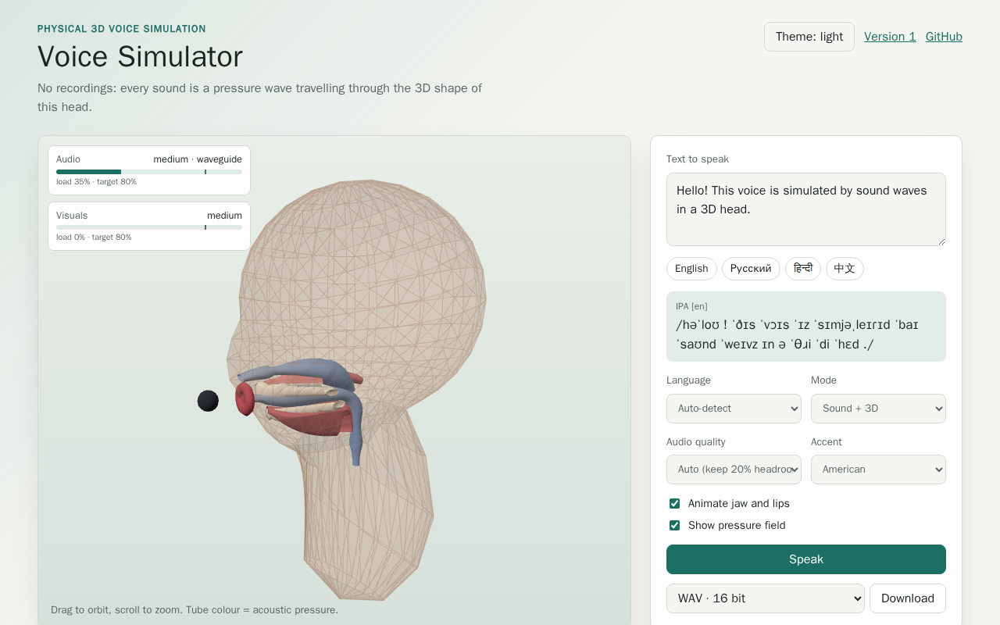

# Voice Simulator Web App

The demo web app for `voice-simulator`. It imports the library from
`src/index.js` and uses the same build output for GitHub Pages, Electron
desktop packages, and Capacitor mobile projects.

- Type text in English, Russian, Hindi or Chinese (or raw IPA) and press
  **Speak**: the transcription is planned on the main thread, the acoustic
  simulation runs in a Web Worker (`src/engine/synth-worker.js`) and audio is
  streamed to Web Audio in chunks.
- English text can be spoken with a General American, British,
  Australian or Indian accent (the accent selector appears for English).
- While it speaks, the text and its IPA (split into syllables) light up the
  current word and syllable (`src/components/SpokenText.js`,
  `src/components/highlight.js`), on the same clock as the audio and the
  3D view.
- The three.js view (`src/viewer/head-viewer.js`) shows the low-poly head
  with its teeth, tongue and palate, animates the jaw, lips and tongue,
  colours the tract by the simulated pressure and marks the microphone.
- Modes: sound and 3D, sound only, or 3D only.
- The head and voice editor starts from a random head on every load;
  `?seed=<value>` reproduces a head. A preset (any, male, female, child)
  limits the random heads to one speaker group.
- **Copy a voice** (`src/components/VoiceMatch.js`): upload a recording or
  record yourself and the head is fitted to it in a Web Worker
  (`src/engine/match-worker.js`).
- **Acoustics** (`src/components/AcousticsSettings.js`): microphone
  distance and angle, room preset, or a simulated box of air around the
  head on the 3D tiers.
- **Download** (`src/components/ExportControls.js`): the last utterance as
  WAV, FLAC, AIFF or AU, with a choice of bit depth and float samples.
- Every version of the app stays online at `/v1/`, `/v2/`, … and the
  current one also at the next path, linked from the header
  (`previous-versions.json`, `scripts/build-previous-versions.mjs`).
- Audio and visual quality tiers are chosen automatically from a benchmark
  and a runtime governor that keeps the load under 80%; the HUD shows both
  loads. A fixed tier can be selected too.



> The preview image above is regenerated automatically on every push to `main`
> by the `preview-regen` job in `.github/workflows/example-app.yml`. Run it
> locally with `npm run example:web:preview-images`.

## Local Setup

```bash
npm install --prefix examples/universal-app
```

## Web

```bash
npm run example:web:dev
npm run example:web:build
npm run example:web:preview
```

The Vite config uses `./` as the default asset base so the bundle also works
when loaded by Electron or copied into Capacitor. In GitHub Pages CI,
`GITHUB_PAGES=true` switches the base path to `/<repository>/`.

## Desktop

```bash
npm run example:desktop:package
npm run example:desktop:make
```

`desktop:package` creates a local Electron package under
`examples/universal-app/out`. `desktop:make` creates distributable artifacts
for the current platform. The GitHub Pages UI links to the latest GitHub
release so users can download desktop packages once release artifacts are
published.

## Mobile

Capacitor native projects are generated by downstream applications when they
are ready to customize app identifiers, icons, signing, and store metadata.

Android:

```bash
npm --prefix examples/universal-app run mobile:android:add
npm run example:mobile:sync
npm --prefix examples/universal-app run mobile:android:run
```

iOS:

```bash
npm --prefix examples/universal-app run mobile:ios:add
npm run example:mobile:sync
npm --prefix examples/universal-app run mobile:ios:run
```

You can test locally without an Apple Developer Program account by running the
iOS app in an Xcode simulator. Physical iOS devices and App Store/TestFlight
submission require Apple signing credentials. Android emulator or physical
device testing does not require a Google Play Console account, while Play Store
submission requires the normal Google Play signing and service account setup.

The workflow includes gated Android and iOS build jobs. Set
`EXAMPLE_APP_ENABLE_ANDROID_BUILD=true` or `EXAMPLE_APP_ENABLE_IOS_BUILD=true`
as repository variables before enabling those native CI paths.
